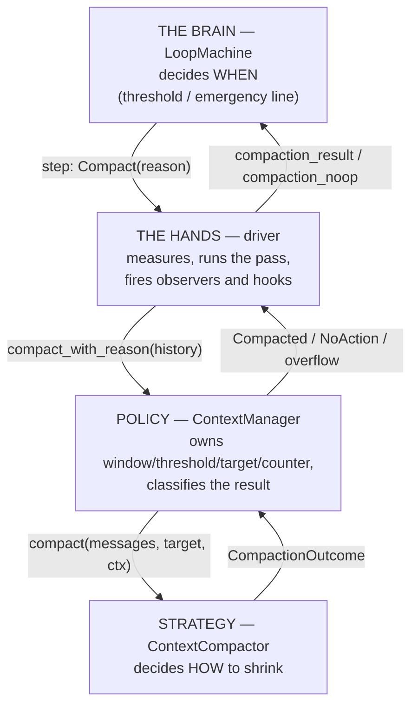
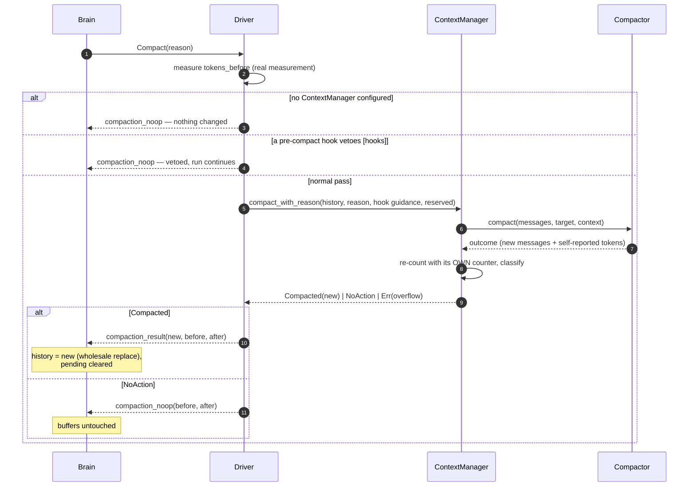
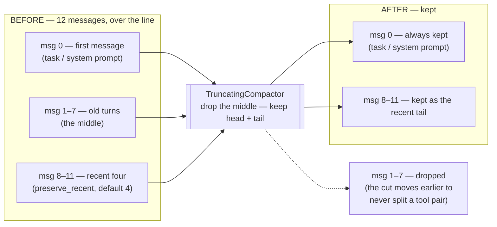

# Compaction — shrinking the conversation so the run can continue

Every model has a hard limit on how much text it can read per request: the **context window**. An agent that just keeps appending will eventually build a request the provider rejects. Compaction is the subsystem that notices the conversation approaching the ceiling and rewrites it into something smaller — then the run continues inside the budget. Sources: `src/compact.rs`, `src/compact/` (the compactor family), `src/engine/core/machine.rs`, `src/engine/bare/compact.rs`.

**Read this if:** your agent runs long, your tools produce big outputs, or you have met `LoopError::ContextExceeded` and want to know exactly what happened.

---

## The words, once

| Term | Plain meaning |
|---|---|
| **Context window** | The provider's hard ceiling, in tokens. You set it (`SessionConfig::context_window`, default 200,000). |
| **Estimate** | The conversation's approximate token count. Compaction runs on estimates, never exact counts. |
| **Token counter** | The pluggable piece that produces estimates. Default: ~4 characters per token (`HeuristicTokenCounter`). |
| **Threshold** | Your soft line: past `compact_threshold`% of the window (default 80%), compact before the next model call. |
| **Emergency line** | The hard line at 95% of the window. Always active, even with `auto_compact: false`. |
| **Committed history / pending** | The two message buffers (see [the big idea](../00-start-here/02-the-big-idea.md)). Compaction replaces **both together**. |
| **Compactor** | The strategy object deciding *how* to shrink. Default install: `TruncatingCompactor` — cut the middle, keep head and tail. The real LLM strategies ship alongside it (see [the compactor family](#the-compactor-family)) and compose best inside a `FallbackCompactor` chain. |
| **Context manager** | Owns the compactor plus the sizing policy (window, threshold, target size, counter). |
| **Landing target** | The post-compaction size the pass must actually reach: by default **15% of the trigger threshold** (window 200k × 80% × 15% = 24k tokens). A pass that lands over its target **declines** — it reports no-change rather than passing silently (0.4.0). |
| **Demotion sink** | Where the evicted messages go. Default: nowhere (dropped). Install a `MemoryDemotionSink` and evicted content becomes retrievable memory (see [below](#demotion--evicted-is-not-destroyed)). |

Two distinctions prevent most confusion:

- **Threshold vs window:** crossing the threshold is *normal* — it's the trigger. Exceeding the window is a *contract violation* — no request is ever sent over it; the run fails first.
- **Measurements vs hints:** a compactor may report its own token numbers, but they're **hints**. Every decision uses the manager's own re-count with its configured counter.

---

## Four roles, cleanly split



| Question | Answered by |
|---|---|
| *When* do we compact? | the machine (threshold + emergency) |
| *How* do we shrink? | the compactor strategy |
| *Did it work?* | the manager (re-measures, classifies) |
| *What now?* | the machine again (continue or fail) |

This split is why you can swap the truncator for an LLM summarizer without touching the engine.

---

## When it triggers

Before every model call, the brain checks (first hit wins):

1. Turn limit exceeded? → end the run (not compaction's business).
2. `estimate >= window × 95%` → **`Compact(Emergency)`** — inclusive comparison, always active.
3. `auto_compact` and `estimate > window × threshold%` → **`Compact(ThresholdExceeded)`** — strict comparison (a payload exactly at 80% serves normally; past it compacts).

Worked example, window 8,000, threshold 80% (the trigger line is 6,400; the emergency line is 7,600):

| Conversation estimate | What happens |
|---|---|
| 5,500 tokens | next model call, nothing special |
| 6,500 tokens | `Compact(ThresholdExceeded)` before the next call |
| 7,700 tokens | `Compact(Emergency)` — even with `auto_compact: false` |

### When the estimate is refreshed

The driver measures the payload at every growth point, so the trigger's number is always current before a request goes out: at run start (committed history + new input), after every model response, and after every batch of tool results (a single huge tool result becomes visible *before* the next request — you can't sneak past the trigger with a giant tool output). Extras riding the next request (memory, contributor messages) are counted too, and the turn defers to compaction if the fuller payload crosses the line — with a reserved budget so the extras still fit after shrinking.

---

## What one pass looks like



The classification rules, in the manager (`compact_with_reason`):

- Compactor reported failure, or its result **still doesn't fit** the window (minus any reserved budget) → `Err(ContextOverflow)` — the run ends with `ContextExceeded`.
- Same message count and no size reduction → `NoAction` — honest "nothing happened." Observers stay silent; hooks stay silent. Since 0.4.0 this includes **over-target landings**: a compactor that shrinks but lands above its target declines instead of passing silently — and on a threshold-triggered pass whose payload still fits the window, that decline *defers* the compaction and serves the turn (the emergency line still forces).
- Anything else → `Compacted` — with `tokens_after`/`tokens_saved` **normalized to the manager's counter** (the compactor's self-report is overwritten).

### Watching a pass — start to finish (0.4.0)

Observers see the whole pass now, not just the success:

- `on_pre_compaction(PreCompactionContext)` — the pass is starting: trigger reason, pre-pass conversation stats (message counts by role, token estimate).
- `on_compaction(CompactedContext)` — a real pass landed, carrying live `CompactTelemetry`: trigger, before/after stats, tokens saved, and the pass's wall-clock duration measured around the whole span (snapshot, counting, the compactor call, and the demotion handoff — not just the compactor in isolation).
- `on_compaction_failed(CompactionFailedContext)` — the pass failed (typed `LoopError::CompactionFailed`/`CompactionStalled` at the run level, with payload-comparable numbers).

### The target size

The manager doesn't just say "shrink" — it passes a concrete target: by default **15% of the threshold line** (e.g. window 200k × threshold 80% × 15% = 24k tokens; tightened from 70% in 0.4.0 — small context slots need landings well below the trigger). Tune it with `with_compact_target(CompactBase::Threshold | Context)` and `with_compact_target_pct`. The sizing also rides every pass as a `CompactSizing` argument — the reserve the landing must leave room for (per-request overhead plus a deferred turn's transients) and an optional one-pass target override (the engine's overflow-salvage arm uses the override to force a landing strictly under a refused payload).

---

## What happens to the two buffers — the important part

After a **successful** pass (`compaction_result`):

1. `history` is **replaced wholesale** by the compacted messages.
2. `pending` is **cleared** — everything the current run said so far was folded into the compacted result.
3. The token estimate is set to the new (smaller) count; state → `Start`; the deferred model call proceeds.

The invariant: **compaction collapses `history + pending` into a new, shorter `history`, and `pending` restarts empty.** That's what makes it actually reduce context — both buffers become one smaller one.

After a **no-op** pass (`compaction_noop`): both buffers untouched. The run simply continues. This distinction exists so an unchanged pass doesn't accidentally glue half-finished run messages into permanent history.

### The no-progress guard

Both feeds compare the driver's measured before/after numbers. If `tokens_after >= tokens_before` — nothing was shaved — the brain ends the run with `Failed(ContextExceeded)` instead of ping-ponging between Compact and CallLLM forever. This is also the honest price of a **hook veto** at over-threshold: nothing shrank, so the guard fires. A veto over-threshold is a decision to stop, not a decision to proceed.

### The audit trail is never touched

Compaction rewrites the *operational* conversation the loop uses. The *observational* record — `session.runs[N].turns` with every turn's original input and output — survives intact. You can always read what was actually said before the summary replaced it. (One nuance: a turn that runs *after* compaction records the summarized view as its context — the trail shows what each turn really saw.)

| | Before | After success | After no-op / failure |
|---|---|---|---|
| `history` | committed messages | **replaced** by compacted list | unchanged |
| `pending` | this run's messages | **cleared** (folded in) | unchanged |
| `session.runs` audit trail | full record | **unchanged** | unchanged |

And remember from [the big idea](../00-start-here/02-the-big-idea.md): a run that compacts and *then* fails leaves the compacted history behind — compaction is a commit point.

---

## The default strategy — `TruncatingCompactor`

Dependency-free, no LLM calls. It drops the **middle** of the conversation:



Two knobs: `with_preserve_recent(n)` (default 4, minimum 1) and `with_min_messages(n)` (default 6, minimum 2 — conversations shorter than this pass through untouched). Three rules:

1. **The first message is always kept** — it usually holds the task or system prompt everything else depends on.
2. **Tool call/result pairs are never orphaned.** If the cut would keep a tool result while dropping its call (or vice versa), the cut point moves so the pair survives together — providers reject conversations with orphaned halves. (The machinery handles even nasty cases: reused call ids pair per occurrence; results of the first message's calls are pulled back adjacent to it.)
3. **Never return an empty list** — a conversation that can't be safely cut reports "no change" instead.

### Inside `TruncatingCompactor`, step by step

The exact procedure behind those rules (`_target_tokens` is deliberately ignored — this is *positional* truncation, not token fitting):

```text
compact(messages):
  1. len ≤ min_messages (6)?          → unchanged
  2. split = len − preserve_recent    // the provisional cut point
  3. fixpoint loop:                   // pair-safety moves the split EARLIER,
       adjusted = adjust_for_tool_pairs(messages, split)   // never later; it is
       if adjusted == split: break                         // non-increasing and
       split = adjusted                                    // bottoms out at 0 —
                                                           // always terminates
  4. split == 0?                      → unchanged          // nothing can be dropped
  5. preserved = [first message] ++ messages[split..]      // first is ALWAYS kept
  6. reattach: dropped ToolResults whose calls live in the
     preserved first message are pulled back, adjacent to it
  7. preserved empty?                 → unchanged          // never replace a
                                                           // conversation with nothing
  8. re-measure with the manager's counter; report tokens_saved
```

The pair-safety machinery behind step 3 works like a bracket-matcher for tool traffic: a forward scan keeps, per tool-call id, a stack of *unconsumed* calls; each `ToolResult` pops the most recent unconsumed preceding call with that id, and the two become a **pair**. Leftovers are classified — an unmatched call is a `LoneCall` (its result may still be in flight), an unmatched result is a `LoneResult` (a result cannot exist without its call — it's a protocol violation). The sanitizer then applies three asymmetric rules to the output: **`LoneResult`s are dropped everywhere**; **`LoneCall`s are kept *outside* the dropped region** (compaction can run before results land) but strict pairing applies *inside* it; and messages left empty by filtering are removed. Even the `unchanged()` path runs the same filtering, so a "no change" report is honest about what it would have saved.

`TokenSplitter` (same file, exported) gives you the same principled split for **custom** compactors — an old/recent boundary at a real turn transition, pair-safe (it slides an orphaning cut instead of refusing it, so agent tool-loop histories never wedge the pass) — so an LLM summarizer can summarize `to_compact` and keep `preserved`. Its budgeted variant (`split_within_budget`, used by both LLM summarizers) takes the deepest pair-safe cut when no tail fits, never the preserve-almost-everything shape (0.4.1).

---

## The compactor family

0.4.0 ships the real strategies alongside the truncator. All are always compiled (no feature flags, no new dependencies):

| Compactor | What it does | When to reach for it |
|---|---|---|
| `TruncatingCompactor` | Positional middle-cut, zero LLM calls. Still the default install and the chain's terminal. | Determinism, no client, the never-fail floor. |
| `QaSummarizer` | The three-step LLM pass: **summarize** the about-to-drop slice into a dense running summary → **question gaps** (ask the model what it would need from the dropped context) → **answer** from the full transcript before it's discarded, folding recovered facts under `## Facts recovered`. Unknowns are dropped, not guessed. Accumulates across passes (`PriorSummary`); enforces its own summary budget (an over-budget response fails the pass, originals intact). | Maximum *retention* — the facts a future turn will need. |
| `StructuredSummarizer` | One LLM call (+ at most one retry) producing a **sectioned** summary — key facts / decisions / pending tasks / open questions, each a bullet list — with contractually stable headings. Templates are configurable (`SummaryTemplate`, `default_template`, `action_only`); a malformed answer degrades to raw text, never an error. | Maximum *shape* — consumers that locate "pending tasks" without parsing prose. |
| `FallbackCompactor` | The never-fail **chain**: stages in order until one succeeds. Default chain: QA → structured → `TerminalCapture(TruncatingCompactor)`. Failed stages' outputs are discarded (the next stage sees the *original* input); `last_report()` names the winning stage; `terminal_min_recent` (default 4) is a structural floor the last-resort truncate cannot go below. | Production — with a non-failing terminal, an out-of-tokens condition stops being a failed pass. |
| `RollingCompactor` | Compacts only the groups older than `age_turns` (pair-safe role-transition boundaries), rolling them into micro-summaries on each pass — compaction as a maintenance cadence, not one big rewrite. | Long unattended runs where each pass should be cheap. |

Two shared contracts worth knowing: every LLM compactor runs its client calls on a caller-supplied client (a dedicated cheaper model is the documented production shape), and a compactor's failure — API error, blank response, over-budget summary — fails **that stage** with the original messages intact, which is exactly the shape the `FallbackCompactor` chain consumes. The compactors' token spend is reported per pass through `loopctl.compaction.summarizer.tokens` metric events (the QA pass) and the chain emits `loopctl.compaction.passes` / `loopctl.compaction.degradations`.

Both LLM compactors consume pre-compact hook guidance identically — `CompactionContext::instructions` rides as host instructions and every `additional_context` fragment as context to weave in — and both honor the **retention classes**: `Requery`-tagged results render as omission markers in the transcript (a summary physically cannot restate content it never saw), `Durable` results are carried verbatim **within the landing's budget** — `Durable` means preferred verbatim, never un-evictable (0.4.1; see [below](#the-0.4.1-hardening-round)).

### The summary seam — one assistant message (0.4.1)

Every LLM compactor emits its summary as an assistant-role message at the head of the preserved tail. When the tail opens with an assistant turn, the common case mid-run, a naive assembly carries two adjacent assistant messages. Some providers reject that shape outright: Z.ai's GLM API answers `HTTP 400 [1214]`, killing the run two seconds after every successful compaction.

The seam now coalesces. `LoopMachine::compaction_result` folds runs of adjacent assistant messages into one message carrying the parts of every member in order: the summary's parts first, a `\n\n` separator parting two adjacent texts at the merge so the wire never glues statements, then the tail's. The assembled machine never carries two adjacent assistant messages whatever the compactor emits. A tail opening with a user or system message keeps the standalone summary assistant message. The Anthropic request build merges any adjacent assistant messages it is handed after system-folding, so a future producer of the hostile shape cannot kill a run even if a compactor changes ([Anthropic client](../05-providers/03-anthropic.md)).

### The 0.4.1 hardening round

A live marathon session exposed four structural killers. All four are fixed:

- **The durable pull is budget-bounded.** `Durable` receipts in the to-drop region used to be exempt from eviction verbatim and unconditionally, so a session whose Edit receipts alone exceeded the landing target could never compact. The pull now walks the dropped region's durable pairs newest-first and carries them while the budget allows, skipping a pair too costly to fit. A receipt the landing cannot hold is information the summary records, not a reason the run dies.
- **Sequenced read-only shell receipts stamp `Requery`.** The workhorse compound `cd /repo && grep -n needle file` fell through the single-command read-only check and stamped `Durable`, pinning its output for the history's lifetime. Classification is now segment-wise: `cd` admitted as a read-only prefix, every segment must pass the allowlist, and any mutating segment, redirection, or control separator (including a newline) keeps the whole receipt `Durable`.
- **The splitter falls back to the deepest pair-safe cut.** When no pair-safe split's tail fit the budget, the old fallback returned the plain `split()` shape, so a history with sparse boundaries compacted to a no-change no-op every pass and drifted into the emergency stall. The budget is a goal: a tail over budget still shrinks the pass.
- **A failing threshold pass defers instead of killing the run.** With a strictly selected compactor, a transient model error at the threshold used to end the run even though the payload still fit. The pass now marks the turn deferred and surfaces `on_compaction_failed` with the stage's cause; the next turn retries. Emergency-line passes still fail honestly.

The structured summarizer also survives its own bad answers (0.4.1): a blank response earns exactly one rescue retry with a tighter prompt, a second over-budget response is trimmed to the budget and committed with a `[trimmed]` marker rather than discarded, and a trim that retains no substantive content fails the pass instead of committing an empty shell.

---

## Demotion — evicted is not destroyed

`CompactionOutcome` carries an `evicted` list — the messages the pass dropped. By default they go nowhere. Install a demotion sink and they become retrievable:

```rust
use loopctl::compact::{MemoryDemotionSink, FallbackConfig, ChainBuilder};

// The store half: what compaction evicts, memory remembers.
let sink = MemoryDemotionSink::new(memory_store, max_chars_per_message);
// (installed on the context manager; the driver hands every pass's
//  evicted messages to the sink after the history rewrite)
```

`MemoryDemotionSink` renders each evicted exchange (tool name, arguments, truncated result — `render_evicted` is the same renderer the QA summarizer feeds its transcript) into a `Trajectory`-category memory entry. Combined with `SearchMemoriesTool` ([memory](../04-extensions/03-memory.md)) this closes the loop: **what compaction evicts, the model can recall on demand.** The prune pass (see [context accounting](09-context-accounting.md)) hands its cleared tool outputs to the same sink under `CompactReason::Prune`.

One thing compaction can never evict: [attachments](../04-extensions/07-attachments.md) (0.4.1). Pinned data rides every request as per-turn transient context and never enters the machine-owned history, so no compactor can even see it. Zero loss by construction, not by a preservation pass.

## Writing your own compactor

One async function:

```rust
impl ContextCompactor for SummarizingCompactor {
    fn compact(&self, messages: Vec<Message>, target: u64, ctx: CompactionContext)
        -> Pin<Box<dyn Future<Output = CompactionOutcome> + Send + '_>>
    {
        Box::pin(async move {
            let split = TokenSplitter::new().split(&messages); // old vs recent
            let summary = self.client.summarize(&split.to_compact, target).await;
            let mut kept = vec![Message::new(Role::System,
                vec![MessagePart::text(summary)])];
            kept.extend(split.preserved);
            let tokens_after = ctx.counter.count(&kept);  // self-report in the right unit
            Ok(CompactionOutcome::compacted(kept, ctx.tokens_before, tokens_after))
        })
    }
}
```

`CompactionContext` carries everything a smart strategy needs: `tokens_before`, the `reason` (an emergency may justify more aggression), the `context_window`, the turn, the manager's counter (use it for self-reports), plus hook-supplied `instructions` and `additional_context`.

Install it:

```rust
let manager = ContextManager::new(Arc::new(SummarizingCompactor { /* ... */ }))
    .with_context_window(32_000)
    .with_threshold(75)
    .with_token_counter(Arc::new(my_real_tokenizer)); // one unit for everything!
agent.set_context_manager(Arc::new(manager));
```

> **Gotcha — one counter, everywhere.** Trigger decisions and post-compaction classification must run in the same "unit." Mixing the heuristic counter (trigger) with a real tokenizer or billed counts (compactor) causes flapping — compact, look small, un-compact, look big, repeat. Install one counter on the manager; the driver reuses *its* counter automatically.

---

## Failure — reading a `ContextExceeded`

`ContextExceeded { used, limit }` can arrive from three places; the numbers tell you which:

| `limit` means | Cause | Fix |
|---|---|---|
| the window | the compacted result still didn't fit | bigger window, or a compactor that can shrink harder (the chain) |
| the pre-pass size | no-progress guard: nothing was shaved (includes hook vetoes and short-but-fat conversations the truncator can't cut) — the typed form is now `CompactionStalled` | summarizing compactor, bigger window, or trim the seed content |
| — | a compactor *error* surfaces as `CompactionFailed` (same payload-comparable numbers) | check the summarizer's client, or let the chain fall through to the terminal truncate |

A threshold-triggered stall whose payload still fits the window no longer kills the run — the pass declines, the machine latches the deferral, and the next model call serves. Only a genuinely over-window (emergency-line) stall does.

Four promises hold in every case: **no request is ever sent over the window** (the run fails first — or, since 0.4.0, the one [overflow-salvage](09-context-accounting.md) compact-and-retry runs under a target strictly below the refused payload); **an interrupt salvages the coherent prefix** (a failed run keeps its completed turns); **a `ContextExceeded` discard leaves the notebook clean** (an unshrinkable history is dropped whole); **the estimate is never faked** (a no-op is reported as a no-op).

---

## Who counts the tokens — the heuristic and the ratio presets

Compaction triggers on an *estimate* of the conversation's size, and the estimator is pluggable. The default is **`HeuristicTokenCounter`** — a rough chars-per-token guess with no provider knowledge. Since 0.3.1 there is a second option: **`RatioTokenCounter`** presets, one per provider family, each pinned to a measured characters-per-token ratio plus a fixed per-message overhead:

```rust
use loopctl::compact::RatioTokenCounter;

let counter = RatioTokenCounter::openai();       // 4.30 chars/token, +4 per message
// anthropic() → 3.60 / +5 · gemini() → 4.05 / +4 · local_default() → 3.80 / +4
let custom  = RatioTokenCounter::new(3.9, 4);    // your own calibration

agent.set_token_counter(Arc::new(counter));
```

The honest long-term answer for local models is the custom ratio: send one known text, read the provider's reported `input_tokens`, divide — the three-minute calibration recipe is in the type's docs. A ratio that is NaN, infinite, or not positive is rejected with a warning and the 4.0 fallback takes over, so a bad constant can never wedge the gate. Presets and heuristic render messages through the same helper, so the two counters can drift only in how they divide — never in *what* they count.

**Defaults are unchanged**: the engine keeps `HeuristicTokenCounter` unless you install a counter. Presets are opt-in, byte-comparable behavior for everyone else. (For why estimates matter at all, see [tokens & context windows](../09-principles/03-tokens-and-context.md).)

---

## Configuration quick reference

```rust
ContextManager::new(Arc::new(TruncatingCompactor::default()))  // the seeded default
    .with_context_window(200_000)   // default 200_000
    .with_threshold(80)             // default 80, clamped 1..=100
    .with_auto_compact(true)        // default true
    .with_compact_target(CompactBase::Threshold)  // default
    .with_compact_target_pct(15)    // default 15 (of the threshold line), clamped 1..=100
    .with_token_counter(Arc::new(HeuristicTokenCounter))  // default
```

The production shape is the chain: `FallbackCompactor::default_chain(client)` (QA → structured → truncate), or compose your own with `ChainBuilder::stage(name, compactor)...terminal(&truncator)` and set the floor via `FallbackConfig::terminal_min_recent`.

Host-facing calls on the manager: `ensure_context_fits(messages, turn)` (checks the threshold itself), `compact_manual(messages, turn)` (bypasses the threshold — hook trigger `Manual`), and `compact_with_reason(..., sizing)` (the engine's path — the sizing argument carries the reserve and any one-pass target override). Watching: `on_pre_compaction` / `on_compaction` / `on_compaction_failed` observers bracket every pass; the `pre_compact` hook can veto or steer (its merged `new_instructions` reach the compactor's `CompactionContext`).

---

## Related pages

- [Tokens and context windows](../09-principles/03-tokens-and-context.md) — what tokens are, why the window is finite, and why the estimate errs high.
- [Session config](../01-core-data/06-session-config.md) — where the window and threshold live.
- [Hooks](../04-extensions/02-hooks.md) — the pre/post compact hooks.
- [File reference: compact.rs](../07-file-reference/compact.md)
