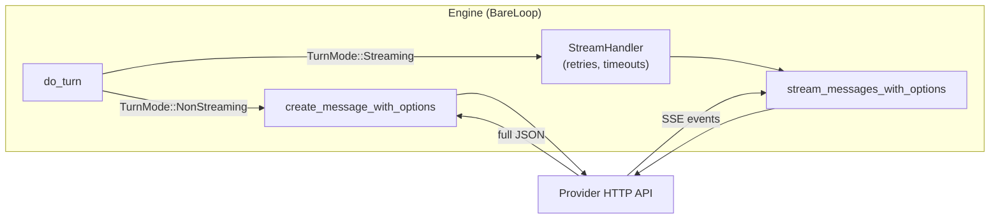

`ApiClient` is the border between loopctl and the outside world. Implement it, and the engine can talk to anything: a big cloud provider, a local model server, or a fake in your tests. Sources: `src/api.rs`, `src/api/error.rs`.

## The trait

Three required methods are the whole contract:

```rust
pub trait ApiClient: Send + Sync {
    // Required:
    fn model(&self) -> String;                       // model name, e.g. "gpt-4o"
    fn stream_messages(&self, request: &StreamRequest)
        -> Pin<Box<dyn Stream<Item = Result<StreamEvent, ApiError>> + Send + 'static>>;
    fn create_message(&self, request: &StreamRequest)
        -> Pin<Box<dyn Future<Output = Result<NonStreamingResponse, ApiError>> + Send + '_>>;

    // Provided (override to opt in):
    fn set_model(&self, _model: &str) -> bool { false }
    fn base_url(&self) -> String { String::new() }
    fn stream_messages_with_options(&self, request: &StreamRequest, options: RequestOptions)
        -> Pin<Box<dyn Stream<...>>>;      // default: rejects non-empty options loudly
    fn create_message_with_options(&self, request: &StreamRequest, options: RequestOptions)
        -> Pin<Box<dyn Future<...>>>;      // default: rejects non-empty options loudly
    fn extract_structured(&self, message: &Message) -> Value;  // default: tool input or JSON-ish text
    fn supports_tool_constraints(&self) -> bool;   // default: false — "I enforce tool schemas"
    fn model_context_window(&self) -> Future<Option<u64>>;   // default: None — disclose the window
}
```

You have two ways to get a reply, and the turn mode picks one:

- `stream_messages` delivers the reply as a stream of small events, which is pieces of text as they are produced. `TurnMode::Streaming` uses it.
- `create_message` delivers the reply whole, in one piece. `TurnMode::NonStreaming` uses it, and it is the rescue path when streaming keeps failing.

`StreamRequest` carries the conversation you send:

```rust
StreamRequest::new(messages)           // Vec<Message> — the conversation
    .with_system(Some("You are...".into()))  // optional system prompt
    .with_tools(Some(schemas))         // optional tool list; None = no tools offered
```

`NonStreamingResponse` carries the reply back: `{ message: Message, stop_reason: StreamStopReason, usage: Option<Usage> }`.

### Rules implementors must follow

Three rules separate a working client from one that corrupts runs:

- The stream returned by `stream_messages` must be `'static`. Clone out of `&self` everything you need, and never borrow the client inside the stream.
- Emit events in the standard order: `MessageStart → (PartStart → deltas → PartStop)* → MessageDelta → MessageStop`. The [stream events page](/core-data/stream-events/) defines each event.
- Never emit a synthetic `MessageStop` on failure. The absence of the stop event is how the engine detects a cut-off stream, so a fake stop turns a truncation into a completed reply.

### RequestOptions

`RequestOptions` is `#[non_exhaustive]` and carries four optional extras:

| Option | Meaning |
|---|---|
| Model override | A per-request model, used by [fallback](/safety/fallback/). |
| Response format | Forced JSON output. |
| Tool constraint | Strict tool schemas. |
| Thinking effort | `ThinkingEffort`: off, low, medium, high, max. See [structured output](/integration/structured-output/). |

If your client cannot honor one of these, say so loudly. The default `*_with_options` implementations reject the request with an `ApiError` rather than silently dropping the option.

A silently ignored model override would send your request to the wrong model, which is the worst kind of success. Override these methods only to actually support the option.

Two capability probes matter for [default wiring](/integration/presets/):

- `supports_tool_constraints()` defaults to `false`, and it answers one question: do you enforce strict tool schemas? Default construction installs the strict tool-call constraint only when this returns `true`.
- `model_context_window()` defaults to `None`, and it asks the provider how many tokens it actually accepts. The shipped OpenAI-compatible client answers from llama.cpp's `/props` divided by `total_slots`, because a `--parallel` server splits its KV budget. It also reads Ollama's `/api/show`. Hosted APIs disclose nothing and keep `None`.

A `None` never errors your run, because the declared `SessionConfig::context_window` stands. The engine resolves the denominator once at run start and freezes it for the run's life. Probe beats declaration, with one exception: a declared `0` is the documented opt-out and wins over any disclosure. See [context accounting](/engine/context-accounting/).

## ApiError

```rust
pub enum ApiError {
    Api(String),                        // generic API failure
    RateLimit { retry_after: Option<Duration>, message: String },  // 429 / 503 / 529
    Auth(String),                       // bad key / no permission
    Http(String),                       // HTTP status errors ("HTTP 429: ...")
    Json(serde_json::Error),            // unparseable response
    Io(std::io::Error),                 // local IO failure
    Tool(String), Config(String), Interrupted, Other(String),
}
```

The shapes matter less than the three questions every error can answer:

| Question | Method | True for |
|---|---|---|
| Worth retrying? | `is_retryable()` | rate limits, timeouts, 5xx server errors, connection errors. False for auth failures and other 4xx, so you fail fast and do not burn retries on a bad key. |
| Are we being throttled? | `is_rate_limited()` | 429/503/529 in any shape, and messages mentioning "rate limit" |
| Is the request too big for the window? | `is_context_overflow()` | messages mentioning "context", "too many tokens", "exceeds maximum", "max tokens" |

Each error also carries a stable numeric `ErrorCode`, such as 1002 for rate-limited and 1101 for auth failed. Use those codes in your logs and dashboards instead of matching on message text.

`RateLimit.retry_after` is the provider's parsed "wait this long" hint from the `Retry-After` header, so nothing downstream has to re-parse it.

### Cached input tokens

`Usage` gained a fourth field: `cached_input_tokens`. It is the share of the input the provider served from its prompt cache, and it is a subset of the input count rather than extra input. Every shipped provider fills it from its native report:

| Provider | Native field |
|---|---|
| Anthropic | `cache_read_input_tokens` |
| OpenAI | `usage.prompt_tokens_details.cached_tokens` |
| Bedrock Converse | `cacheReadInputTokens` |

`Usage::new` leaves the count at zero, and `with_cached_input(n)` attaches it. Anthropic's raw `input_tokens` excludes cache traffic, so loopctl adds raw input, cache reads, and cache-creation spend to keep the cached share the documented subset.

## Ready-made clients

You usually will not implement this trait at all, because loopctl ships clients:

| Client | Feature | Notes |
|---|---|---|
| `OpenAiClient` | `openai` | Also the base for Ollama, DeepSeek, Grok/xAI, Azure OpenAI, Moonshot, and self-hosted servers. |
| `AnthropicClient` | `anthropic` | Claude, and also used by Z.ai. |
| `GeminiClient` | `gemini` | Google Gemini. |
| `BedrockClient` | `bedrock` | AWS Bedrock, with request signing. |
| `MockApiClient` | `testing` | Scripted fake for your tests. |

Each one gives you `from_env()` reading the obvious environment variables, a builder with `with_api_key`, `with_model`, `with_base_url` and the timeouts, and full support for streaming, tool calls, and `RequestOptions`. The provider pages carry the details: [the providers section](/providers/overview/).

## The shared HTTP layer

Every shipped client sits on one shared HTTP layer, with three hard caps:

| Guard | Value | Enforced |
|---|---|---|
| Max response body | 10 MB | Twice: pre-read from `Content-Length`, then chunk by chunk during the read. A server lying about its length cannot cause the allocation. |
| Max error-diagnostic body | 8 KiB | Error bodies are for humans reading logs, not for parsing. The rest is dropped. |
| Max SSE line buffer | 1 MiB | A newline-less event from a broken server is a protocol error, not unbounded memory. |

### Timeouts

The HTTP-level `with_timeout` defaults to 120 s and is a read/idle-gap timeout. That is deliberately not a total deadline. A healthy stream that produces an event every few seconds can legitimately run for minutes, and a total deadline would kill it.

Total-duration bounding belongs to the [StreamHandler](/core-data/stream-events/)'s 5-minute clock, so each layer owns the kind of time it can actually judge. Around the read timeout sit `with_connect_timeout` at 10 s, TCP nodelay on by default, keepalive off, and a pool idle timeout of 90 s.

### Error classification

Error classification happens in one place. Every non-2xx response funnels through a single construction site. It reads `Retry-After` in both spellings, delta-seconds like `"12"` and the HTTP-date form, then classifies by status:

- `401` becomes an invalid-key auth error, which is permanent.
- `403` becomes an auth error.
- `429 | 503 | 529` → `RateLimit`, carrying the parsed hint.
- Anything else becomes a plain HTTP error with the bounded body attached.

One consequence is worth knowing before you write retry logic. Mid-stream SSE errors cannot carry `Retry-After`, because an event has no header. They are classified into the rate-limit family by their payload instead, and the hint is `None`.

### Credential headers

Four headers are marked sensitive: `Authorization`, `x-api-key`, `x-goog-api-key`, and `X-Amz-Security-Token`. The client redacts them in debug output and excludes them from HTTP/2 header-compression indexing, so your keys do not linger in logs or in header-compression caches.

## Writing your own client

A minimal implementation is one model name and two methods:

```rust
struct MyClient { http: reqwest::Client, base: String, key: String }

impl ApiClient for MyClient {
    fn model(&self) -> String { "my-model".into() }

    fn stream_messages(&self, request: &StreamRequest)
        -> Pin<Box<dyn Stream<Item = Result<StreamEvent, ApiError>> + Send + 'static>>
    {
        // Clone everything you need out of &self here, then:
        Box::pin(try_stream! {
            yield Ok(StreamEvent::MessageStart(/* ... */));
            for chunk in call_your_api(&self.base, &self.key, request).await? {
                yield Ok(StreamEvent::IndexedDelta(/* ... */));
            }
            yield Ok(StreamEvent::MessageStop);
        })
    }

    fn create_message(&self, request: &StreamRequest)
        -> Pin<Box<dyn Future<Output = Result<NonStreamingResponse, ApiError>> + Send + '_>>
    {
        Box::pin(async move { /* one request, one response */ })
    }
}
```

Wire it in with `BareLoop::new(Arc::new(my_client), tools, config)`. The engine treats every client identically.

`set_model` returns `false` by default. Return `true` when your client supports hot-swapping the model, which unlocks [`switch_model`](/engine/model-switch/).

Do not ignore `base_url()`. It keys the built-in [rate limiter](/providers/overview/), so requests to the same base URL share one token bucket. The default is `""`, which means every custom client that does not override it shares one bucket with every other. Override it if that matters to you.

## How the engine uses the client



Three paths reach your client, and you should expect all three:

- In non-streaming mode, each turn is one `create_message_with_options` call, raced against the cancel signal.
- In streaming mode, the turn goes through `StreamHandler`, which handles retry, per-event timeout, the rate-limit ladder, and the non-streaming rescue. It calls `stream_messages_with_options`, possibly several times per turn.
- On [fallback](/safety/fallback/), the engine adds a per-request model override through `RequestOptions`. One shared client can then serve two models without cross-talk.

## Related pages

- [Stream events](/core-data/stream-events/) defines the event vocabulary your client must speak.
- [Providers](/providers/overview/) covers the shipped clients, env vars, and defaults.
- [Testing](/integration/testing/) covers `MockApiClient`, the zero-infrastructure client.
