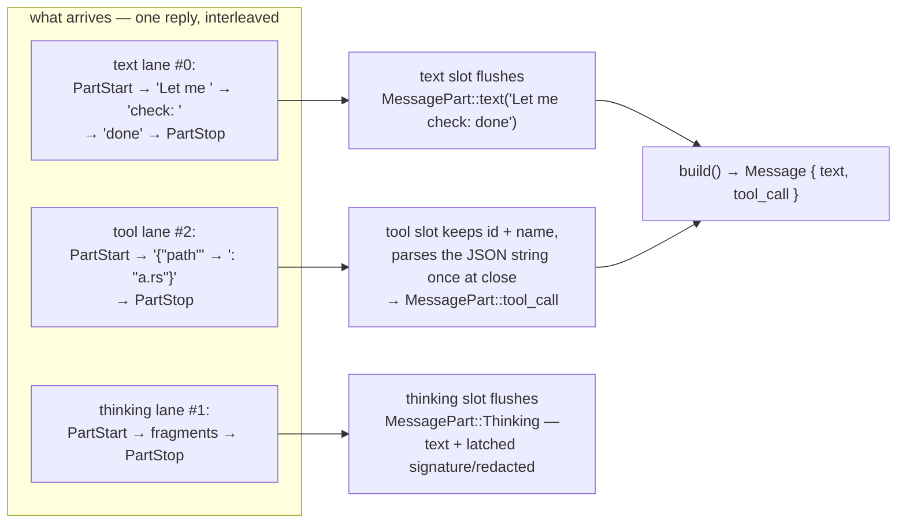
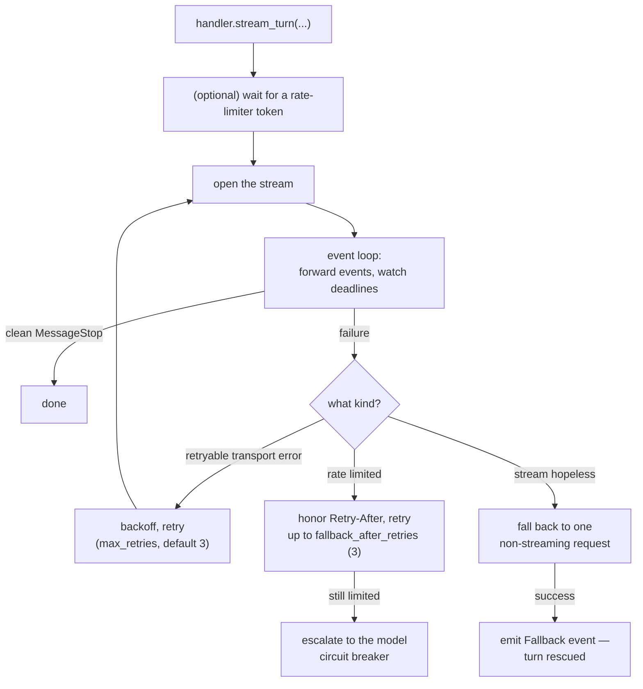

Streaming means the model's answer arrives gradually instead of all at once.

Two things come with that. Your UI shows text the instant it appears, and a long answer cannot time out as one silent wait, because the engine sees progress or the lack of it.

Providers speak one event vocabulary, and this page is that vocabulary plus the machinery that folds it into a message. Sources: `src/stream.rs`, `src/stream/handler.rs`.

## The event sequence

Every streaming reply you handle follows this shape:

```text
MessageStart                     ← a reply is beginning (id, model name)
  PartStart (index 0)            ← a lane opens: text, thinking, or a tool call
  IndexedDelta (index 0, "Hello")  ← a fragment for that lane
  IndexedDelta (index 0, " world")
  PartStop (index 0)             ← the lane closes
  PartStart (index 1)            ← another lane (e.g. a tool call)
  IndexedDelta (index 1, json fragment)
  PartStop (index 1)
MessageDelta                     ← the stop reason + token usage
MessageStop                      ← the reply is complete — the only "done" signal
Ping                             ← may appear anywhere; ignore it
```

`MessageStop` is the only completion signal. If you never see it, the reply is not finished, no matter how much text arrived. You will match on these Rust types:

```rust
pub enum StreamEvent {
    MessageStart(MessageStart),        // { message: { id, role, model } }
    PartStart(PartStart),              // { index, part: Option<MessagePart> }
    IndexedDelta(IndexedDelta),        // { index, delta: DeltaPart }
    PartStop { index: Option<usize> },
    MessageDelta(MessageDelta),        // { stop_reason, usage }
    MessageStop,
    Ping,
}

pub enum DeltaPart {
    Text      { text: String },          // visible text fragment
    InputJson { partial_json: String },  // tool-argument JSON, arriving in pieces
    ToolCall  { partial_json: Value },   // (legacy form)
    Thinking  { text: String,            // the model's private reasoning fragment
                signature: Option<String>,   // a provider signature over the block
                redacted: Option<String> },  // an opaque redacted-block payload
}
```

### Lane indexes

One reply can carry several lanes at once: visible text, hidden reasoning, and several tool calls. Each lane gets an index, and every delta carries the index it belongs to, so interleaved content stays separated. You never demux a reply by hand:

```text
PartStart(0, text "")        ← text lane opens
IndexedDelta(0, "Let me ")
IndexedDelta(0, "check: ")
PartStart(2, tool_call)      ← a tool lane opens (index from the provider)
IndexedDelta(2, "{\"path\"") ← tool-argument JSON, in fragments
IndexedDelta(2, ": \"a.txt\"}")
PartStop(2)                  ← tool lane closes
IndexedDelta(0, "...")
PartStop(0)
```

Three rules cover the odd cases:

- A `PartStart` whose `part` is `None` opens a thinking lane, because reasoning has no content at open time.
- `PartStop { index: None }` closes the oldest open lane, which is what legacy providers do. `Some(i)` closes the lane with that index.
- Thinking deltas feed the live `on_thinking_delta` callback and the assembled message. That dual delivery started in 0.4.0, with reasoning persistence.

A closed thinking lane flushes a `MessagePart::Thinking` carrying the concatenated text plus whatever `signature` or `redacted` payload the deltas latched. That is how the reasoning rides the conversation and gets replayed on continuation requests.

If a thinking delta is empty but carries a `redacted` payload, the provider withheld the reasoning. Render a placeholder rather than silence.

## The accumulator

`StreamAccumulator` is the folding machine. You feed it events one at a time, and `build()` hands you the finished assistant `Message`:

```rust
let mut acc = StreamAccumulator::new();
while let Some(event) = stream.next().await {
    acc.process(&event?)?;          // Err only for invalid tool JSON at close
}
let message: Message = acc.build();
let usage: Option<Usage> = acc.usage().cloned();
```

Four rules describe what you can expect from the fold:

- Text deltas append to the lane's buffer, and `PartStop` flushes that buffer into a `MessagePart::Text`.
- Tool lanes collect JSON fragments, and those fragments are parsed on close. Empty input becomes `{}`. Unparseable input is the accumulator's one error, `StreamError::InvalidToolInputJson`.
- Thinking lanes buffer reasoning fragments and latch any `signature` or `redacted` payload. On close they flush a `MessagePart::Thinking`, so the reasoning joins the conversation and continuations can replay it. See [messages](/core-data/messages/).
- Deltas with no matching open lane are dropped silently. Slots still open at `build()` are dropped too, because only closed lanes produce parts.

### Open slots

Internally the accumulator is neither a parser nor a state enum. It is a row of open slots, one per lane you are receiving:

```rust
struct OpenPart {
    index: usize,           // the lane's index
    kind: OpenPartKind,     // Text | Tool | Thinking — decided ONCE, at PartStart
    text: String,           // text lane buffer
    thinking: String,       // thinking lane buffer
    tool_id: String,        // tool lane: the call's id
    tool_name: String,
    tool_input: String,     // tool lane: RAW JSON text, appended fragment by fragment
}
```

Seven rules make interleaving safe:

- The kind is fixed at `PartStart`, from the part it carries. A `ToolCall` part opens a Tool slot, a text-carrying part opens a Text slot, and a `None` part opens a Thinking slot. A lane never changes kind mid-flight.
- Deltas route by `(kind, index)`. The payload's kind picks the lane kind, then the slot with that index is found.
- Indices may be reused across kinds, so a text lane 0 and a tool lane 0 coexist. A text fragment can never land in a tool slot, and a tool fragment can never land in a text slot.
- A delta with no matching open slot is silently ignored, so a misbehaving provider cannot corrupt your assembly.
- Tool arguments accumulate as a raw string, never as JSON values. Fragments like `{"pa` plus `th": "a` plus `.rs"}` are appended, and `serde_json::from_str` runs once, at `PartStop`.
- An empty buffer parses to `{}`. A parse failure is the accumulator's one and only error, `InvalidToolInputJson`, so you get the raw text back in the error.
- `PartStop { index: Some(i) }` closes the first slot with that index. `index: None` closes the oldest open slot, which is how legacy providers stop lanes, FIFO.

Flush conditions differ per slot type. A Text slot flushes a `MessagePart::text` only if it is non-empty, and a Tool slot flushes a `tool_call` only if the name is non-empty.

The Thinking slot flushes a `MessagePart::Thinking` when anything was accumulated, and text, a signature, and a redacted payload all count. That last rule matters, because you do not want to lose a signature-only or withheld-reasoning block before its replay.

`build()` drops anything still open, so you never see a half-part. A stream that died mid-lane leaves nothing behind, and the truncation machinery upstream decides whether to retry.



### Usage

Your token accounting arrives on `MessageDelta`: `{ input_tokens, output_tokens, cached_input_tokens }`. `total_tokens()` is the sum of input and output, and the cached share is a subset of the input rather than a fourth number. The provider classification behind these numbers is in [API client](/core-data/api-client/).

### Stop reasons

Four stop reasons cover every ending you will see:

```rust
pub enum StreamStopReason { ToolCall, MaxTokens, StopSequence, EndTurn }
```

You continue the agent loop only on `ToolCall`, because it means the model wants to run tools. `MaxTokens` means a length cap cut the reply off. `from_api_str()` maps provider spellings onto these four, including `"tool_use"`, `"tool_calls"`, `"stop"`, and `"length"`.

## StreamHandler

Raw streams fail in annoying ways: the connection drops mid-answer, the provider throttles you, one event never arrives. `StreamHandler` wraps a turn's stream and handles all of it. This machinery needs the `streaming` feature.



Three timeouts guard every stream you open:

| Guard | Default | Catches |
|---|---|---|
| `initial_event_timeout` | 2 min | the first event never arrives |
| `per_event_timeout` | 3 min | the stream stalls mid-answer |
| `total_stream_timeout` | 5 min | the whole turn takes too long, even if it is flowing |

`max_consecutive_timeouts` adds a fourth limit at 10, but an empty stream fails after only 2 timeouts. A dead connection has nothing to lose.

### The four budgets

Everything the handler spends, in one view:

| Budget | Knobs with defaults | Spent on |
|---|---|---|
| Timeouts | `initial_event_timeout` 2 min, `per_event_timeout` 3 min, `total_stream_timeout` 5 min, `max_consecutive_timeouts` 10 | silence and stalls |
| Transport retries | `max_retries` 3, `base_delay_ms` 100, `max_delay_ms` 10 s, `jitter_factor` 0.1 | connection errors, 5xx, 408, never 429 |
| Rate-limit retries | `respect_retry_after` on, `default_delay` 5 s, `max_delay` 60 s, `fallback_after_retries` 3, `max_retries` 5 | 429, 503, 529 |
| Proactive throttle | optional `RateLimiter` plus `rate_limit_max_wait` 30 s | spending requests evenly before the server complains |

Trap: those defaults describe a configured handler. If you never install one, the engine wires a passthrough handler instead: every timeout is `Duration::MAX`, both retry budgets are zero, and there is no fallback.

Your stream then works until the first hiccup, and nothing protects it then. Installing a stream handler is how you opt into the whole table above.

### One attempt

`stream_turn` runs the loop below. One iteration of the outer loop is one attempt:

```text
stream_turn(request):
  total_deadline = now + 5 min
  loop:                                          ── one attempt per iteration
    not the first attempt?
        → wipe the shadow accumulator
        → yield AttemptReset   (consumers void the failed attempt's fragments)
    gate on the rate limiter (bounded wait, 30 s max, cancel-aware)
    open the stream
    inner loop, per event:
        race: stream.next() vs cancel vs event-deadline vs total-deadline
        event deadline = 2 min until the first event arrives,
                         then 3 min per event after that
        accepted event → shadow-accumulate + yield Stream(event)
        MessageStop seen → saw_terminal = true
    stream ended, no terminal event seen
        → transient failure: "stream ended without a terminal event
          after N events (truncated?)"
    on any failure, decide:
        not retryable      → Fail now
        total deadline hit → fallback rescue (if on), else Fail
        transport-shaped   → jittered backoff (budget 4) → Retry
        rate-limit-shaped  → hint-honored wait (budget 5) → Retry / Escalate
  return (accumulated message, usage, stop reason)
```

Three details in that trace repay attention:

- The shadow accumulator exists purely for diagnostics. It is what makes `has_partial_data` truthful in failure outcomes, and it never contributes to the reply.
- The first attempt never emits `AttemptReset`, because you have nothing to void yet.
- A truncated stream is classified as transient. That classification, rather than any flag, is what routes it into the retry ladder instead of surfacing half a reply to the model.

### Outcomes

Every stream failure ends as exactly one `StreamOutcome`. They are ordered below by severity, which is how you should read them in logs:

```text
Completed < TotalTimeout < EventTimeout < RateLimited < InitFailed < FallbackToNonStreaming < Cancelled
```

| Outcome | Meaning | Carries |
|---|---|---|
| `Completed` | terminal event seen, message built | events processed, duration |
| `TotalTimeout` | the 5-minute wall clock blew | partial-data flag, event count |
| `EventTimeout` | stalls beat the per-event limits | partial-data flag, consecutive count |
| `RateLimited` | throttled past the reactive budget | detail, partial-data flag |
| `InitFailed` | the stream never opened at all | last error, attempts made |
| `FallbackToNonStreaming` | rescued by the one-shot unstreamed request | nothing |
| `Cancelled` | the signal won | nothing |

### The fallback rescue

Streaming gives up when the deadline blows or the transport budget is spent. If `fallback_to_non_streaming` is on, which is the default, one `create_message_with_options` request tries to bring the turn home unstreamed:

- The rescue races your cancel signal and its own deadline, like everything else in the engine.
- The deadline arithmetic has a twist. If the 5-minute total deadline has already elapsed, the rescue still runs with one fresh `initial_event_timeout` of 2 min.
- A turn that died at the wall clock deserves one last unstreamed attempt rather than an instant loss.
- A reply that resolves by the time the select is polled counts, even at or past the deadline. You still take that answer.
- On success the handler emits the `Fallback { message, stop_reason, usage }` event. The engine adopts the complete reply wholesale and abandons the accumulator.
- On failure you get `FallbackFailed { stream_outcome, fallback_error }`, so both halves of the story travel together in one error.
- Rate limits never trigger the rescue. A 429 is charged against the model's quota however the bytes travel, so the ladder escalates instead of re-asking unstreamed.

### HandlerEvent

The handler yields three things, and your consumer has to handle all three:

- `Stream(StreamEvent)` is a raw provider event, forwarded after the handler has seen it.
- `AttemptReset` means that attempt failed and everything you buffered from it is void. Consumers must reset on this signal, or they concatenate a failed attempt's fragments with the retry's.
- The engine resets its accumulator and fires the `on_attempt_reset` observer once per retried attempt, never on the first. Your live display should treat that as the cue to wipe its partial render.
- `Fallback { message, ... }` means streaming gave up and this is the complete reply from the non-streaming rescue.

Four behaviors are pinned by tests, so you can build on them:

- A truncated stream is not a finished one. A stream that ends without `MessageStop` is treated as truncated and retried, or rescued by fallback.
- Permanent errors never retry. A 401 for a bad key or a 404 costs exactly one attempt. Only 5xx, timeouts, and rate limits get the ladder.
- Rate-limit escalation is not same-model fallback. By default, exhausting rate-limit retries escalates to the model-level [fallback manager](/safety/fallback/) rather than hammering the same endpoint unstreamed.
- Everything is cancel-aware. Cancellation during backoff, during the event loop, or during fallback returns immediately.

### Callbacks

The engine forwards every accepted event to [observers](/extensions/observers/). You get `on_text_delta` per text fragment and `on_thinking_delta` per reasoning fragment. If all you want is text as it arrives, use `set_text_streamer(callback)`.

Gotcha: with retries enabled, delta callbacks fire for failed attempts too, including partial text that later gets replayed.

If you concatenate deltas into a live display, reset your buffer on `AttemptReset`. Observers see a fresh turn context, and `text_streamer` users get the same fragments the accumulator does. The final `on_response` text is always the safe, committed one.

## The rate limiter

`RateLimiter::new(requests_per_minute)` builds one token bucket per provider base URL, and 0 disables it. Requests draw tokens, and tokens refill continuously. Attach it to the handler with `with_rate_limiter(...)`. If you share one limiter across handlers, they share one brake.

The handler then waits before an attempt rather than firing into a throttled endpoint. The wait is sliced, bounded by `rate_limit_max_wait`, default 30 s.

Honoring 429 responses and their `Retry-After` headers is the reactive half, which is the retry ladder above. The two layers complement each other: this one spaces your requests, and that one recovers when the server says no anyway.

## Related pages

- [Backoff and jitter](/principles/backoff-and-jitter/) covers the math behind the retry ladder.
- [Rate limiting](/principles/rate-limiting/) derives the token bucket and the `Retry-After` ladder from scratch.
- [API client](/core-data/api-client/) covers the trait producing these events.
- [The LLM turn](/engine/llm-turn/) covers how the engine drives streaming and non-streaming turns.
- [File reference: stream.rs](/file-reference/stream/)
