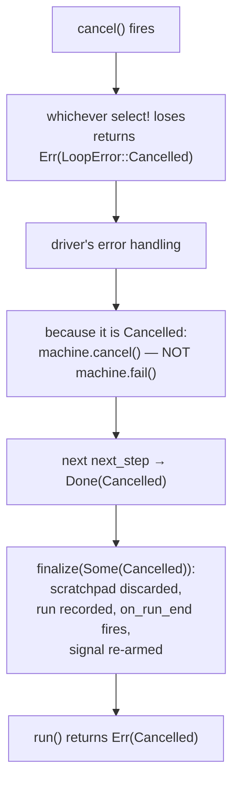

Users press Ctrl-C. Servers shut down. Tasks get abandoned. loopctl's answer is one small type, `CancelSignal`, in `src/cancel.rs`, and every level of the engine honors it.

This page covers the mechanism, every checkpoint, and the "one cancel equals one cancelled run" guarantee you can rely on.

## The signal

```rust
let signal: Arc<CancelSignal> = agent.cancel_signal();  // share it anywhere

signal.cancel();                  // fire — idempotent, wakes every waiter
signal.is_cancelled();            // non-blocking check: true/false
signal.notified().await;          // async wait: completes when fired
signal.reset();                   // re-arm for the next run (the engine does this for you)
```

Inside, it wraps a tokio `CancellationToken`. That primitive is built for this job, and it avoids the classic race in a hand-rolled `AtomicBool` plus notification pair.

That race is a check-then-act race. A cancel arrives exactly between "I checked" and "I started waiting", and your waiter sleeps forever.

The token is one-shot, so once it fires it stays fired. When you need a fresh start, `reset()` swaps in a new token rather than un-firing the old one.

**The wiring you will actually write**, a Ctrl-C handler:

```rust
let cancel = agent.cancel_signal();
tokio::spawn(async move {
    if tokio::signal::ctrl_c().await.is_ok() {
        cancel.cancel();
    }
});
```

Any task holding a clone can fire it. That may be a UI button, a watchdog, or your test.

## Where cancellation is honored

Your engine checks the signal at five granularities, so a cancel lands quickly no matter what your run is doing:

| Granularity | Where | Mechanism |
|---|---|---|
| Before any turn's work | `do_turn` entry | early guard: return `Err(Cancelled)` before touching the provider |
| During the run-start window probe | driver run-start | the probe future races the cancel signal (0.4.0) |
| During a model call | non-streaming path | biased `select!`: cancel raced against the provider future |
| During a streaming reply | the stream handler | every event poll races the cancel signal |
| During one tool call | `execute_tool_call` | biased `select!`: cancel raced against the tool future |
| During a compaction pass | `handle_compact` | the compactor future races the cancel signal (0.4.0) |
| During a parked ask | the ask channel | the resolver race includes the cancel signal; the park ends typed `Cancelled` with one `Cancelled` gate record (0.4.0) |
| Between tools / during retry backoff | dispatcher, recovery | poll checks and raced sleeps |

"Biased" means your cancel branch is polled **first**. So if the signal already fired, the work future is never even started, and cancellation always wins the race.

## What a cancel actually does



Three deliberate properties hold here.

1. **Cancelled is not Failed.** Your brain routes it to `Terminal(Cancelled)`, not `Terminal(Failed)`. Your error handling can treat them differently, because a cancel is expected and a failure is not.

2. **Completed work is salvaged (0.4.0).** A cancelled run keeps its completed turns. The coherent prefix of your scratchpad glues into history, and only the in-flight exchange is dropped.

   So a Ctrl-C three turns into a five-turn task still leaves you a usable conversation. Before 0.4.0 the whole scratchpad was wiped, which means an interrupt cost the run's entire conversation. Your audit trail (`session.runs`) still records the run, with `stop_reason: Cancelled`.

3. **The signal re-arms after the run, not before.** That ordering carries a guarantee you would otherwise lose.

Suppose you fire cancel while no run is active, then call `run()`. If `run()` cleared the signal at its top, the pending cancel would vanish. Your agent would then look permanently dead, or your cancel would be silently ignored.

So `finalize()` re-arms after the run observes and reports the cancellation. One cancel always produces exactly one `Err(Cancelled)` for you, and the next run starts fresh.

## Cancel mid-tool: what your tool should know

The engine drops your tool's future when a cancel lands mid-call. Rust's async dropping means **execution stops at the next await point**. No destructors run politely, and no cleanup handler fires.

The practical rule is to write tools that are safe to abandon mid-write. Write to a temp file and rename at the end. Use transactions rather than half-states. Keep external side effects, such as HTTP calls to other services, idempotent or resumable.

The same applies to tools served over MCP. Your server adapter races each call against the request's cancellation token and drops in-flight futures on cancel.

Compactors carry their own drop-safety contract. `ContextCompactor::compact` may be dropped mid-pass, and a cancelled pass leaves the last committed state.

The demotion-sink handoff in a cancelled pass is raced too. So a cancel during a hanging sink ends your run typed `Cancelled`, never wedged.

## Cancelling from inside a run

You do not need a separate task. Anything holding the `Arc<CancelSignal>` can fire, including code inside an [observer](/extensions/observers/) or a [hook](/extensions/hooks/) running on your engine's tasks.

The next checkpoint picks it up, almost always within milliseconds.

Tests pin the whole ladder: cancel during the model call, during a stream, during a tool, during retry backoff, and before your run starts. Every one returns `Err(Cancelled)` promptly, and your agent is usable again immediately after.

## Related pages

- [Cooperative cancellation](/principles/cooperative-cancellation/): the pattern behind this design, and why a shared flag beats a kill switch.
- [Termination](/engine/termination/): how Cancelled compares to the other endings.
- [The driver loop](/engine/driver-loop/): the error path a cancel travels.
- [File reference: cancel.rs](/file-reference/cancel/)
