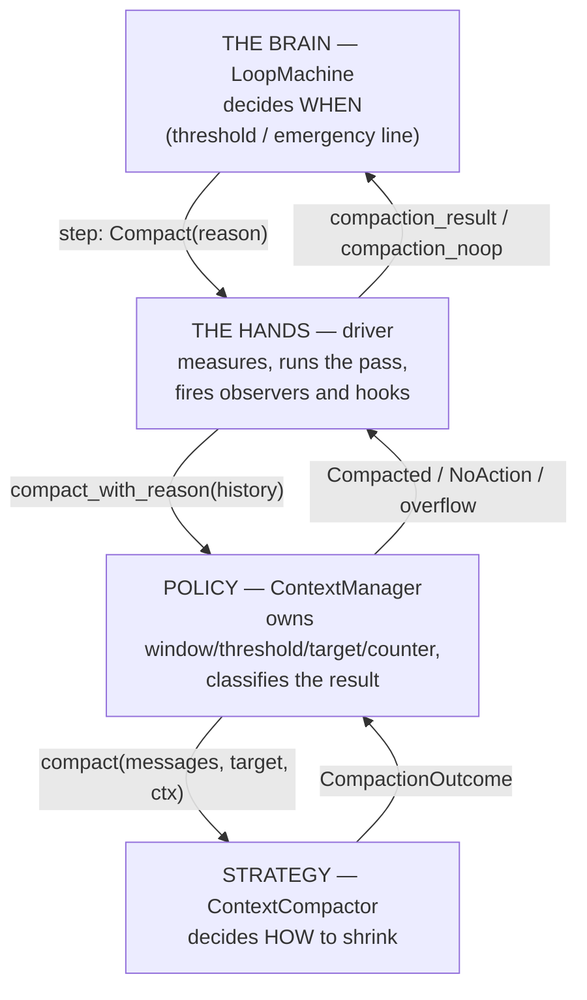
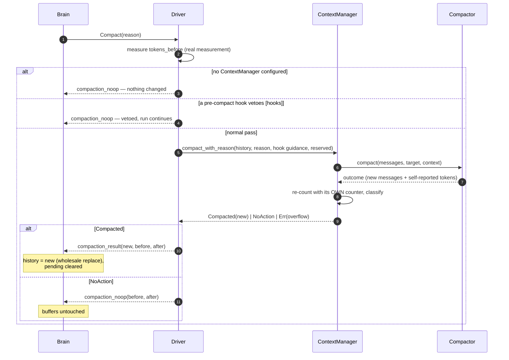
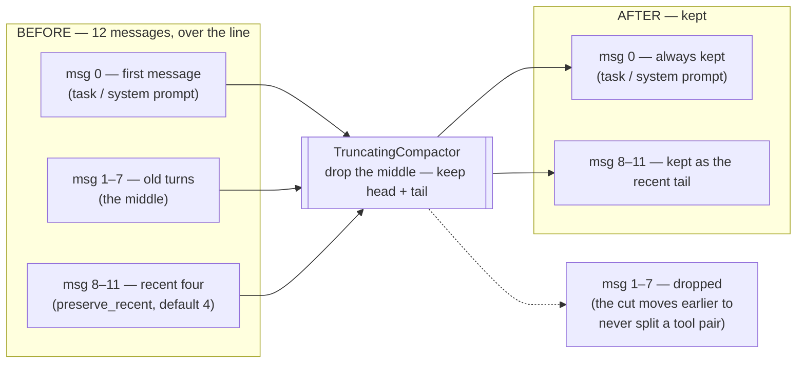

Every model has a hard limit on how much text it can read per request: the **context window**. An agent that keeps appending will eventually build a request your provider rejects.

Compaction is the subsystem that notices your conversation approaching the ceiling and rewrites it into something smaller, and then your run continues inside the budget.

Sources: `src/compact.rs`, `src/compact/` (the compactor family), `src/engine/core/machine.rs`, `src/engine/bare/compact.rs`.

Read this page when your agent runs long, your tools produce big outputs, or you have met `LoopError::ContextExceeded` and want to know exactly what happened.

## The words, once

| Term | Plain meaning |
|---|---|
| **Context window** | The provider's hard ceiling, in tokens. You set it (`SessionConfig::context_window`, default 200,000). |
| **Estimate** | The conversation's approximate token count. Compaction runs on estimates, never exact counts. |
| **Token counter** | The pluggable piece that produces estimates. Default: ~4 characters per token (`HeuristicTokenCounter`). |
| **Threshold** | Your soft line: past `compact_threshold`% of the window (default 80%), compact before the next model call. |
| **Emergency line** | The hard line at 95% of the window. Always active, even with `auto_compact: false`. |
| **Committed history / pending** | The two message buffers (see [the big idea](/start-here/the-big-idea/)). Compaction replaces **both together**. |
| **Compactor** | The strategy object deciding *how* to shrink. Default install: `TruncatingCompactor` — cut the middle, keep head and tail. The real LLM strategies ship alongside it (see [the compactor family](#the-compactor-family)) and compose best inside a `FallbackCompactor` chain. |
| **Context manager** | Owns the compactor plus the sizing policy (window, threshold, target size, counter). |
| **Landing target** | The post-compaction size the pass must actually reach: by default **15% of the trigger threshold** (window 200k × 80% × 15% = 24k tokens). A pass that lands over its target **declines** — it reports no-change rather than passing silently (0.4.0). |
| **Demotion sink** | Where the evicted messages go. Default: nowhere (dropped). Install a `MemoryDemotionSink` and evicted content becomes retrievable memory (see [below](#demotion-evicted-is-not-destroyed)). |

Two distinctions prevent most confusion:

- **Threshold versus window.** Crossing the threshold is normal, it is your trigger. Exceeding the window is a contract violation: no request is ever sent over it, because your run fails first.

- **Measurements versus hints.** A compactor may report its own token numbers, but those are **hints**. Every decision uses your manager's own re-count with its configured counter.

## Four roles, cleanly split



| Question | Answered by |
|---|---|
| *When* do we compact? | the machine (threshold + emergency) |
| *How* do we shrink? | the compactor strategy |
| *Did it work?* | the manager (re-measures, classifies) |
| *What now?* | the machine again (continue or fail) |

This split is why you can swap the truncator for an LLM summarizer without touching your engine.

## When it triggers

Before every model call, the brain checks (first hit wins):

1. Turn limit exceeded? Then end the run, which is not compaction's business.

2. `estimate >= window × 95%` gives **`Compact(Emergency)`**, an inclusive comparison that is always active.

3. `auto_compact` and `estimate > window × threshold%` gives **`Compact(ThresholdExceeded)`**, a strict comparison. So a payload exactly at 80% serves normally, and only growth past it compacts.

Worked example, window 8,000, threshold 80%. The trigger line is 6,400 and the emergency line is 7,600:

| Conversation estimate | What happens |
|---|---|
| 5,500 tokens | next model call, nothing special |
| 6,500 tokens | `Compact(ThresholdExceeded)` before the next call |
| 7,700 tokens | `Compact(Emergency)` — even with `auto_compact: false` |

### When the estimate is refreshed

Your driver measures the payload at every growth point, so the trigger's number is always current before a request goes out.

It measures at run start on committed history plus new input, after every model response, and after every batch of tool results.

A single huge tool result therefore becomes visible before your next request, so you cannot sneak past the trigger with a giant tool output.

Extras riding your next request, meaning memory and contributor messages, are counted too. If the fuller payload crosses the line, your turn defers to compaction with a reserved budget, so the extras still fit after shrinking.

## What one pass looks like



The classification rules, in the manager (`compact_with_reason`):

- The compactor reported failure, or its result **still does not fit** the window minus any reserved budget, gives `Err(ContextOverflow)`, and your run ends with `ContextExceeded`.

- Same message count and no size reduction gives `NoAction`, an honest "nothing happened". Your observers stay silent and your hooks stay silent.

- Since 0.4.0 this includes **over-target landings**: a compactor that shrinks but lands above its target declines instead of passing silently.

- On a threshold-triggered pass whose payload still fits your window, that decline defers the compaction and serves the turn, while the emergency line still forces.

- Anything else gives `Compacted`, with `tokens_after` and `tokens_saved` **normalized to the manager's counter**, which overwrites the compactor's self-report.

### Watching a pass from start to finish

Observers see the whole pass now, not only the success:

- `on_pre_compaction(PreCompactionContext)`: your pass is starting. It carries the trigger reason and pre-pass conversation stats, meaning message counts by role and the token estimate.

- `on_compaction(CompactedContext)`: a real pass landed. It carries live `CompactTelemetry` with the trigger, before and after stats, tokens saved, and the pass's wall-clock duration measured around the whole span.

- That span is the snapshot, the counting, the compactor call and the demotion handoff, not the compactor in isolation.

- `on_compaction_failed(CompactionFailedContext)`: your pass failed, typed as `LoopError::CompactionFailed` or `CompactionStalled` at the run level, with payload-comparable numbers.

### The target size

Your manager does not only say "shrink". It passes a concrete target, by default **15% of the threshold line**, say window 200k × threshold 80% × 15% = 24k tokens.

That was tightened from 70% in 0.4.0, because small context slots need landings well below the trigger.

You tune it with `with_compact_target(CompactBase::Threshold | Context)` and `with_compact_target_pct`.

The sizing rides every pass as a `CompactSizing` argument: the reserve the landing must leave room for, which is per-request overhead plus a deferred turn's transients.

The argument also carries an optional one-pass target override. Your engine's overflow-salvage arm uses that override to force a landing strictly under a refused payload.

## What happens to the two buffers

After a **successful** pass (`compaction_result`):

1. `history` is **replaced wholesale** by the compacted messages.

2. `pending` is **cleared**, because everything your run said so far was folded into the compacted result.

3. The token estimate is set to the new, smaller count, state moves to `Start`, and your deferred model call proceeds.

The invariant: **compaction collapses `history + pending` into a new, shorter `history`, and `pending` restarts empty.**

That is what makes it actually reduce your context, because both buffers become one smaller one.

After a **no-op** pass (`compaction_noop`), both buffers are untouched and your run continues. This distinction exists so an unchanged pass does not accidentally glue half-finished run messages into permanent history.

### The no-progress guard

Both feeds compare your driver's measured before and after numbers. If `tokens_after >= tokens_before`, nothing was shaved.

So the brain ends your run with `Failed(ContextExceeded)` instead of ping-ponging between Compact and CallLLM forever.

This is also the honest price of a **hook veto** at over-threshold: nothing shrank, so the guard fires.

A veto over-threshold is a decision to stop, not a decision to proceed.

### The audit trail is never touched

Compaction rewrites the operational conversation your loop uses. The observational record, `session.runs[N].turns` with every turn's original input and output, survives intact.

You can always read what was actually said before the summary replaced it.

One nuance: a turn that runs after compaction records the summarized view as its context, so your trail shows what each turn really saw.

| | Before | After success | After no-op / failure |
|---|---|---|---|
| `history` | committed messages | **replaced** by compacted list | unchanged |
| `pending` | this run's messages | **cleared** (folded in) | unchanged |
| `session.runs` audit trail | full record | **unchanged** | unchanged |

And remember from [the big idea](/start-here/the-big-idea/): a run that compacts and then fails leaves the compacted history behind, because compaction is a commit point.

## The default strategy: `TruncatingCompactor`

Dependency-free, no LLM calls. It drops the **middle** of the conversation:



Two knobs: `with_preserve_recent(n)` (default 4, minimum 1) and `with_min_messages(n)` (default 6, minimum 2, so conversations shorter than this pass through untouched). That 6 is this truncator's own. The LLM-backed compactors further down default to 8 instead. Three rules:

1. **The first message is always kept**, because it usually holds the task or system prompt everything else depends on.

2. **Tool call and result pairs are never orphaned.** If your cut would keep a tool result while dropping its call, or the reverse, the cut point moves.

   It always moves so the pair survives together.

3. Providers reject conversations with orphaned halves, so the machinery handles even nasty cases.

   Reused call ids pair per occurrence, and results of the first message's calls are pulled back adjacent to it.

4. **Never return an empty list.** A conversation that cannot be safely cut reports "no change" instead.

### Inside `TruncatingCompactor`, step by step

Here is the exact procedure behind those rules. Your `_target_tokens` is deliberately ignored, because this is positional truncation, not token fitting:

```text
compact(messages):
  1. len ≤ min_messages (6)?          → unchanged
  2. split = len − preserve_recent    // the provisional cut point
  3. fixpoint loop:                   // pair-safety moves the split EARLIER,
       adjusted = adjust_for_tool_pairs(messages, split)   // never later; it is
       if adjusted == split: break                         // non-increasing and
       split = adjusted                                    // bottoms out at 0 —
                                                           // always terminates
  4. split == 0?                      → unchanged          // nothing can be dropped
  5. preserved = [first message] ++ messages[split..]      // first is ALWAYS kept
  6. reattach: dropped ToolResults whose calls live in the
     preserved first message are pulled back, adjacent to it
  7. preserved empty?                 → unchanged          // never replace a
                                                           // conversation with nothing
  8. re-measure with the manager's counter; report tokens_saved
```

The pair-safety machinery behind step 3 works like a bracket-matcher for your tool traffic. A forward scan keeps, per tool-call id, a stack of unconsumed calls.

Each `ToolResult` pops the most recent unconsumed preceding call with that id, and the two become a **pair**. Leftovers are then classified.

An unmatched call is a `LoneCall`, because its result may still be in flight. An unmatched result is a `LoneResult`, because a result cannot exist without its call.

That second case is a protocol violation.

The sanitizer then applies three asymmetric rules to your output. **`LoneResult`s are dropped everywhere**, and **`LoneCall`s are kept outside the dropped region**.

That asymmetry is deliberate: compaction can run before results land, while strict pairing applies inside the dropped region.

Messages left empty by filtering are removed too. Even the `unchanged()` path runs the same filtering, so your "no change" report is honest about what it would have saved.

`TokenSplitter`, exported from the same file, gives you the same principled split for **custom** compactors: an old and recent boundary at a real turn transition.

It is pair-safe, since it slides an orphaning cut instead of refusing it, so your agent tool-loop histories never wedge the pass.

An LLM summarizer can then summarize `to_compact` and keep `preserved`.

## The compactor family

0.4.0 ships the real strategies alongside the truncator. All are always compiled (no feature flags, no new dependencies):

| Compactor | What it does | When to reach for it |
|---|---|---|
| `TruncatingCompactor` | Positional middle-cut, zero LLM calls. Still the default install and the chain's terminal. | Determinism, no client, the never-fail floor. |
| `QaSummarizer` | The three-step LLM pass: **summarize** the about-to-drop slice into a dense running summary → **question gaps** (ask the model what it would need from the dropped context) → **answer** from the full transcript before it's discarded, folding recovered facts under `## Facts recovered`. Unknowns are dropped, not guessed. Accumulates across passes (`PriorSummary`); enforces its own summary budget (an over-budget response fails the pass, originals intact). | Maximum *retention* — the facts a future turn will need. |
| `StructuredSummarizer` | One LLM call (+ at most one retry) producing a **sectioned** summary — key facts / decisions / pending tasks / open questions, each a bullet list — with contractually stable headings. Templates are configurable (`SummaryTemplate`, `default_template`, `action_only`); a malformed answer degrades to raw text, never an error. | Maximum *shape* — consumers that locate "pending tasks" without parsing prose. |
| `FallbackCompactor` | The never-fail **chain**: stages in order until one succeeds. Default chain: QA → structured → `TerminalCapture(TruncatingCompactor)`. Failed stages' outputs are discarded (the next stage sees the *original* input); `last_report()` names the winning stage; `terminal_min_recent` (default 4) is a structural floor the last-resort truncate cannot go below. | Production — with a non-failing terminal, an out-of-tokens condition stops being a failed pass. |
| `RollingCompactor` | Compacts only the groups older than `age_turns` (pair-safe role-transition boundaries), rolling them into micro-summaries on each pass — compaction as a maintenance cadence, not one big rewrite. | Long unattended runs where each pass should be cheap. |

Two shared contracts are worth knowing. Every LLM compactor runs its client calls on a client you supply, and a dedicated cheaper model is the documented production shape.

A compactor's failure, whether an API error, a blank response or an over-budget summary, fails **that stage** with your original messages intact.

That is exactly the shape the `FallbackCompactor` chain consumes.

The compactors' token spend is reported per pass through `loopctl.compaction.summarizer.tokens` metric events for the QA pass.

The chain also emits `loopctl.compaction.passes` and `loopctl.compaction.degradations`.

Both LLM compactors consume your pre-compact hook guidance identically. `CompactionContext::instructions` rides as host instructions, and every `additional_context` fragment as context to weave in.

Both honor the **retention classes**. `Requery`-tagged results render as omission markers in the transcript, because a summary physically cannot restate content it never saw. `Durable` results survive eviction.

## Demotion: evicted is not destroyed

Your `CompactionOutcome` carries an `evicted` list, which holds the messages the pass dropped. By default they go nowhere. Install a demotion sink and they become retrievable:

```rust
use loopctl::compact::{MemoryDemotionSink, FallbackConfig, ChainBuilder};

// The store half: what compaction evicts, memory remembers.
let sink = MemoryDemotionSink::new(memory_store, max_chars_per_message);
// (installed on the context manager; the driver hands every pass's
//  evicted messages to the sink after the history rewrite)
```

`MemoryDemotionSink` renders each evicted exchange, meaning tool name, arguments and truncated result, into a `Trajectory`-category memory entry. Your renderer is `render_evicted`, the same one the QA summarizer feeds its transcript.

Combined with `SearchMemoriesTool` ([memory](/extensions/memory/)) this closes your loop: **what compaction evicts, the model can recall on demand.**

The prune pass, described in [context accounting](/engine/context-accounting/), hands its cleared tool outputs to the same sink under `CompactReason::Prune`.

## Writing your own compactor

One async function:

```rust
impl ContextCompactor for SummarizingCompactor {
    fn compact(&self, messages: Vec<Message>, target: u64, ctx: CompactionContext)
        -> Pin<Box<dyn Future<Output = CompactionOutcome> + Send + '_>>
    {
        Box::pin(async move {
            let split = TokenSplitter::new().split(&messages); // old vs recent
            let summary = self.client.summarize(&split.to_compact, target).await;
            let mut kept = vec![Message::new(Role::System,
                vec![MessagePart::text(summary)])];
            kept.extend(split.preserved);
            let tokens_after = ctx.counter.count(&kept);  // self-report in the right unit
            Ok(CompactionOutcome::compacted(kept, ctx.tokens_before, tokens_after))
        })
    }
}
```

Your `CompactionContext` carries everything a smart strategy needs: `tokens_before`, the `reason`, the `context_window`, the turn, and the manager's counter for your self-reports. It also carries hook-supplied `instructions` and `additional_context`. An emergency may justify more aggression.

Install it:

```rust
let manager = ContextManager::new(Arc::new(SummarizingCompactor { /* ... */ }))
    .with_context_window(32_000)
    .with_threshold(75)
    .with_token_counter(Arc::new(my_real_tokenizer)); // one unit for everything!
agent.set_context_manager(Arc::new(manager));
```

Watch the counter unit. Trigger decisions and post-compaction classification must run in the same unit.

Mixing the heuristic counter for your trigger with a real tokenizer for the compactor causes flapping: compact, look small, un-compact, look big, repeat. Install one counter on the manager, and your driver reuses its counter automatically.

## Failure: reading a `ContextExceeded`

`ContextExceeded { used, limit }` can arrive from three places, and the numbers tell you which:

| `limit` means | Cause | Fix |
|---|---|---|
| the window | the compacted result still didn't fit | bigger window, or a compactor that can shrink harder (the chain) |
| the pre-pass size | no-progress guard: nothing was shaved (includes hook vetoes and short-but-fat conversations the truncator can't cut) — the typed form is now `CompactionStalled` | summarizing compactor, bigger window, or trim the seed content |
| — | a compactor *error* surfaces as `CompactionFailed` (same payload-comparable numbers) | check the summarizer's client, or let the chain fall through to the terminal truncate |

A threshold-triggered stall whose payload still fits your window no longer kills your run. The pass declines, your machine latches the deferral, and your next model call serves.

Only a genuinely over-window stall on the emergency line still ends the run.

Four promises hold in every case. You can rely on them when you debug.

- **No request is ever sent over the window.** Your run fails first, or, since 0.4.0, the one [overflow-salvage](/engine/context-accounting/) compact-and-retry runs under a target strictly below the refused payload.

- **An interrupt salvages the coherent prefix**, so a failed run keeps its completed turns.

- **A `ContextExceeded` discard leaves the notebook clean**, with an unshrinkable history dropped whole.

- **The estimate is never faked**, so a no-op is reported as a no-op.

## Who counts the tokens: the heuristic and the ratio presets

Compaction triggers on an estimate of the conversation's size, and the estimator is
pluggable. The default is **`HeuristicTokenCounter`**, a rough chars-per-token guess
with no provider knowledge.

Since 0.3.1 there is a second option, the **`RatioTokenCounter`** presets, one per
provider family, each pinned to a measured characters-per-token ratio plus a fixed
per-message overhead:

```rust
use loopctl::compact::RatioTokenCounter;

let counter = RatioTokenCounter::openai();       // 4.30 chars/token, +4 per message
// anthropic() → 3.60 / +5 · gemini() → 4.05 / +4 · local_default() → 3.80 / +4
let custom  = RatioTokenCounter::new(3.9, 4);    // your own calibration

agent.set_token_counter(Arc::new(counter));
```

The honest long-term answer for local models is the custom ratio: send one known text,
read the provider's reported `input_tokens`, and divide. The three-minute calibration
recipe is in the type's docs.

A ratio that is NaN, infinite, or not positive is rejected with a warning and the 4.0 fallback takes over, so a bad constant can never wedge your gate.

Presets and the heuristic render messages through the same helper, so your two counters can drift only in how they divide, never in what they count.

**Defaults are unchanged**: the engine keeps `HeuristicTokenCounter` unless you install a counter. Presets are opt-in, with byte-comparable behavior for everyone else. For why estimates matter at all, see [tokens and context windows](/principles/tokens-and-context/).

## Configuration quick reference

```rust
ContextManager::new(Arc::new(TruncatingCompactor::default()))  // the seeded default
    .with_context_window(200_000)   // default 200_000
    .with_threshold(80)             // default 80, clamped 1..=100
    .with_auto_compact(true)        // default true
    .with_compact_target(CompactBase::Threshold)  // default
    .with_compact_target_pct(15)    // default 15 (of the threshold line), clamped 1..=100
    .with_token_counter(Arc::new(HeuristicTokenCounter))  // default
```

The production shape is the chain: `FallbackCompactor::default_chain(client)` (QA → structured → truncate), or compose your own with `ChainBuilder::stage(name, compactor)...terminal(&truncator)` and set the floor via `FallbackConfig::terminal_min_recent`.

Your manager exposes three host-facing calls. `ensure_context_fits(messages, turn)` checks the threshold itself, and `compact_manual(messages, turn)` bypasses the threshold and fires hook trigger `Manual`.

The third, `compact_with_reason(..., sizing)`, is the engine's path, where the sizing argument carries the reserve and any one-pass target override.

For watching, the `on_pre_compaction`, `on_compaction` and `on_compaction_failed` observers bracket every pass.

Your `pre_compact` hook can veto or steer, since its merged `new_instructions` reach the compactor's `CompactionContext`.

## Related pages

- [Tokens and context windows](/principles/tokens-and-context/): what tokens are, why the
  window is finite, and why the estimate errs high.
- [Session config](/core-data/session-config/): where the window and threshold live.
- [Hooks](/extensions/hooks/): the pre/post compact hooks.
- [File reference: compact.rs](/file-reference/compact/)
