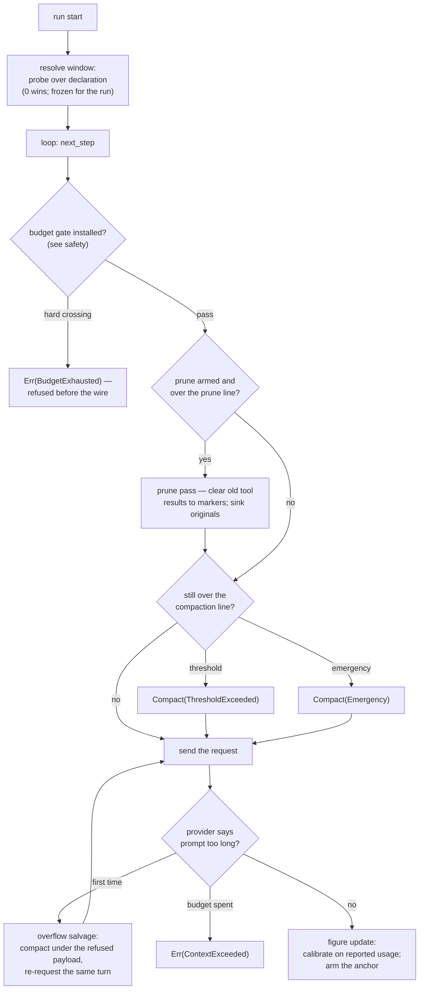

Compaction, covered by [the previous page](/engine/compaction/), is the act of shrinking.

This page is the decision layer under it: what number the engine compares against the window, and where that number comes from.

It also covers the 0.4.0 mechanisms that moved that decision from guesses toward real numbers. Those are the **window probe**, **usage calibration and anchoring**, the **prune** pass, and **overflow salvage**.

Sources: `src/engine/bare.rs`, `src/engine/bare/prune.rs`, `src/compact.rs`, `src/provider/openai.rs`.

Read this page when you hit one of three puzzles. Your provider's real context is smaller than the declared window. Your compaction triggers at the "wrong" time. Or a `ContextExceeded` arrived with a payload you believed fit.

## The words, once

| Term | Plain meaning |
|---|---|
| **Declared window** | `SessionConfig::context_window` — your guess, default 200,000. |
| **Disclosed window** | What the provider's metadata endpoint says it accepts (llama.cpp `/props`, Ollama `/api/show`). `None` when the provider discloses nothing. |
| **Resolved window** | The one number a run actually uses: **probe over declaration**, unless you declared `0` (the deliberate opt-out, which wins). |
| **Context figure** | The engine's current size number. Either **estimated** (pure counter) or **anchored** (a real reported `input_tokens` plus an estimated tail). |
| **Calibration ratio** | A rolling correction (basis points, clamped `[250, 4000]`) between estimates and reported usage. Applied whenever no fresh anchor exists. |
| **Prune** | The no-LLM reclamation pass: old tool results beyond a protected tail become `[cleared: prior tool output]` markers. Opt-in. |
| **Overflow salvage** | The one compact-and-retry a provider's oversized-prompt rejection earns, under a target strictly below the refused payload. |

## The window probe: ask, do not guess

The declared window is a guess your engine used to trust blindly. Since 0.4.0, at each **run start** your driver asks the client's `model_context_window()`:

- **llama.cpp `/props`** reads `default_generation_settings.n_ctx`, **divided by `total_slots`**. A `--parallel` server splits its KV budget across slots, and the per-slot allocation is what any single request must fit.

- The incident that built this: a ~140k-token run 500'd "Context size has been exceeded" against a proxy. Its real per-slot window, 65,536, was machine-readable all along.

- **Ollama `/api/show`** is a POST carrying your model name, where the `context_length` key is matched by suffix. Real Ollama keys it by architecture as `llama.context_length`.

- **Hosted APIs** such as OpenAI, Anthropic and Gemini disclose nothing, so the default is `None` and the declaration stands.

Probes are **fail-soft**. They return `None` on timeout, HTTP error or garbage, and never a turn error you must handle.

Each probe has its own 5-second deadline, so a wedged metadata endpoint costs you seconds, not the 120-second conversational read timeout.

You read probes through the crate's bounded-body control and cache them per model epoch, and `set_model` clears the cache, so a hot-swapped model re-probes.

The resolution rules:

1. Probe over declaration. The disclosure is what your server will actually accept, while the declaration is your guess.

2. A declared `0` stays `0`, because a deliberate opt-out outranks any disclosure.

3. The resolved number is **frozen for the run's whole life**, so the trigger and the emergency line cannot disagree mid-run. A model switch invalidates it and the next run re-resolves.

4. A probing resolution **re-syncs** the installed `ContextManager`, so machine trigger and compactor target unify on the disclosed number.

5. A probe-less resolution leaves your host-installed manager exactly as you built it, and reverts one an earlier probe had synced. Otherwise your `switch_model` without a window would leave that manager targeting a stale disclosed number while the machine triggered on your declaration.

Your `TurnEndContext.context_window` reports the denominator on every turn end, and it is `None` exactly under the disabled policy. So your utilization display divides by the limit your engine enforced.

Telemetry: `loopctl.context.window` (gauge, `source=probe|declared`) on every change, `loopctl.context.probe.failures` (`kind=timeout|http|parse`) per failed attempt.

## The figure: estimate, calibration, anchor

The raw figure is your token counter's estimate of what the wire will carry: conversation + system prompt + tool schemas + this turn's transients.

When you install a [tool selector](/core-data/tool-selection/), the schema component is the advertised subset since 0.4.1. Every figure of your upcoming payload counts what the request will carry, and a narrowed surface lets the figure fall below the prior report.

Three corrections sit on top:

### 1. Suppression-aware overhead

A turn of yours running under a `response_format` does not reserve the tool schemas its request suppresses. OpenAI and Gemini drop `tools` outright, and Anthropic substitutes one forced tool you never see, a bounded and small under-reserve.

Compaction's reservation keeps the full sum for the post-compaction turn.

### 2. The calibration ratio

When your provider reports real `input_tokens`, your prediction error feeds a rolling integer-thousandths ratio.

The first report seeds it, later reports halve the distance, and the clamp to `[250, 4000]` stops an absurd report from pegging it. You apply the ratio at every estimate update, which keeps your stored figure in one scale.

A zero-bearing report is no usage at all, so a backend you point at `input_tokens: 0` throughout never moves it, which is byte-identical behavior.

You see the ratio per update as a `loopctl.estimate.calibration` metric event and at run end through `RunEndContext.calibration_ratio_bp`. A `None` there means no ground truth ever arrived, the honest reading.

When the ratio moves, your installed manager's window re-syncs in converted units, so your compactor target and trigger line stay in one scale.

### 3. The anchor

When your provider reports usable `input_tokens`, your figure becomes **`reported_input + calibrated(estimate of the appends since that report)`**.

The real number carries the figure, and the error surface shrinks from the whole history to the tail. The anchor:

- arms only on non-zero reports, so an all-zero backend you run never anchors, which is dch's local shape,

- invalidates wherever your wire changes wholesale, meaning a compaction pass or any model change, because a different tokenizer breaks the pairing. Since 0.4.1 it also invalidates on an advertised-surface change, a steering drain that delivered guidance, or a history rewind,

- ages on the session-wide turn basis, so an anchor surviving into later runs reads as aging, not fresh.

With no anchor your figure is exactly the calibrated estimate, so usage-less backends behave byte-identically to before.

Your `RunEndContext.context_figure` says which figure drove your last trigger. It gives `source: Anchored | Estimated` plus the anchor's age in completed turns.

## Prune: reclamation without a summarizer

Compaction rewrites your conversation with an LLM, or drops its middle. Prune is cheaper: it clears **old tool results** your model can re-derive from, without touching anything else.

```rust
agent.set_prune(PruneConfig::default())?;   // opt-in; off by default
```

The pass runs at the pre-request site, before the compaction deferral:

1. Everything **beyond a protected tail** (default 2,000 tokens) is eligible.

2. **Untagged results clear first.** `Requery`-tagged results clear only when the untagged pool cannot satisfy your minimum-free gate. That gate is a fraction of your window (default 10%).

3. Cleared content becomes the `[cleared: prior tool output]` marker, with identity intact on call id, tool name, error flag and retention class, oldest first and deterministic.

4. The originals go to the demotion sink under `CompactReason::Prune`, so pruned is not destroyed.

You evaluate that gate in the counter's raw units, so a settled calibration ratio cannot distort the verdict. `Durable` never clears. The classes are in [retention classes](/core-data/messages/#retention-classes).

Your prune line must sit strictly below the compaction threshold, validated with `InvalidInput` and never clamped.

**A prune that frees enough can avert the compaction it would otherwise defer to.**

## Overflow salvage: surviving the provider's refusal

A provider rejection whose text reports an oversized prompt used to end your run. Now it earns that turn's **one** compact-and-retry:

```text
provider rejects: "prompt too long" (is_context_overflow)
  → the failed turn fires its turn-end event
  → the machine is forced onto the emergency compaction path
    with target = min(configured target, half the refused estimate)
    (CompactSizing::target_override — the landing must sit strictly
     UNDER the payload the provider refused, because the configured
     target can sit above what a provider whose real limit is below
     the declared window accepts)
  → the same turn is re-requested against the compacted history
  → a repeat rejection on the spent turn is a genuine misfit:
    Err(ContextExceeded), run-end carries unfinished_input
```

The oversized-prompt matcher understands both phrasing families since 0.4.1. The hosted providers use spaced phrases like "context length" and "max tokens", while a self-hosted engine answers `context_length_exceeded` or `prepared prompt exceeds Engine max_context` in snake_case.

Underscore forms cannot collide with the "context deadline exceeded" transient idioms the strict set excludes, so they joined verbatim. Without them, a local engine's 400 never armed your salvage and the run died with the raw error.

The budget is **per run**. Your turn numbers restart and the spent retry clears at run start, so a follow-up run's salvage is never denied by the prior run's.

If your conversation has nothing to shrink, the figure resets and the turn re-enters directly.

## How the pieces order, per model call



## Configuration quick reference

```rust
agent.set_prune(PruneConfig::default())?;          // opt-in reclamation
// (PruneConfig: protected tail budget 2_000, minimum-free fraction 10%,
//  prune line validated strictly below the compaction threshold)

// The window: declare what you know; the probe corrects what the server knows.
SessionConfig::default().with_context_window(0)    // the deliberate opt-out —
                                                    // no window policy at all
```

You can read all of it back, read-only: `agent.context_tokens()`, `machine.context_tokens()`, `TurnEndContext.context_tokens` / `.context_window`, `RunEndContext.calibration_ratio_bp` / `.context_figure`.

## Related pages

- [Compaction](/engine/compaction/): the pass itself, with triggers, compactors and demotion.
- [Session config](/core-data/session-config/): the declared window and its `0` sentinel.
- [Messages](/core-data/messages/): retention classes and what prune may clear.
- [Tokens and context windows](/principles/tokens-and-context/): why estimates exist at all.
- [File reference: engine/bare/prune.rs](/file-reference/engine-bare-prune/)
