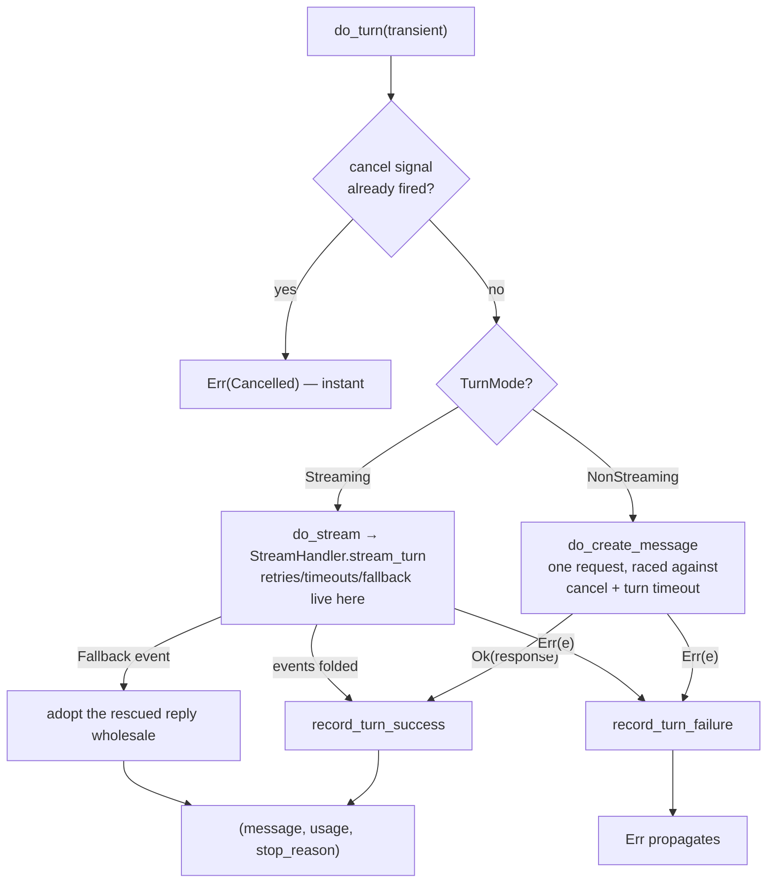

Every model call in your engine funnels through one small module: `src/engine/bare/llm_turn.rs`.

This page follows a single turn from "the brain said `CallLLM`" to "the brain received the reply". It is your source of truth for anything about request construction.

## Building the request

```rust
fn build_turn_request(&self, transient: Vec<Message>) -> StreamRequest {
    let mut messages = transient;                    // contributors + memory (this turn only)
    messages.extend(self.machine.full_history());    // history + pending — the conversation
    StreamRequest::new(messages)
        .with_system(self.session.config.system_prompt.clone())
        .with_tools(self.build_tool_schemas())       // None if no tools registered
}
```

The order matters and is deliberate: **transient extras first, conversation after**. The extras (goal reminders, memory excerpts) frame the conversation, not the other way around.

What rides alongside rather than inside your request, as **`RequestOptions`**:

- whatever you set with `set_request_options(...)` (`ToolConstraint::Strict`, say), and

- a per-request **model override** when the [fallback manager](/safety/fallback/) is routing to a backup model.

Both apply to your streaming and non-streaming paths alike.

### Counting the context

Before each call, your driver measures the payload the provider would actually receive:

```text
context estimate = tokens(history + pending)      // the conversation
                 + overhead_tokens()              // system prompt + tool schemas,
                                                 //   measured once, cached
                 + tokens(transient extras)       // contributors + memory, if any
```

That estimate feeds `machine.set_context_tokens(...)`, and it is the number your compaction trigger compares against the window.

Since 0.4.0 the counting is honest about what the wire suppresses: a turn running under a `response_format` no longer reserves the tool schemas its request drops.

The OpenAI and Gemini bodies omit `tools` outright, and Anthropic swaps in one forced tool that rides uncounted, a bounded and small under-reserve stated in the docs.

On backends that report usage, the [calibration ratio](/engine/context-accounting/) further corrects your raw estimate, and a usable `input_tokens` report can anchor the figure wholesale.

## Two paths, one entry point



### The non-streaming path

One `create_message_with_options` call, wrapped in a **biased** `tokio::select!` against your cancel signal and the turn timeout.

"Biased" means the cancel signal is checked first, always. So if it already fired when you arrive, the provider call is never even started.

The three arms of that race, exactly:

```text
biased select! {
    cancel.notified()                          → Err(Cancelled)             // polled first
    sleep(turn_timeout)                        → Err(Api("request timed     // if no timeout is
                                                 out after …"))               configured, this arm is
    client.create_message_with_options(...)    → the reply                    std::future::pending()
                                                                              — a future that never
}                                                                             resolves
```

That `pending()` trick is how "no timeout" is expressed inside a `select!` without special-casing the whole shape, since an arm that can never win is a disabled arm.

Note what this path does **not** have: retries.

A non-streaming turn gets exactly one attempt under your deadline, and all retrying lives in the [stream handler](/core-data/stream-events/), one layer down.

The handler's rescue request is the one unstreamed call that gets careful treatment, with deadline arithmetic and cancellation, because it exists to save an already-failing turn.

### The streaming path

Your turn is driven through `StreamHandler::stream_turn` ([full story](/core-data/stream-events/)):

- Every accepted event goes to three places: your observers (`on_text_delta` and `on_thinking_delta`), your `text_streamer` callback if set, and the engine's own `StreamAccumulator`.

- `AttemptReset` wipes the accumulator, so a failed attempt's fragments must not mix with the retry's.

- `Fallback { message, ... }` abandons the accumulator and adopts the rescued complete reply as-is.

- The stop reason comes from the final `MessageDelta`, and usage comes with it or from the accumulator.

Hint: the turn timeout is shared across both paths. With streaming it is the handler's `total_stream_timeout` (default 5 min), and without the `streaming` feature it is a fixed 5 minutes.

### Event routing, exactly

Every accepted event goes somewhere specific, and this table is your whole routing decision:

| Event | Who sees it | Effect on the turn |
|---|---|---|
| `IndexedDelta` carrying Text | your `text_streamer` callback **and** your observers (`on_text_delta`) **and** the accumulator | fragment joins the reply's text |
| `IndexedDelta` carrying Thinking | your observers (`on_thinking_delta`) **and** the accumulator | joins a `MessagePart::Thinking` on close, and the reasoning rides the conversation for replay (0.4.0) |
| `IndexedDelta` carrying tool JSON | the accumulator only | fragment joins a tool call's argument string |
| `MessageDelta` with a stop reason | the engine | becomes the turn's `StreamStopReason`; an unrecognized string keeps the previous value rather than guessing |
| `MessageStart`, `PartStart`, `PartStop` | the accumulator | lane bookkeeping |
| `Ping` | nobody | a no-op |

Two defaults protect your turn when providers are sparse. If no stop reason ever arrives, the turn keeps `EndTurn`, the benign assumption.

Only `ToolCall` continues your agent loop, while `MaxTokens` and `StopSequence` end it with whatever text accumulated.

### Recording the outcome, exactly

`record_turn_success(turn, usage)`:

1. `fallback().record_success()`, which during a recovery probe is one of the two successes that close the breaker and route back to your primary.

2. `on_stream_success` fires, carrying the model that actually served your turn, not the configured one.

`record_turn_failure(turn, error)`, in strict order:

1. `Cancelled`? Then short-circuit with the breaker untouched and no event, because a user stop is not a model failure.

2. Classify: `RateLimitEscalation` becomes `FailureKind::RateLimit`, and everything else becomes `Transient`.

3. `record_failure`, where your 3rd consecutive one trips the breaker and fires `on_fallback(from → to)`.

4. Already in `Fallback` with the active backup also failing this turn? Then `mark_fallback_failed(active)`, so that chain entry burns one of its two strikes and routing advances next turn.

5. `on_stream_failure` fires, always except on cancel, and the original error returns to your caller unchanged.

The routing that precedes all of this: `routed_model()` answers the original model while your breaker is `Primary` and the active backup while it is `Fallback`.

That answer is written into the request's options as a per-request override, so your shared client is never mutated.

When the serving model changes between turns, `note_routed_model` fires `on_model_switched`, so your observability sees model churn even when you never configured any.

## After the reply: recording success and failure

Two small functions with outsized importance (they live in `emission.rs`):

**`record_turn_success(turn, usage)`** tells your fallback breaker "one success", which may close a recovery probe and route back to the primary model. Then it fires `on_stream_success` with the model that actually served the turn.

**`record_turn_failure(turn, error)`** works in this order:

- `Cancelled` short-circuits with the breaker untouched and no failure event, because a cancel is not a model failure.

- Rate-limit escalations count as `FailureKind::RateLimit`, and everything else is `Transient`.

- If this failure **tripped** your breaker and a fallback model exists, `on_fallback` fires.

- If the breaker was already tripped and the fallback you are on now failed too, the chain advances and that model is marked as failed.

- `on_stream_failure` always fires except on cancel, and the original error returns to your caller.

These few lines are the entire glue between your LLM turn and the [model fallback system](/safety/fallback/).

## The turn's paper trail

Every served turn appends a `Turn` to your current `Run` in `session.runs`, the audit trail:

```rust
Turn {
    turn: usize,                 // 0-indexed
    input: String,               // what the model was asked (display text)
    output: String,              // the model's text reply
    tool_calls: Vec<ToolCall>,   // any tool calls it requested
    input_tokens: u64,
    output_tokens: u64,
    stop_reason: StreamStopReason,          // why this turn's reply ended (0.4.0)
    transport_fallback: bool,               // served by the unstreamed rescue (0.4.0)
}
```

This trail is **never touched by compaction**. Even after the conversation is rewritten into a summary, your `session.runs` still holds every turn's original input and output.

One nuance: a turn that runs after a compaction records the post-compaction summarized text as its context, so your trail shows what each turn actually saw, which is internally consistent.

## Gotchas collected here

1. **Transients are ephemeral by design.** Contributor and memory messages are re-emitted fresh each turn and never persisted. Stop returning them and they vanish from your conversation, with nothing to clean up.

2. **A deferred turn is invisible.** When your compaction trigger fires after transients were gathered, the turn defers without firing `on_turn_start` or `on_turn_end`. The retried turn after compaction fires them once, with a reserved budget so its transients fit.

3. **The model override beats your `RequestOptions.model`.** When the fallback manager routes to a backup, its decision overwrites any per-request model you set. That is the point of automatic failover.

4. **Usage may be `None`.** Providers do not guarantee usage reports, as with Ollama under `stream_usage: false` and some proxies. Code against `Option<Usage>`.

5. A backend that reports no usage at all also leaves your context estimate uncalibrated and un-anchored, behaving byte-identically to the pure estimate, as [context accounting](/engine/context-accounting/) covers.

6. **Prior-turn thinking rides the request.** Since 0.4.0 your engine does not strip reasoning at turn boundaries, so the request prefix stays byte-stable and provider prompt caches keep hitting.

   The cost is window space for the reasoning's lifetime, as [messages](/core-data/messages/) covers.

## Related pages

- [Stream events](/core-data/stream-events/): the handler's retry and fallback ladder.
- [Fallback](/safety/fallback/): what "the routed model" means.
- [The driver loop](/engine/driver-loop/): where this fits.
