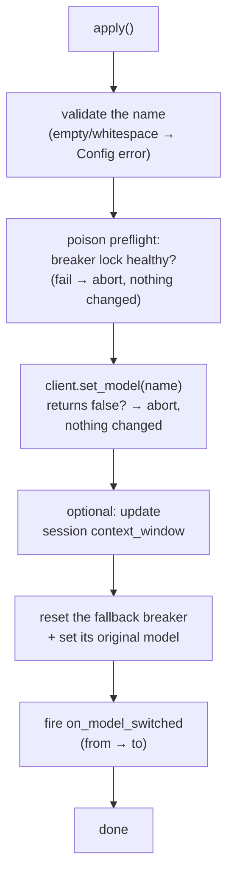

Sometimes you need to change the model while the agent lives. The task turns out harder than you expected, a cheaper model suffices, or the provider retires the old name.

`BareLoop::switch_model(...)` does it for you, in `src/engine/bare/model_switch.rs`. It runs one careful sequence, so no half-switched state survives a failure.

This page covers the manual, host-driven switch you drive from your host. The automatic one, which fires on provider failures, is the [fallback manager](/safety/fallback/). That is a different mechanism with the same notification.

## The basics

```rust
use loopctl::engine::SwitchOutcome; // (names simplified for reading)

// Switch to a bigger model whose context window differs:
agent.switch_model("claude-sonnet-4-5")
     .with_context_window(200_000)
     .apply()?;

// Just change the model name:
agent.switch_model("gpt-4o-mini").apply()?;
```

`switch_model(...)` hands you a small builder, `ModelSwitch`, and nothing happens until you call `.apply()`.

You will notice it is deliberately **not** `Clone`. Two concurrent switches would race on shared state, so the type system stops you before that can happen.

`apply()` either fully succeeds or changes nothing. You never see a partial switch.

## What one apply does, in order



Each step exists for a reason you can act on.

- **Client acceptance first.** Some clients cannot hot-swap, because their `set_model` returns `false`. The switch aborts before touching anything else. So you get no half-updated window and no reset breaker.
- **The window is optional but usually right.** Your new model may carry a different context window. If you do not update it, your compactor keeps using the old threshold. That is either too small, which causes needless compaction, or too big, which risks overflow.

  So call `with_context_window(tokens)` when the window differs.
- Since 0.4.0 the window re-sync converts into the manager's raw units under a settled calibration ratio. Writing the provider window verbatim left your manager's target and your trigger line in different scales.
- A switch also **invalidates the window-probe cache and the run's resolved window**. So your next run re-probes for the new model, as [context accounting](/engine/context-accounting/) covers.
- **The breaker resets because old-model failures are meaningless for the new model.** Failure counts and tripped state are wiped. Your new model starts with a clean slate as primary.
- **Observers find out.** `on_model_switched(ModelSwitchedContext { from, to })` fires exactly once per apply. That is a 0.4.0 fix, since it previously double-fired for programmatic switches. Your UI or logs can then track what is serving.

## Requirements

Your client must support hot-swapping, which is `ApiClient::set_model(&str) -> bool`. Every shipped provider client returns `true` and swaps an internal mutex-guarded model string. `MockApiClient` does too, so you can test switching in your own suite.

The default trait implementation returns `false`. So a custom client that does not override it rejects every switch, and it rejects them cleanly.

Per-request overrides through `RequestOptions::with_model` are a lighter tool. They change one request's model without touching your client, and your fallback machinery uses them internally. `ModelSwitch` answers a different question, which is that your session's model is now X.

## Gotchas

1. **Call it between runs, not during.** Nothing mechanically explodes, but a switch racing an in-flight run means the run's requests may span two models. The clean pattern is to finish or cancel the run, switch, then run again.

2. **Concurrent loops over one shared client.** Per-request overrides do not cross-wire, because they live on the request rather than the client. A `ModelSwitch` mutates the shared client for everyone using it. So keep one client per loop when their models must differ.

3. **The fallback manager's `original_model` becomes the new name.** After your switch, "fall back to primary" means the new primary. That is usually what you want. It is worth knowing if you kept references to the old name.

4. **`switch_model` is not gated by the "configure before run" rule**, unlike `set_memory` and friends. It is designed for mid-session use. Your setters panic-in-debug after the machine advanced, while switching does not.

## Related pages

- [Fallback](/safety/fallback/): the automatic model switching.
- [Observers](/extensions/observers/): `on_model_switched` and friends.
