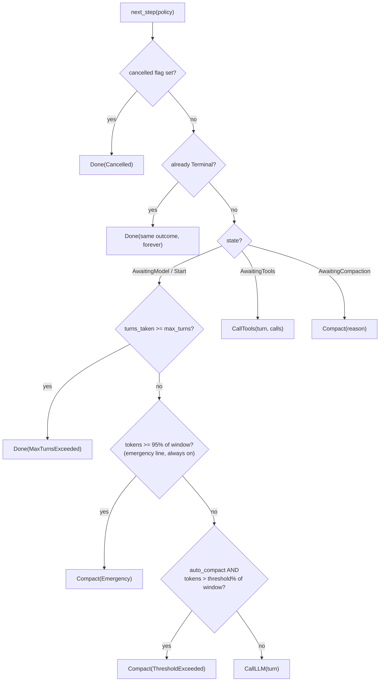

The `LoopMachine` in `src/engine/core/machine.rs` is the decision-making half of your engine.

It holds the conversation, counts turns, watches the context size, and answers one question with total consistency: "what next?".

It performs **no** network calls, no tool runs, no clock reads. You feed it results and read its decisions.

Serialize it, restore it, and it resumes exactly where it left off.

If you have not yet, read [the big idea](/start-here/the-big-idea/) first, because this page goes deeper into every rule the brain follows.

## What the brain holds

| Field | What it is |
|---|---|
| `state: MachineState` | Where you are: `Start`, `AwaitingModel`, `AwaitingTools`, `AwaitingCompaction`, `Terminal(outcome)` |
| `history: Vec<Message>` | The notebook: messages of your past **successful** runs |
| `pending: Vec<Message>` | The scratchpad: your current run's messages |
| `pending_tools: Vec<PendingToolCall>` | Tool calls awaiting dispatch (with any pre-resolved answers) |
| `turns_taken: usize` | Turns you completed this run |
| `context_tokens: u64` | The latest estimate of your conversation's size |
| `cancelled: bool` | Whether you requested cancel |
| `last_compaction_tokens: Option<u64>` | Size measured just before the current compaction pass |

Settings such as max turns, context window and thresholds are **not** stored, because your driver passes them in as a `MachinePolicy` on every `next_step()` call.

That is what keeps your machine pure: serializable state and nothing else.

### `MachinePolicy`: the numbers, and where each comes from

| Policy field | Source | Default |
|---|---|---|
| `max_turns` | `RunConfig::max_turns` | 200 |
| `context_window` | `SessionConfig` / `ContextManager` | 200,000 tokens |
| `compact_threshold` | `ContextManager::threshold` | 80 (%) |
| `auto_compact` | `ContextManager::auto_compact` | true |

Your driver rebuilds this struct every loop iteration from the session config, the in-flight run's config, and the context manager's sizing policy.

So a mid-run change to any of them takes effect on your very next step, and the machine itself serializes without a single setting inside it.

### The feeds' postconditions, in one table

| Feed | Legal from | Effect on buffers | New state |
|---|---|---|---|
| `accept_input` | any non-terminal | clears `pending`, pushes the user message, resets counters | `Start` |
| `model_response` | `AwaitingModel` | reply appended to `pending`; tool calls classified into `pending_tools` (unknown names pre-answered) | `AwaitingTools`, or `Terminal(Completed)` |
| `tool_results` | `AwaitingTools` | results appended; **consumes `pending_tools`** (only feed that does) | `Start` |
| `compaction_result` | `AwaitingCompaction` | `history` replaced wholesale, `pending` cleared, estimate = after | `Start`, or `Terminal(Failed)` on no-progress |
| `compaction_noop` | `AwaitingCompaction` | **both untouched** | same two exits, buffers preserved |
| `adopt_pruned` | `AwaitingCompaction` (prune pass) | adopts the rewritten conversation, splitting at the old history length | unchanged state |
| `inject` | non-terminal | one message appended to `pending`; estimate **not** refreshed | unchanged |
| `cancel` / `fail` | non-terminal | none (flag / terminal only) | flag set / `Terminal(Failed)` |

The "illegal from" column is implicit and enforced. A feed arriving in the wrong state is a driver contract violation, not a silent no-op.

That is what makes the transition set auditable for you.

## The decision order in `next_step(policy)`

Every call to `next_step` walks these checks in this exact order. The first hit wins:



Read the two compaction checks precisely:

- **Emergency line:** `tokens >= window × 95%`, inclusive. It fires **even when `auto_compact = false`**, and it ignores `compact_threshold`. It is your last-ditch net against overflowing the window.

- **Threshold line:** `tokens > window × compact_threshold%`, strict. So a payload exactly at the line serves normally, and you honor the line only when `auto_compact` is on.

- **The deferral latch (0.4.0):** a threshold-triggered pass that declined while your payload still fits the window sets `deferred_compaction`. So your next model call serves instead of cycling between compact and defer. The emergency line ignores the latch, so a genuinely over-window payload still forces the pass.

- `context_window = 0` disables both checks, which turns your window policy off entirely.

`next_step` is **pure and repeatable**: call it twice with nothing in between and you get the same answer. Nothing is recorded by asking.

## The feeds: how results come back

Each step has exactly one matching feedback method:

### `model_response(response, context_tokens)`

Your driver calls this after a model reply. The brain:

1. Pushes the assistant message onto `pending`, adopts the token estimate, counts the turn.

2. No tool calls in the reply? Then **`Terminal(Completed { final_text })`**. The run is over, and the final text is the reply's text.

3. Tool calls present? Each one is **classified** against `available_tools`, the names your driver advertised.

   - Known name: a real pending call, waiting for dispatch.

   - Unknown name: the brain **pre-answers** it with a tool-result message "tool 'x' is not available" and `is_error: true`, stored alongside.

4. Your driver feeds that answer back without ever dispatching, so your model sees its mistake and can correct it.

5. State becomes `AwaitingTools { turn }`.

### `tool_results(messages)`

You call this after tools run. It appends result messages to `pending` and **consumes** `pending_tools`, the only feed that does, which is what makes re-polling safe for you.

State becomes `Start`. Your next step will be a fresh `CallLLM`, subject to the checks above.

### `compaction_result(compacted, tokens_before, tokens_after)` when history was rewritten

After a **successful** compaction pass:

1. **No-progress guard:** if `tokens_after >= tokens_before`, the outcome is **`Terminal(Failed(ContextExceeded))`**. Compaction achieved nothing, and looping between compact and call would be pointless. Buffers are left untouched.

2. Otherwise `history = compacted`, a wholesale replacement. `pending` clears, because its content was folded into the compacted result. The estimate becomes `tokens_after` and state moves to `Start`.

### `compaction_noop(tokens_before, tokens_after)` when nothing changed

This covers passes that did not rewrite anything: no compactor configured, a hook vetoed it, or the compactor returned your conversation unchanged.

The same no-progress guard applies, but **both buffers are left alone**. In particular `pending` survives, so your run continues rather than silently committing early.

The distinction matters to you. Feeding an unchanged conversation through `compaction_result` would glue your run's half-finished scratchpad into permanent history mid-run, and `compaction_noop` exists precisely to avoid that.

### The smaller feeds

- `accept_input(input)` starts a run: it clears `pending`, pushes your user message, resets counters, and state becomes `Start`.

- `set_context_tokens(n)` updates the size estimate only. Your driver refreshes it at run start, after tool results, and before model calls carrying fresh extras such as memory and contributor messages. So your compaction trigger always sees the true size of the next request.

- `inject(message)` lets you push an arbitrary message onto `pending`. It does **not** refresh the context estimate, so if you inject something big, call `set_context_tokens` yourself.

- `cancel()` sets the flag, and your next `next_step` returns `Done(Cancelled)`.

- `fail(error)` sets an instant `Terminal(Failed)`, and is how your driver records errors.

### The three maintenance operations

- `commit_pending()` glues your scratchpad into the notebook. Your driver calls this **only** on a successful run exit.

- `salvage_pending()` keeps the coherent prefix and drops the tail, which is 0.4.0's cancel and failure salvage.

- The longest prefix in which every assistant tool-call message is answered by its results glues into `history`, and the unanswered remainder is returned for your demotion sink and discarded. An interrupt costs you the in-flight turn, not the run's whole conversation.

- `discard_pending()` throws your scratchpad away whole. It is called on the `ContextExceeded` family, because an unshrinkable over-window history must not wedge every future run. It keeps your notebook clean.

## Reading and resuming

```rust
machine.history()        // committed messages only
machine.full_history()   // history + pending — exactly what the next request would send
machine.state()          // current MachineState
machine.turns_taken()
machine.context_tokens() // the current size estimate (read accessor, 0.4.0)
machine.is_terminal()
machine.is_cancelled()

// The checkpoint/resume pair at the driver level:
let saved = serde_json::to_string(&agent.into_machine())?;    // pause anywhere
let m: LoopMachine = serde_json::from_str(&saved)?;           // restore anywhere
let agent = BareLoop::from_machine(m, config, client, tools); // new body, same brain
```

Tests pin that a restored machine makes **identical** step decisions, so resume is not close enough, it is exact for you.

Once `Terminal`, a machine accepts no further input and repeats its outcome forever, and a restored finished run still knows it finished.

`fail()` even ensures an errored machine carries its failure record into serialization.

One driver-level choice: `from_machine` builds a fresh manager bundle, so every observer you installed is dropped on resume.

Since 0.3.2, `BareLoop::from_machine_with_managers(m, config, client, tools, managers)` resumes while keeping your `LoopManagers`, meaning observer host, dispatch pipeline and context manager.

That gives you an observer-preserving resume of a seeded or deserialized machine. A bundle carrying none gets the session-synced default, matching `new_with_managers`.

## Rules recap: the brain's contract

1. The brain never does IO, it only decides. All doing belongs to your [driver](/engine/driver-loop/).

2. Policy is passed in fresh each step, never stored, so your brain serializes as pure state.

3. `next_step` is pure: asking never changes anything, except consuming the cancelled flag's transition.

4. Feeds are the only way in, and each step has exactly one matching feed. `tool_results` is the only feed that consumes `pending_tools`.

5. Terminal is forever. Every outcome maps to at most one `LoopError` via `to_loop_error()`, and `Completed` maps to `None`.

6. Failed runs keep the coherent prefix. Your `pending` is **salvaged** on cancellation and ordinary failure, so completed turns commit and the in-flight tail drops.

7. It is **discarded** only on the `ContextExceeded` family. The one exception is a mid-run compaction, which is a commit point, so the compacted history stays even if your run then fails.

8. A machine you serialize mid-phase resumes at the run boundary, and checkpoint and resume is documented and pinned for exactly that boundary, not mid-phase.

## Related pages

- [State machines](/principles/state-machines/): the pattern this machine is an instance of, explained from scratch.
- [The driver loop](/engine/driver-loop/): the hands that execute these steps.
- [Compaction](/engine/compaction/): the full story of the Compact step.
- [File reference: machine.rs](/file-reference/engine-machine/)
