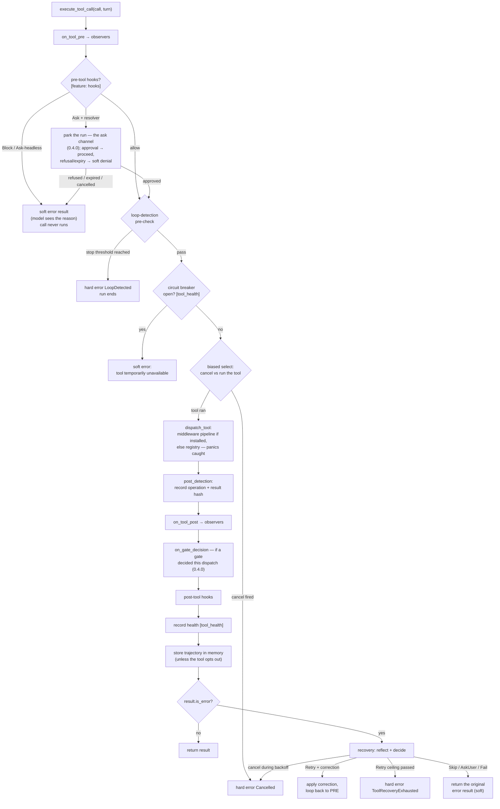

When the model asks "run tool X with input Y", that request travels through a carefully ordered pipeline before and after your tool code runs.

This page covers the whole journey, which lives in `src/engine/bare/dispatch.rs`.

## The per-call pipeline: `execute_tool_call`

One function owns the entire lifecycle of a single tool call. Both dispatch modes, sequential and parallel, use **the same** function. So your observers, detection, hooks, and health fire identically either way.



The diagram has three outcome kinds, and you will meet all of them in your logs.

- **Soft error**: `is_error: true` on an otherwise normal result. The run continues and your model reads the error and adapts. This is the destination for hook blocks, breaker-open refusals, tool errors, panics, unknown tools, and failures that are unrecoverable but not fatal.

- **Hard error**: an `Err(LoopError)` that ends your run, namely cancellation, a detected loop, or exhausted recovery.

- **Success**: the tool's result, recorded everywhere and returned to you.

### The attempt loop, in code order

The diagram above is the shape. Here is the same lifecycle as the code runs it, per attempt, where `attempt` starts at 0:

```text
execute_tool_call(call, turn):
  loop:
    notify_tool_pre                        (observers: on_tool_pre)
    pre-tool hooks                         (Block/Ask-headless → soft error, return)
    pre_detection                          (pure read of the loop window;
                                            hard stop → soft "dispatch refused" + Err)
    health gate [tool_health]              (allow_request? no → soft "temporarily
                                            unavailable", return)
    biased select!:
        cancel fired                       → Err(Cancelled)
        dispatch_tool(...)                 → the result (panics caught inside)
                                           (the pipeline core checks the cancel
                                            signal BEFORE invoking the tool, so a
                                            pre-cancelled call never starts — the
                                            select is the backstop, not the guard)
    ── the POST phase, in this exact order ──
    post_detection                         (record operation + result hash —
                                            the single write point per invocation)
    notify_tool_post                       (observers, with the result)
    post-tool hooks
    record_tool_health [tool_health]       (success/failure + duration)
    record_tool_memory                     (successful calls only)
    result not an error                    → return it
    recovery_wait_or_return:
        Retry { next_attempt, correction } → attempt = next_attempt
            (> 5 → Err(ToolRecoveryExhausted))
            apply correction, loop — PRE and POST re-fire
        otherwise                          → return the ORIGINAL result, soft
```

Two asymmetries in that ordering are deliberate.

**Detection records before observers fire**, so an observer reacting to a tool result already sees the detection state that includes it.

And **health records under the resolved tool name**, meaning what actually ran after renaming. Your pre-flight gate keys on the requested name, which is the only name that exists before dispatch.

One 0.3.2 guarantee sits under the `select!`. The pipeline's core in `middleware/tool_call.rs` checks the cancel signal before invoking your tool, so a call that was already cancelled when dispatch reached it never starts.

That removes the reliance on `select!`'s branch order, which could poll a side-effecting tool once before the cancel branch won. The biased select above remains the guard for a cancel that arrives while the tool runs.

### What the tool actually receives: `ToolContext`

Your context is built per dispatch as `{ session_id, temp_dir, ..Default::default() }`.

The `temp_dir` is your session's managed scratch at `{tmp}/loopctl-{session_id}/`. It is created lazily and idempotently on first dispatch, so on failure your tools see the process-wide temp dir instead.

It is removed best-effort when the loop drops. So a tool always has a writable scratch directory and never has to create one.

### What memory records about a call

Only **successful** calls are recorded, and lossy by design. Input and result are each truncated to **500 characters**, joined as `"tool={name}; input={…}; result={…}"`, and stored as a `Trajectory` entry.

Memory is for gist, while your audit trail keeps the full text. Store failures are logged and swallowed, because memory must never be why your turn failed.

### The per-call metric

Every settled call emits one `loopctl.tools.calls` event on the `loopctl::metrics` `tracing` target. It carries `tool`, `outcome` (`ok` or `error`), and `duration_ms`.

It is emitted once at the shared exit of the direct-registry and middleware paths. So your retries and both dispatch modes can neither double-count nor miss a call.

It counts every tool, including `Think`, which is why the Think tool's own counter is now deprecated. See [the metric stream](/extensions/observers/).

### Panic isolation

`dispatch_tool` wraps your tool in `catch_unwind`. A panicking tool becomes a soft error reading `"tool 'x' panicked: <message>"`, logged at error level, and it never crashes your run.

This is one half of loopctl's no-panic guarantee. The other half is that the crate's own code contains no panics at all.

### Unknown tool names: two layers

1. **Names never advertised.** Your brain classifies each requested call against the tool list it sent. Unknown names are pre-answered with "tool 'x' is not available" (`is_error: true`) and never dispatched.

2. **Advertised but missing at dispatch time**, for example renamed via middleware. Your registry or pipeline miss produces `Tool not found: x. Available: a, b, c...`. If you install `UnknownToolMiddleware`, it appends "Did you mean 'a'?" using a similarity match with a default threshold of 0.4. See [middleware](/safety/middleware/).

## Recovery: when a tool fails

A failing tool enters the reflect-and-decide loop, which [reflection](/safety/reflection/) covers in full:

1. The **reflector** analyzes the failure, and your default `NoopReflector` marks everything non-recoverable.

2. The **recovery strategy** decides, and the default `ExponentialBackoffRecovery::new(3)` gives up to 3 retries with delays 100ms, 200ms, 400ms, capped at 30s.

3. On `Retry { delay }` with a **correction**, meaning fixed input or a different tool, the correction is applied and the call re-runs. Your full pipeline, PRE and POST included, fires for every attempt.

4. A hard ceiling `MAX_RECOVERY_ATTEMPTS = 5` overrides everything. So the 6th total call fails your run with `ToolRecoveryExhausted`.

Watch out for the default retry count. `NoopReflector` marks every failure non-recoverable, so stock defaults give each tool exactly one attempt. To get retries, install a reflector that judges recoverability, as [reflection](/safety/reflection/) shows.

Also watch that detection counts attempts, not calls. Every retry records into your loop detector, so a flaky tool failing 3 times in a row looks to the detector like a repeating operation.

The detector's result-hash awareness usually saves you, since different error texts are different results. Identical error texts do stack up.

## Sequential vs parallel dispatch

You choose this per-run with `RunConfig.parallel_tool_dispatch`:

| | `Sequential` (default) | `Parallel` |
|---|---|---|
| Execution | one call at a time | concurrency-safe calls run together, up to `max_concurrency` (default 8) |
| Which calls | all | `Tool::is_safe_for_concurrent_execution(input)` says yes; same-`resource_key` calls are split into separate waves |
| Observer view | strictly paired pre/post per call | PREs batch, then POSTs; pair by `tool_call_id`, **not** arrival order |
| Results order | call order | **still the model's requested order** (filled by position) |
| Hard error | first error stops everything | the wave is cancelled; already-finished sibling results in that wave are **discarded** |
| Cancellation | checked between calls | checked at wave boundaries and per call |

Parallel mode falls back to the sequential path when a batch has fewer than 2 calls.

Setting `max_concurrency: 1` makes parallel behave like sequential on the same code path, which is handy when you debug.

## What each result carries

`ToolDispatchResult` is the pipeline's output type:

```rust
pub struct ToolDispatchResult {
    pub tool_call_id: String,        // the model-issued id — the engine stamps this
                                     // AFTER the pipeline, authoritatively
    pub output: ToolContent,         // text or multipart; middlewares may have rewritten it
    pub is_error: bool,
    pub duration: Duration,          // real wall time (memoize hits replay the original's)
    pub resolved_tool_name: String,  // differs from requested when middleware renamed it
    pub display_hint: Option<DisplayHint>,
    pub gate: Option<GateDecision>,  // the decision record when a gate decided (0.4.0)
}
```

The engine stamps `tool_call_id` after the pipeline returns, and it does so unconditionally. So a middleware that returns a stale or fabricated id cannot break the model's call and result pairing.

That covers the case of a cache replaying the first call's id. Tests pin this exact guarantee for you.

**The gate record (0.4.0).** Every gated dispatch emits exactly one `GateDecision` through `on_gate_decision`, ordered `on_tool_pre → gate → on_tool_post` on each dispatch.

It carries the tool, args digest, verdict, rule id and source, reason, and engine-stamped timestamp, which keeps your compositions honest.

A memoize cache hit re-stamps your call id and clears the gate, since a dispatch no gate consulted produces no record.

Stacked permission layers follow a precedence lattice where a deny displaces anything and a rewrite displaces a pass-through. So the record that decided the outcome survives, as [permissions](/safety/permission/) explains.

## The middleware pipeline, in one paragraph

If you install a pipeline through `set_pipeline(builder)`, every dispatched call goes through your layers before reaching the registry core.

Those layers cover timeout, permissions, output caps, caching, verification, and redaction, in **registration order, first registered is outermost**.

The core, `ToolCallMiddleware`, sits innermost and performs the actual registry lookup with panic isolation. The full page is [middleware](/safety/middleware/).

## Gotchas collected here

1. **Every retry re-fires everything**, meaning observers, hooks, detection, and health, per attempt, in both dispatch modes.

2. **`on_tool_call_received` fires once per call**, before any dispatch and including pre-answered unknown tools, while `on_tool_pre` fires per **attempt**. The former carries the input JSON and the latter does not.

3. **A model turn with tools produces two `on_turn_end` events.** One covers the LLM phase and one covers the tool phase, with disjoint durations. The same token counts repeat, since tools do not spend model tokens.

4. **Cancellation during recovery backoff** is honored, because your retry wait is raced against the cancel signal.

5. **The breaker gate keys on the requested name** while health recording keys on the resolved name. They are identical unless a middleware renames tools, and no in-tree one does.

## Related pages

- [Waves](/principles/scheduling-parallel-work/): the planning algorithm behind parallel mode, from scratch.
- [Middleware](/safety/middleware/): the layers between the engine and your tool.
- [Reflection](/safety/reflection/): the recovery loop's brains.
- [Tools](/core-data/tools/): writing the tool itself.
