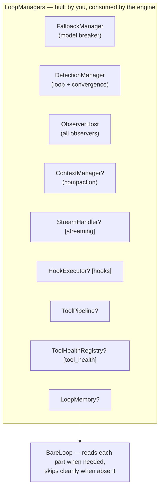

An engine carries a lot of optional equipment. You can attach observers, detectors, a fallback breaker, a compaction manager, a stream handler, hooks, a middleware pipeline, tool health, and memory.

`LoopManagers` in `src/managers.rs` is the box they all go in. It is one struct the engine carries, with one accessor per part. You build the bundle, hand it to the engine, and you are done.

## The picture



Every part marked with a `?` is an `Option`, so it is absent by default.

You can skip all of them. A minimal agent that never calls a `with_*` method runs fine with an empty bundle.

## Building one

```rust
let managers = LoopManagers::new()
    .with_observer(Arc::new(logging_observer))          // appends — see below
    .with_detection(my_detection_manager)
    .with_fallback(my_fallback_manager)
    .with_memory(Arc::new(InMemoryStore::new()))
    .with_stream_handler(StreamHandler::new())          // [streaming]
    .with_hook_executor(Arc::new(my_hooks))             // [hooks]
    .with_health_registry(Arc::new(ToolHealthRegistry::new()))  // [tool_health]
    .with_pipeline(my_pipeline)
    .with_context_manager(Arc::new(my_context_manager))
    .with_ask_resolver(Arc::new(ask_channel));          // 0.4.0 — the ask channel's engine half

let mut agent = BareLoop::new_with_managers(client, tools, config, managers);
agent.with_budget_gate(BudgetGate::new(limits));        // 0.4.0 — engine-side, per loop
```

Or take the simple way. `BareLoop::new(...)` starts with an empty bundle, and you install parts afterward through the loop's own setters, such as `set_memory` and `register_observer`. Those setters write into this same bundle.

Facts about the bundle:

- Fallback, detection, and observers are always present, because they carry defaults. The rest are `Option`s.

- The constructor seeds a compaction manager if your bundle does not carry one. That seed is a `ContextManager` around the default truncating compactor, synced to your `SessionConfig`. Auto-compaction is therefore never on without machinery behind it, and your own manager is never overridden.

- `with_observer` appends. There is no replace-observers call, so hosts accumulate.

- The bundle is not `Clone`, because the engine consumes it by value.

- If you need the same store in two places, clone the `Arc`s for your shareable parts before you build. Memory, the context manager, the health registry, and the hook executor are all `Arc`-wrapped for that reason.

- The 0.4.0 seams ride here too, and the budget gate is installed per-loop with `with_budget_gate`, so accounting stays local to each loop.

## The newer seams

Use `with_ask_resolver` and `with_ask_timeout` for the ask channel's engine half, described in [approvals](/safety/approvals/).

Use `with_clock` and `with_id_gen` for the two determinism seams, covered in the [determinism file reference](/file-reference/determinism/). Those are `Clock` and `IdGen`, and the defaults are the system clock and UUIDs.

Pair a `FixedClock` with a `SeededIdGen` and a run's timestamps and ids become byte-reproducible, which is what you want in a test harness.

The third seam is `Rng`. That is the trait the stream handler draws its jitter through, and it defaults to thread-local randomness.

Budget is different. You install the budget gate per loop with `with_budget_gate`, and it is taken by value, so its accounting is local to each loop.

## Reading it with capability traits

Code that wants to use a bundle without knowing it is `LoopManagers` can narrow to what it needs. The capability traits in `src/capabilities.rs` do that:

- `Observable` for observers.
- `Detectable` for detection.
- `FallbackCapable` for fallback.
- `Compactable` for the context manager.
- `RememberCapable` for memory.
- `StreamCapable` for the stream handler.
- `Hookable` for hooks.
- `PipelineAware` for the pipeline.
- `HealthTrackable` for tool health.

`LoopManagers` implements all nine, and that is the point of the layer. Your generic code asks for `impl Detectable` rather than for the whole world.

### One subtlety about streaming

`StreamCapable::stream_handler()` never returns `None`. An unset handler yields a shared passthrough, which means no retries, no timeouts, and a total timeout that is effectively unbounded.

If you need to know whether a real handler is configured, compare against the passthrough default. The other answer is to always configure one.

## reset_all: the clean slate

`managers.reset_all()` does three things. It resets the fallback breaker to Primary, clears loop and convergence detection state, and calls `reset()` on every observer.

It does not touch memory, hooks, the pipeline, health, the stream handler, or the context manager, and the engine never calls it for you.

Reach for it mid-session when stale state would mislead you. Two examples: after a long outage, or when you switch to an unrelated task.

You can also set `RunConfig { reset_managers: true }`, which triggers the same reset at the start of a run.

## Gotchas

1. The default `FallbackManager` has an empty chain. It counts failures and it trips, but with no backup models configured the routed model never changes. Call `set_fallback_models` for real failover.

2. Default detection thresholds warn at 3 repetitions and stop at 10.

3. Feature-gated accessors vanish without the feature rather than degrading. The `stream_handler` accessor, for instance, exists only under `streaming`.

4. A poisoned lock inside fallback or detection surfaces as `LoopError::LockPoisoned`, both from reset and from the operations that need those locks. After a detection poison the engine goes further and disables detection for the session rather than failing runs.

## Related pages

- [The driver](/engine/driver-loop/) covers who consumes the bundle.
- Each component has its own page: [observers](/extensions/observers/), [hooks](/extensions/hooks/), [memory](/extensions/memory/), [detection](/safety/loop-detection/), [fallback](/safety/fallback/), [compaction](/engine/compaction/), and [stream handler](/core-data/stream-events/).
