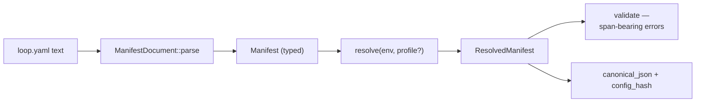

A `loop.yaml` file describes a loop's configuration declaratively: provider, model, budgets, memory, tools. The `manifest` feature (`src/manifest.rs` + `src/manifest/`) is the model around that file — parse, merge, interpolate, validate, hash. It is types and functions only: no IO, no engine wiring — a host (CLI, config loader) reads the file and applies it.

---

## The pipeline — text to resolved config



- **`ManifestDocument::parse(text)`** — YAML into the typed `Manifest`. Syntax errors and shape errors are `ManifestError`s (typed, in `manifest/error.rs`).
- **`resolve(env, profile)`** — two steps in one:
  - **Profile deep-merge** — a manifest can carry base settings plus named *profiles*; resolving with a profile name merges it over the base (maps merge per-key, sequences and scalars replace — the usual deep-merge rules, applied recursively).
  - **`${VAR}` interpolation** — environment references in string values resolve through an `EnvResolver` (the default reads real env vars; `EnvMap::from_pairs([...])` is the injectable alternative for tests). An unresolved variable is a loud error naming the reference, never an empty string.
- **Validation** — semantic checks over the *resolved* result, with **span-bearing errors**: the message names the field and where it came from (which file section / which profile layer), not just "invalid."
- **Schema export** — a JSON Schema for the manifest's own shape (`manifest/schema.rs`, `schemars`-backed), so editors and validators can check `loop.yaml` before loopctl ever sees it.
- **`config_hash()`** — a stable hash over the resolved manifest's canonical form — the identity a daemon or cache keys on ("this loop, exactly this configuration").

## The shape, briefly

```yaml
# loop.yaml — illustrative; the schema export is the authoritative shape
profile: local
provider:
  type: ollama
  model: qwen3:14b
budgets:
  turns: 40
  tokens: 200000
  duration: 30m
memory:
  store: vector
profiles:
  local:
    provider: { model: llama3.1:8b }
```

The `budgets` stanza maps into the [budget gate](/safety/budget-gate/)'s `BudgetLimits` (`cost_usd` deliberately maps to nothing — no price table is consulted, so cost has no line; an unparseable `duration` disables the wall-clock line with a warn rather than guessing).

**The `EnvResolver` seam** is the determinism story for manifests: resolve the same document against an `EnvMap` and the resolved result — and its `config_hash` — is byte-identical everywhere.

---

## Related pages

- [The budget gate](/safety/budget-gate/) — where the budgets stanza lands.
- [Determinism](/file-reference/determinism/) — the seams this module shares.
- [File reference: manifest.rs](/file-reference/manifest/)
