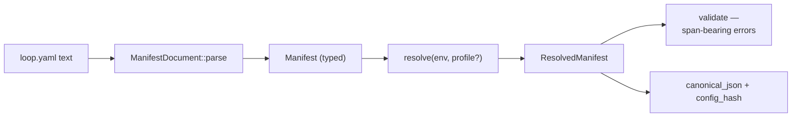

A `loop.yaml` file describes a loop's configuration declaratively: provider, model, budgets, memory, and tools.

The `manifest` feature is the model around that file, and it lives in `src/manifest.rs` plus `src/manifest/`. It parses, merges, interpolates, validates, and hashes.

It is types and functions only, with no IO and no engine wiring, so a host such as your CLI or config loader reads the file and applies it.

## The pipeline: text to resolved config



**`ManifestDocument::parse(text)`** turns your YAML into the typed `Manifest`. Syntax errors and shape errors come back as `ManifestError`s, which are typed and live in `manifest/error.rs`.

**`resolve(env, profile)`** does two steps in one:

- **Profile deep-merge.** Your manifest can carry base settings plus named profiles. Resolving with a profile name merges that profile over the base, where maps merge per-key and sequences and scalars replace. Those are the usual deep-merge rules, applied recursively.

- **`${VAR}` interpolation.** Environment references in your string values resolve through an `EnvResolver`. The default reads real env vars, and `EnvMap::from_pairs([...])` is the injectable alternative for your tests. An unresolved variable is a loud error naming the reference, and never an empty string.

**Validation** runs semantic checks over the resolved result with span-bearing errors. Each message names the field and where it came from, meaning which file section and which profile layer, rather than only saying "invalid."

**Schema export** gives you a JSON Schema for the manifest's own shape from `manifest/schema.rs`, backed by `schemars`, so your editors and validators can check `loop.yaml` before loopctl ever sees it.

**`config_hash()`** returns a stable hash over the resolved manifest's canonical form. That is the identity your daemon or cache keys on for "this loop, exactly this configuration."

## The shape, briefly

```yaml
# loop.yaml — illustrative; the schema export is the authoritative shape
profile: local
provider:
  type: ollama
  model: qwen3:14b
budgets:
  turns: 40
  tokens: 200000
  duration: 30m
memory:
  store: vector
profiles:
  local:
    provider: { model: llama3.1:8b }
```

Your `budgets` stanza maps into the [budget gate](/safety/budget-gate/)'s `BudgetLimits`.

A `cost_usd` key deliberately maps to nothing, because no price table is consulted and so cost has no line. An unparseable `duration` disables your wall-clock line with a warn rather than guessing.

The `EnvResolver` seam is the determinism story for manifests. Resolve the same document against an `EnvMap` and your resolved result, plus its `config_hash`, is byte-identical everywhere.

## Related pages

- [The budget gate](/safety/budget-gate/) is where your budgets stanza lands.
- [Determinism](/file-reference/determinism/) covers the seams this module shares.
- [Manifest.rs, file reference](/file-reference/manifest/) is the source-level detail.
