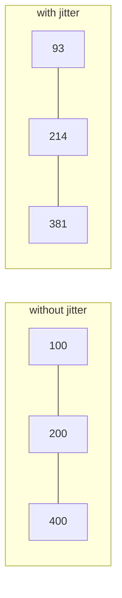

Your networks hiccup. Servers get overloaded. Streams die halfway in the middle of a turn. The question is never whether to retry.

It is when, how many times, and what to do when everyone retries at once.

This page explains the two ideas that answer those questions for you, **exponential backoff** and **jitter**.

It maps them onto loopctl's actual retry ladders.

## Why "retry immediately, forever" is wrong

Suppose your request fails because the server is briefly overloaded. The naive response is to retry at once.

But if a hundred of your clients all failed at once, they all retry at once: a synchronized wall of requests landing on the very server that said "stop".

Each retry fails, each client retries again, and the failure becomes self-sustaining. The names for this are **thundering herd** and **retry storm**.

So your design needs two rules:

1. **Wait between your attempts**, to give the failure time to pass.

2. **Grow the wait**, because every additional failure is evidence your problem is not the millisecond-blip kind.

## Exponential backoff

**Backoff** is rule 1, **exponential** is rule 2. The wait before attempt *n* is:

```text
delay(n) = min( base × 2ⁿ , cap )
```

With loopctl's default stream-transport numbers (base 100 ms, cap 10 s), the ladder is:

```text
attempt 1 → wait  100 ms
attempt 2 → wait  200 ms
attempt 3 → wait  400 ms
attempt 4 → wait  800 ms   ...capped at 10 s
```

Why exponential rather than fixed or linear? Each retry of yours that fails carries information: "the problem outlasted my last wait."

Doubling responds to that information. If the outage lasts 30 seconds, you want your waits to span 0.1 to 10 s in a handful of attempts.

You do not want them crawling there linearly over fifty. And the **cap** exists because the opposite failure mode is worse than stopping.

A client that waits unboundedly is a client that hangs. loopctl's caps are 10 s in your stream-transport ladder.

Then 30 s in your tool-recovery ladder, and 60 s for your rate-limit waits.

## Jitter: breaking the lockstep

Backoff alone has a hidden flaw for you: it is deterministic. Every client of yours that failed at the same moment computes the same schedule of 100, 200, 400.

It continues to arrive in synchronized waves. The waves get smaller, but they stay synchronized.

**Jitter** is random variation added to each of your delays. loopctl's stream ladder multiplies each delay by a random factor in **±10%**:

```text
delay = base × 2ⁿ × (1 + f),   f uniform in [−0.1, +0.1]
```

Your first retry now lands somewhere in 90 to 110 ms, the next somewhere in 180 to 220 ms.

Within a few attempts your herd has smeared across the timeline and the synchronized wave is gone.

Ten percent is enough for that job while keeping the exponential shape clearly visible in your logs.



Without jitter every client marches the same staircase. With jitter, clients smear across the staircase's steps.

## loopctl's ladders, with their numbers

Backoff+jitter appears in four places, each with its own budget and its own job:

| Ladder | Where | Base → cap | Attempts | Decided by |
|---|---|---|---|---|
| **Stream transport** | [stream handler](/core-data/stream-events/) | 100 ms → 10 s, ±10% jitter | 4 (1 + 3 retries) | config, automatic |
| **Rate limit** | stream handler | server's `Retry-After` (or 5 s) → 60 s | 5, then escalate | config, automatic |
| **Tool recovery** | [recovery](/safety/reflection/) | 100 ms → 30 s | ≤ 5 hard ceiling | your `RecoveryStrategy` |
| **Timeout retry** | [timeout middleware](/safety/middleware/) | deadline **doubles** per retry | 1 + `max_retries` | middleware config |

Two structural choices in that table are worth calling out, because they are principles for you, not only settings:

**Rate limits get their own budget.** A 429 ("slow down") is not a transient glitch. It is the server pricing your usage.

loopctl keeps your rate-limit ladder separate from your transport ladder so a rate-limit storm cannot eat the retries you need for genuine network failures.

Nor the reverse. When your rate-limit budget is spent the failure **escalates**.

It becomes a `RateLimitEscalation` that the [fallback breaker](/safety/fallback/) understands, rather than a retry in disguise.

Your ladder also honors `Retry-After`, the server's own "wait this long" header, whenever it is present.

That hint is capped at 60 s. The server knows its load better than any formula.

**Tool retries are yours, model retries are the engine's.** Retrying a model call is cheap and safe: worst case you paid for some regenerated text.

Retrying your tool may charge a credit card twice.

That is why your tool retries route through a pluggable `RecoveryStrategy` that sees each failure and decides retry, skip, ask, or fail.

Model-call retries, meanwhile, are an engine default you can only tune, not per-call arbitrate.

## The formulas, exactly

Every wait in the engine reduces to one of these four lines:

```text
transport:     delay(attempt) = min( base_ms × 2^attempt , 10_000 ms )
               jitter:        delay × (1 + f),  f uniform in [−0.1, +0.1]
                              f = ((rand() − 0.5) × 2) × jitter_factor

rate limit:    delay = min( Retry-After hint if present else 5_000 ms , 60_000 ms )
               — always clamped to the remaining turn deadline

tool recovery: delay(attempt) = min( 100 ms × 2^attempt , 30_000 ms )
               budget = min(strategy.max_retries, 5)      ← two ceilings, first reached wins

timeout retry: current_timeout = current_timeout × 2      ← the deadline itself grows
```

Read the jitter line carefully and you will see it is multiplicative, not additive.

It is plus or minus 10% of a doubling number, so your smear grows with the delay instead of being flattened by it.

Note your timeout middleware's difference in kind too. It does not wait and retry.

It re-runs with a doubled deadline. Your bet is "the tool is slow, not dead," which longer patience can win.

## The transport ladder, step by step

What actually happens when a streaming attempt fails, in order:

1. **Classify.** Was your error retryable at all? `ApiError::is_retryable` says yes for 5xx, timeouts and transport failures, and no for 401, 403 and other 4xx.

2. Not retryable means fail now, one attempt total. **Check the total deadline.** Your whole turn has a wall-clock budget, default 5 min.

3. Blown means skip to your fallback path, step 4's exit, else fail. **Check your attempt budget.**

4. `max_retries + 1` total attempts, default 4. Spent means your fallback path if enabled, else fail. **Otherwise sleep and reconnect.**

5. Your sleep is the jittered `delay(transport_attempts)` clamped to the deadline. Increment your counter and open a fresh stream.

6. Emit `AttemptReset` first so everything buffered from your failed attempt is voided before the retry's fragments arrive.

One special rule sits inside step 2's family for you. An attempt that has produced **zero events** fails after only `min(2, max_consecutive_timeouts)` event timeouts instead of the usual 10.

A connection that has shown nothing has nothing to lose by giving up early.

## The rate-limit ladder, counted

The same shape, different budget, and the server gets a vote:

```text
429/503/529 arrives → count = 1
  count ≤ 3:  sleep min(Retry-After hint, 60s), retry the stream
  count > 3:  ESCALATE — LoopError::RateLimitEscalation { attempts, retry_after }
              → recorded as FailureKind::RateLimit on the model breaker
  count > 5:  hard stop → non-streaming fallback if enabled, else fail
```

Your escalation at count 4 is the interesting rung: it stops retrying this model and reports upward.

Up there the [fallback system](/safety/fallback/) can reroute your turn to another model entirely.

Retrying harder against a service that is explicitly rationing you is never the answer.

Your ladder is built to hand the problem to a different mechanism at exactly the point where more patience stops being creditable.

A worked timeline of both your ladders together: a turn that hits a blip, then a rate limit, with transport budget 4 and rate budget 5:

```text
t=0.00s  attempt 1 → connection reset (retryable, transport)
t=0.10s  sleep ~100ms (jittered)
t=0.10s  attempt 2 → events flow... → 429 with Retry-After: 2
t=2.10s  rate-limit retry 1 → events flow, reply completes → success
```

Cost of your whole incident: about 2.2 s, one transport retry, one honored server hint, zero escalations.

Had the 429 persisted, your retries would land at about t=4.2 and t=6.2, with escalation out at about t=8.2.

From there the breaker takes it, not your ladder.

## What is safe to retry: idempotency

A request is **idempotent** if doing it twice has the same effect as doing it once. Reading your file is idempotent. Generating a model reply effectively is: it costs money and changes nothing.

Charging a payment is **not** idempotent, because the retry itself becomes a new failure.

Backoff schedules assume idempotence. loopctl's defaults respect this asymmetry for you.

Transport-level retries wrap your model requests, which are safe to repeat, while your tool calls retry only when your recovery strategy says so.

That strategy can see your tool's name and input. When you write your own retry logic around side-effecting tools, the question "is this safe to repeat?" must come first.

It comes before "how long should I wait?"

## A worked timeline

A streaming turn hits a brief provider blip (defaults throughout):

```text
t=0.0s   attempt 1 → connection error (retryable)
t=0.1s   wait ~100 ms (jittered)
t=0.1s   attempt 2 → another error
t=0.3s   wait ~200 ms (jittered)
t=0.3s   attempt 3 → events flow, reply completes → success
```

Total cost of your blip: about 0.3 s and two failed attempts. Had both failures been a real outage, your attempt 4 would land at about plus 700 ms.

After that your ladder hands off, either to the non-streaming fallback path or upward as an error.

It never becomes an infinite wait for you. Every ladder in loopctl is finite, and every finite ladder ends by **escalating honestly** rather than dying quietly.

## Related pages

- [Stream events](/core-data/stream-events/): where your transport and rate-limit ladders live.

- [Reflection and recovery](/safety/reflection/): your tool-side ladder.

- [Circuit breakers](/principles/circuit-breakers/): what happens when your retries keep failing, so stop retrying and start probing.
