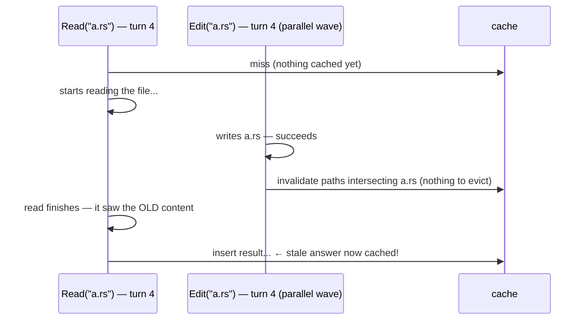
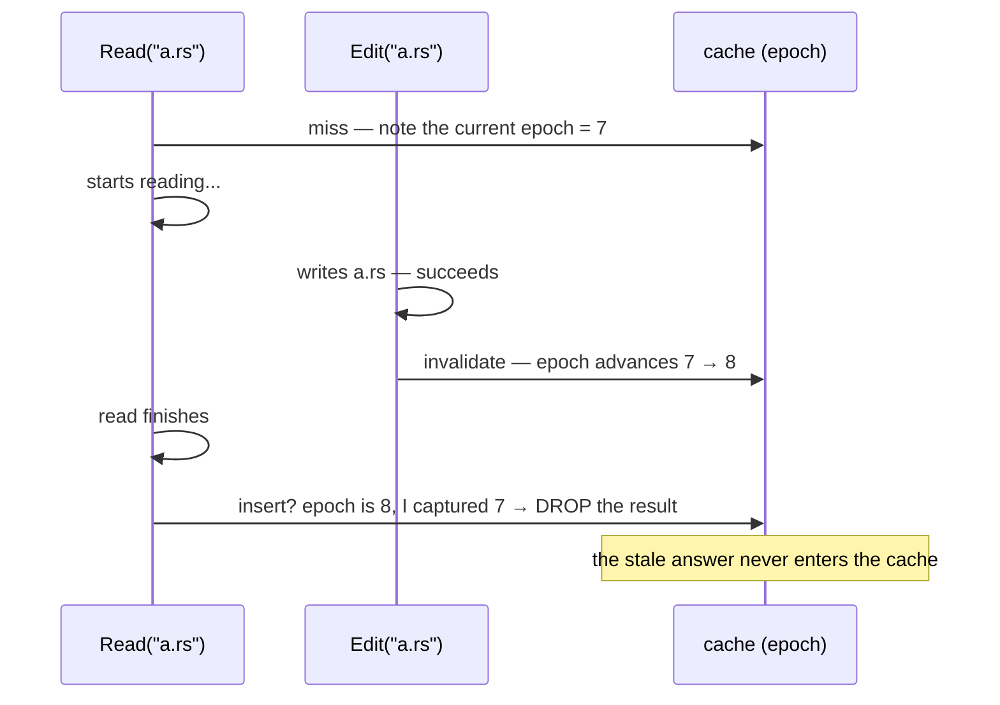
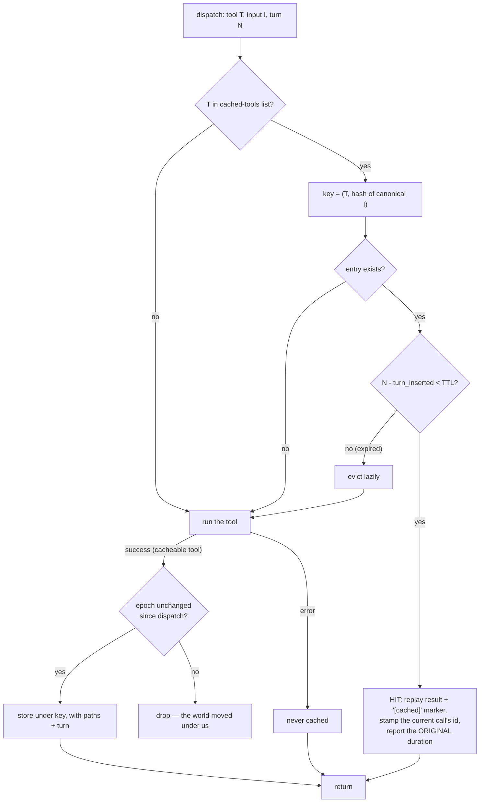

Your agents repeat themselves. A model will read the same file in turn 2 and turn 6, grep the same pattern twice, and list the same directory after every edit.

A **cache** skips your repeated work: remember the answer, replay it.

That is the easy half. The hard half, which is what this page is about, is **forgetting at the right moment**.

A cached answer is only safe while the world it describes has not changed.

loopctl's memoizer (`MemoizingMiddleware`, in `src/middleware/memoize.rs`) is a small, complete example of a cache done carefully.

Every choice in it illustrates a rule you can reuse.

## The two clocks of staleness

A cache entry goes stale in two ways, and each has its own cure:

| Staleness clock | Meaning | Cure |
|---|---|---|
| **Time** | the entry is simply old | **TTL** — "time to live": forget after N units |
| **Events** | something happened that invalidates it | **invalidation** — forget when the world changes |

Time-based forgetting is cheap and blunt. Your TTL does not know what changed, only that enough has happened since.

Event-based forgetting is precise, but only as good as your detection of "the world changed".

Real caches you build will use both. Your TTL catches what your invalidation misses, and your invalidation catches what a TTL would let linger.

loopctl's memoizer measures its TTL in **turns**, not seconds, which is a natural unit for your agents: "how long ago" matters less than "how much has happened since".

A 5-turn TTL means your answer is trusted for the next 5 turns of your run, then re-earned.

## What gets remembered, and what never does

Before any timing question, your memoizer is picky about what enters the cache:

- **Only successes are cached.** An error is not an answer. It is a report that the world was in a certain state.

- Retrying a failing call of yours is cheap and might succeed, and caching the failure would freeze it.

- **Write-tool results are never cached.** A write's value is its effect, not its text, and its effect is to evict things.

- See the write rule below. **Only tools you name are cached.** You declare your cached tools (`Read`, `Glob`, `Grep`) and your write tools (`Write`, `Edit`) explicitly.

- Nothing in your cache is there by accident.

## The key: canonical form

Your cache answers "have I seen this question before?", which requires two phrasings of your same question to produce the same key.

The memoizer's key is:

```text
key = ( tool name,  hash of the input JSON in canonical form )
```

**Canonical form** means one agreed spelling for every equivalent input. Here your trick is almost free: the JSON serializer stores object keys in sorted order.

So `{"path":"a.rs","line":1}` and `{"line":1,"path":"a.rs"}` serialize to identical bytes and hash to your same key.

Same question, cache hit. Hashing shrinks your input to one number, the same fingerprinting idea as [loop detection](/principles/measuring-repetition/).

The free-ness has a price tag for you: it depends on your serializer's key ordering.

Turning on serde_json's `preserve_order` feature anywhere in your dependency graph would make the two spellings hash differently. That means silent cache misses, never wrong answers, but your cache quietly stops working.

### The rules, precisely

The moving parts, in the middleware's own terms:

```rust
struct CacheEntry {
    result: ToolDispatchResult,   // only ever a success (is_error == false)
    turn_inserted: usize,         // when it was earned
    paths: Vec<String>,           // what the PathExtractor says it touched
}

// freshness — integer turn arithmetic, no clock anywhere:
expired  ⇔  current_turn.saturating_sub(entry.turn_inserted) ≥ ttl_turns
//            ttl 0 caches nothing; 1 expires on the turn after insertion
```

On a **hit**, four things happen for you, three of which are anti-footguns:

1. Your `[cached]` marker is appended, as `"\n[cached]"` onto a Text result. Or a new `" [cached]"` text part is pushed into a Multipart one, so your model knows it is reading a replay.

2. The result is **re-stamped with your requesting call's id**: a replay must answer the call you are making now, not the call that populated the cache.

3. The **original call's duration is reported**, not ~0, so [health statistics](/safety/tool-health/) keep measuring your real tool instead of discovering an impossibly fast one.

4. Your inner pipeline is skipped entirely. That is the point.

On an **insert**, one guard runs, the epoch check below, and one invariant holds always for you: the lock is never held across the inner dispatch.

So a slow tool cannot block your cache reads for every other call.

## Invalidation: the write rule

The event half. A `PathExtractor` you supply declares, per call, **which files your tool touches**. Then one rule drives everything for you:

**After a successful write, evict every cached entry whose paths intersect the write's paths.**

A write to `src/main.rs` throws out your cached `Read` of `src/main.rs` (and of anything else your extractor says that write touched).

Two subtleties make your rule safe in practice:

- **A failed write invalidates nothing.** Your filesystem did not change, so your old answers are still true.

- **Matching is exact string equality**: no globs, no prefixes. So your extractors should over-return paths.

- Naming extra paths costs you a few harmless extra evictions, while missing a path costs **staleness**, a wrong answer served as truth.

- Over-erase is always safe for you, and under-erase never is.

## The epoch guard: closing the race

One race survives the rules above, and it is worth seeing in slow motion because it is the classic cache bug:



The read started before your write and finished after the invalidation, so its result describes the pre-write world. It enters your cache after the eviction that was meant to kill it, and would then survive until your TTL expires.

Your memoizer closes this for you with an **epoch counter**, a number that advances on every invalidation:



Capture your epoch when your work starts, and refuse to insert if it moved while you worked.

Three lines of code, and the window where staleness can slip into your cache closes completely.

## A session, cached turn by turn

All of the above in one concrete sequence: cached tools `Read`/`Glob`, write tools `Write`/`Edit`, TTL 5 turns:

| Turn | Call | What the cache does | Why |
|---|---|---|---|
| 2 | `Read("src/main.rs")` | miss → run → **insert** (key: `("Read", hash("src/main.rs"))`, turn 2, paths `["src/main.rs"]`) | first earn |
| 3 | `Read("src/main.rs")` | **hit** — replayed with `[cached]`, this call's id, the original 340 ms | 3 − 2 = 1 < 5, still fresh |
| 4 | `Edit("src/main.rs")` succeeds | run (writes are never cached) → **evict** the turn-2 entry | paths intersect `src/main.rs`; epoch 7 → 8 |
| 5 | `Read("src/main.rs")` | miss → run against the *new* content → insert (turn 5) | the eviction worked — no stale answer |
| 5 | `Read("src/main.rs")` again, same turn | **hit** — fresh entry, replayed | 5 − 5 = 0 < 5 |
| 9 | `Read("src/main.rs")` | **hit** — the turn-5 entry is replayed; it expires at turn 10 | TTL arithmetic: 9 − 5 = 4 < 5 |
| 12 | (nothing) | entries from turn ≤ 7 are all expired on sight | lazy eviction: removed when a lookup touches them |

Two things for you to notice: the edit at turn 4 is what keeps your cache correct, while your TTL is what keeps it bounded.

Remove either and the other's failure mode eventually bites you. And nowhere in the table does a clock appear: "when" is always a turn number for you.

## The full decision, end to end



Details on that diagram worth pausing at:

- **Eviction is lazy.** Your cache has no background timer sweeping expired entries. A stale entry is removed when your lookup touches it.

- That is simpler, and the cost lands where your benefit is.

- **A hit re-stamps the call id.** Your model pairs calls to results by id.

- A replayed answer must answer this call, not the original one.

- Your engine stamps ids authoritatively after the pipeline anyway, so this is belt and suspenders for you.

- **A hit replays the original duration.** Your first read took 900 ms, so the hit reports 900 ms rather than 0.

- That way [health statistics](/safety/tool-health/) keep tracking real latency instead of discovering an impossibly fast tool.

- **No capacity limit.** Your cache grows with distinct (tool, input) pairs until entries expire. For your long sessions the fix is a shorter TTL, not hope.

## The principles, compressed

1. **Storing is easy. Forgetting is the design.** Your TTL covers time, your invalidation covers events, both together.

2. **Only facts worth freezing enter your cache:** successes, read-only, declared tools.

3. **Canonical keys or no hits.** Two spellings of your one question must hash the same.

4. **Your invalidation may over-fire, never under-fire.** Extra evictions are cheap, staleness is corruption.

5. **Your races need epochs.** "Checked before, inserting after" needs a guard, not good intentions.

## Related pages

- [Middleware](/safety/middleware/): your memoizer's configuration and pipeline position, innermost beside the core.

- [Parallel tool calls](/principles/scheduling-parallel-work/): the parallel execution that creates your epoch race in the first place.

- [Windows, averages, and similarity](/principles/measuring-repetition/): the same fingerprint-hashing idea used for repetition instead of caching.
