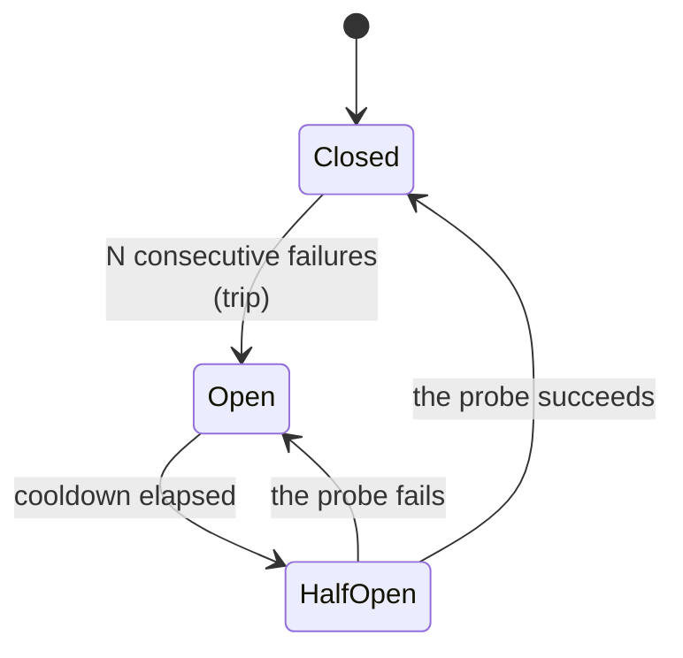

Your retries answer "the last call failed, so try again?"

But retries have no memory: call number 500 into a dead service gets exactly the same eager retry as call number 2.

A **circuit breaker** adds that memory. After enough consecutive failures it decides to stop calling for a while, and later, carefully, tests whether the thing came back.

The name comes from your electrical panel: when a circuit draws too much current, the breaker **trips** and cuts the flow to protect the wiring.

Flipping it back on immediately would re-trip it again, so you fix the fault first and then reset. The software pattern, an old and industry-standard one, copies the whole dance.

## The three states

Every circuit breaker you install, loopctl's included, is a three-state machine:



- **Closed** means your circuit is complete: normal life. Calls flow and failures are counted. One success resets your failure count.

- This is where every breaker of yours starts, and where a healthy system stays. **Open** means tripped. Your calls are **refused without being attempted**.

- This is the entire point: failing fast instead of hanging on a call that was going to time out anyway. A cooldown clock starts.

- **Half-open** is your experiment. After the cooldown, the breaker lets **exactly one** of your calls through as a probe.

- If the probe succeeds, the breaker closes and normal life resumes for you. If it fails, the breaker opens again with a fresh cooldown.

Why is the probe a single call? If the service is still down and you let all your traffic probe it, you have rebuilt the thundering herd the cooldown had cured. One cautious request, then decide.

## Why this is more than "retry with extra steps"

Compare the two policies against a 5-minute outage for you, with a 2-minute timeout per call:

| | Plain retries | Breaker |
|---|---|---|
| Call during outage | attempts, hangs 2 min, fails, backs off, attempts again... | refused **instantly** |
| Cost while broken | every caller burns timeouts and backoff budget | one refusal message |
| Recovery after fix | traffic was still hammering. First retry succeeds, fine | one probe confirms, then full traffic resumes |

Your breaker's value is the **open** state: converting slow failures into fast ones, for everyone, until there is evidence the target is healthy again.

The probe is your evidence-gathering step. Recovery must be proven, not assumed.

A single lucky success amid an outage would otherwise slam the door open and re-trip everything you rely on.

## loopctl has two breakers

Same pattern, two granularities for you:

| | Model breaker ([fallback](/safety/fallback/)) | Tool breaker ([tool health](/safety/tool-health/)) |
|---|---|---|
| Protects | the *model* connection | each *tool* individually |
| States | `Primary` / `Fallback` / `Recovering` | `Closed` / `Open` / `HalfOpen` |
| Trips after | 3 consecutive failed turns | 3 consecutive failed calls |
| While "open" | requests route to a **backup model** (the fallback chain) | calls are **refused** with a soft error |
| Cooldown | 60 s | 30 s |
| Closes after | 2 probe successes | 1 probe success |

Your model breaker's "open" is softer in effect. It does not refuse your run, it reroutes, but the skeleton is identical: consecutive-failure trip, cooldown, careful probe, proven recovery.

Its half-open is called `Recovering`, and its trip routes to a chain of backups. Each of them gets its own limited failure budget of 2 strikes before your chain advances on.

When the whole chain is spent and the cooldown has not elapsed, your run fails honestly with `FallbackExhausted`.

## The subtle rules, and the reasons

Three breaker behaviors look odd until you see the failure they prevent for you.

**1. A success arriving while open is ignored.** A call that succeeded was started before the trip, so it describes the pre-breakage world.

Letting it close your breaker would re-open the floodgates on stale evidence. Only the probe's verdict counts.

Compare a thermometer that worked yesterday: it does not prove today's fever is gone.

**2. Half-open refuses everyone but the probe, and the probe has a lease.** If your probe call vanishes, cancelled or dropped as a task, a naive breaker waits in half-open. It sits there wedged.

loopctl's probe carries a **lease** of 30 s, and yours needs one too. When it expires, the breaker re-arms as if your probe failed, with a fresh cooldown, so a lost probe cannot strand your machine.

**3. A failure arriving while open restarts the cooldown clock.** It is fresh bad news about the present rather than history, so your wait to probe again should count from now.

One loopctl-specific rule sits on your model breaker: a **rate-limit** failure during a recovery probe re-trips instantly, because your provider is explicitly saying "no more load".

A transient failure, by contrast, resets the probe's success streak and keeps probing patiently.

## Every transition, with its side effects

State diagrams show the moves. The side effects are where your semantics live. Here is the model breaker (`Primary / Fallback / Recovering`):

| Transition | Trigger | Side effects beyond the state flip |
|---|---|---|
| `Primary → Fallback` | 3rd consecutive failed turn (`trip_threshold`) | `fallback_activated` set (sticky "ever tripped"), cooldown clock starts, **both counters zeroed** (the failure streak is now the fallback's problem), `on_fallback` fires with from/to |
| `Fallback → Recovering` | before a turn: `elapsed ≥ 60s` (`recovery_timeout`) | `primary_success_count = 0` — the probe starts with a clean slate |
| `Recovering → Primary` | 2nd probing success (`recovery_successes_needed`) | everything zeroed, cooldown clock cleared — **and every chain entry's failure count cleared too**: a recovered primary means the backups get a fresh chance as well |
| `Recovering → Fallback` | a *rate-limit* failure during the probe | immediate re-trip — the provider explicitly said "no more load" |
| `Recovering` (no move) | a *transient* failure during the probe | only `primary_success_count = 0`; **probation continues** — one blip doesn't waste the cooldown already paid |
| `Primary` (no move) | any success | `consecutive_failures = 0` |

Your per-tool breaker (`Closed / Open / HalfOpen`) has the same shape with more forensic rules:

| Transition | Trigger | Side effects |
|---|---|---|
| `Closed → Open` | 3rd consecutive failure (`failure_threshold`) | `last_failure_time = now`. The probe slot is cleared |
| `Open → HalfOpen` | a call arrives and `elapsed(last_failure) ≥ 30s` (`recovery_duration`) | `probe_started_at = now` — **the caller that asked is the probe**, granted the single slot |
| `HalfOpen → Closed` | the probe succeeds (lease still live) | counters zeroed — recovery *proven* |
| `HalfOpen → Open` | the probe fails | cooldown restarts from this failure |
| `HalfOpen → Open` | the probe's **lease expired** (30s, `probe_timeout`) | `last_failure_time` *backdated to the lease's end* — a vanished probe counts as failed from when it should have answered |
| `Open` (no move) | a success arrives | **ignored** — it was started before the trip. It describes the pre-breakage world |
| `Open` (no move) | a failure arrives | `last_failure_time = now` — fresh bad news restarts the wait |

The backdating in the lease row is the detail worth sitting with. Without it, an expired lease would either strand your breaker half-open forever, a wedge, or restart the cooldown from now.

That hands your dead tool 30 free seconds per probe. Anchoring to the lease end makes your timeline honest.

## Chain arithmetic: how backups spend out

Your fallback chain is a list of entries, each with its own small budget:

```text
entry.failed()  =  manually disabled  OR  attempt_count ≥ max_fail_count (default 2)
routing         =  active_model = the FIRST entry that is not failed
a failed turn while in Fallback  →  the active entry's attempt_count += 1
```

So a flaky backup of yours gets two strikes, its own failed turns, then routing advances to the next entry on the following turn.

Your breaker trips within the chain, per entry, on top of the primary-level breaker.

`FallbackExhausted` is the exact conjunction of three facts, checked at the top of every one of your LLM turns:

```text
state == Fallback                    // the breaker is tripped
AND active_model() == None           // every chain entry is failed
AND !fallback_models.is_empty()      // there WAS a chain to spend
→ LoopError::FallbackExhausted       // fail rather than retreat to the known-bad primary
```

The third clause matters to you: a manager with no chain configured never produces this error. It trips, but keeps serving your primary, because the trip state is bookkeeping rather than an outage.

## Reading without consuming

Your tool breaker offers two APIs that agree at every instant but differ in one dangerous way. `allow_request(name)` is the mutating gate: calling it in `HalfOpen` may grant you the single probe slot.

`would_allow_request(name)` is a pure oracle that answers your same question without touching anything. Your dashboards and availability checks use the pure one.

A telemetry poll of yours that used the mutating gate would eat the probe, and the actual recovery test would be refused as "already probing".

Two functions, one invariant, and no way for you to accidentally spend the slot from the bleachers.

## Refuse softly

Both of your breakers report their refusals as **soft errors** your model can read: *"tool temporarily unavailable: circuit breaker open"*. Your run continues, and your model routes around the sick tool or waits.

A breaker that crashed your agent to protect it would be trading one failure for a worse one, so see [soft and hard errors](/principles/soft-and-hard-errors/) for the principle.

For your tools, refusal is not even the only policy: the `HealthRouter` can substitute a healthy backup tool instead.

## Where breakers sit relative to retries

The two mechanisms compose in time:

```text
call fails → [retry ladder: backoff + jitter]  — handles TRANSIENT failures
                 ↓ keeps failing
             [breaker trips]                   — handles SUSTAINED failures
                 ↓ cooldown, then
             [one probe]                       — tests RECOVERY
                 ↓ success
             [breaker closes]                  — normal life resumes
```

Retries are optimism at millisecond scale, and breakers are pessimism at minute scale. You need both of them in that order, so see the [previous page](/principles/backoff-and-jitter/) for the optimism half.

## Related pages

- [Fallback](/safety/fallback/) and [tool health](/safety/tool-health/): your two real breakers, in full detail.

- [Backoff and jitter](/principles/backoff-and-jitter/): what happens before your breaker gets involved.

- [State machines](/principles/state-machines/): the pattern both of your breakers are instances of.
