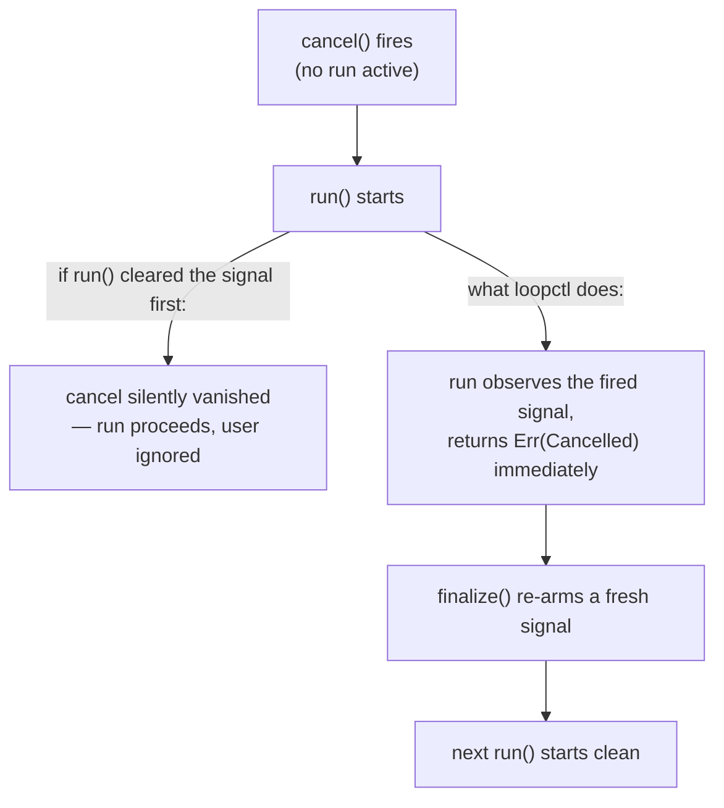

An agent run can be told to stop at any instant. The user hits Ctrl-C, a watchdog times out, or a UI button says "abort". There are two ways for a program to honor that:

- **Preemptive**: someone kills the work from outside, mid-sentence, whether it is ready or not.

- **Cooperative**: a shared flag is raised, and the work itself checks that flag at agreed points and exits cleanly.

loopctl is built entirely on the second. This page covers why cooperative is the right model for your agents, how your signal works, and what "cooperative" demands from you as a tool author.

## Why not kill it outright?

Preemptive stopping is fast but blind. Your agent mid-run is often holding something half-done. It may be a tool that has written half a file, or a request that has charged an API and not recorded the answer.

Or a conversation with a tool call whose result never arrived.

Killing at a random instruction can leave all of those broken, and silently so.

Cooperative cancellation moves the decision to somewhere safe. Your run keeps executing until it reaches a **checkpoint**, a moment between actions where nothing is half-done, and exits there.

You lose "instantly, in the middle of anything". You gain "always at a clean boundary, and within milliseconds anyway".

There is also a Rust-specific reason the question comes this way: async Rust has no preemptive kill for your tasks. An async task runs only while it is being polled.

Your runtime can drop a future, which abandons it at its next `await` point, but it cannot stop one mid-computation. Cooperative checkpoints are therefore not a design preference.

They are the only design your execution model offers. loopctl's job is to place enough of them that the practical difference vanishes for you.

## The signal, and why not a plain bool

Your flag is `CancelSignal` in `src/cancel.rs`. It is shareable as an `Arc` and wraps tokio's `CancellationToken`. The obvious hand-rolled version, an `Arc<AtomicBool>`, has a classic race you would hit:

```text
worker:  if flag.is_cancelled() { ... }        // check: not cancelled
                                                // ← cancel() fires HERE
worker:  await something_that_takes_10s();     // act: starts waiting anyway
```

The check and the wait are two steps, and a cancel landing between them is missed until your wait finishes. A `CancellationToken` closes that gap by construction.

Checking "is it fired?" and waiting "wake me when fired" are two views of the same primitive. So a cancel you raise at any instant wakes every current and future waiter immediately.

Two deliberate semantics sit on top for you:

- **The signal is one-shot.** Once fired, it stays fired. There is no "un-fire", because two of your tasks disagreeing about whether a fired signal is live is exactly the race you are avoiding.

- **So `reset` swaps in a brand-new token.** Re-arming for your next run replaces the fired token with a fresh one, observed by everyone through the same shared handle.

- A task of yours still awaiting the old token resolves against it correctly.

### The type, inside

```rust
pub struct CancelSignal {
    inner: Mutex<CancellationToken>,    // tokio_util's purpose-built primitive
}
```

Method by method, here is what each of them actually does for you:

| Method | Behavior | The detail that matters |
|---|---|---|
| `cancel()` | fires the token — **idempotent**, wakes every current and future waiter | a poisoned lock is force-recovered: a panicking holder can't brick the signal |
| `is_cancelled()` | non-blocking poll | for checks at checkpoints |
| `notified().await` | clones the token out under the lock (held only for the clone), then awaits the clone | the clone-and-await is the race-freedom: a cancel fired any time before or during your await resolves it |
| `reset()` | swaps in a **brand-new** token | "un-firing" is not an operation that exists |

## The checkpoints, where the flag is honored

Your engine checks the signal at every granularity where your work can get stuck. "Biased" in the table below means the cancel check is polled first: if the signal is already fired, the competing work never even starts.

| Where | What happens on cancel |
|---|---|
| Before each model call | the turn is never sent, giving you instant `Err(Cancelled)` |
| During a model call (non-streaming) | the request future is dropped at its next await |
| During streaming | every event poll races the signal, so you exit mid-stream |
| During a tool call | the tool's future is dropped at its next await |
| Between tools / between parallel waves | next call never starts |
| During recovery backoff sleep | the sleep is abandoned, no retry starts |

The exhaustive map, for when you are reasoning about a specific hang of yours. Every place the signal is consulted, and what each check returns to you:

| # | Call site | Mechanism | On cancel |
|---|---|---|---|
| 1 | turn entry (`do_turn`) | early guard | `Err(Cancelled)`, provider untouched |
| 2 | non-streaming request | biased 3-way `select!` | request future dropped at its await |
| 3 | streaming, per event poll | `select!` racing `stream.next()` and both deadlines | mid-stream exit, no further events read |
| 4 | streaming, gate and backoff sleeps | cancel-aware sleeps | the wait is abandoned |
| 5 | non-streaming fallback rescue | biased `select!`, checked on entry | the rescue is never sent |
| 6 | sequential dispatch, between calls | poll before each call | the next call never starts |
| 7 | parallel dispatch, wave boundaries | poll at each wave top | remaining waves never start |
| 8 | a single tool call | biased `select!` vs the tool future | **the future is dropped mid-flight** |
| 9 | recovery backoff sleep | biased `select!` vs the sleep | no retry starts |
| 10 | pipeline level (`dispatch_all`, the timeout layer) | checks before/after each call; layers race the signal | partial batches are discarded |

Rows 2, 3, 5, 8 and 9 are races: your cancel wins instantly, mid-work. Rows 1, 6, 7 and 10 are polls: the next unit of your work never begins.

Nothing else in your engine waits indefinitely without falling into one of these rows. That invariant is what makes "how fast does a cancel land?" answerable for you: at worst, one event poll or one await point.

The result lands on your run's record as `Cancelled`, which is not `Failed`. A cancel you asked for is an expected, healthy outcome for an interactive program.

Your brain records it as its own terminal state and salvages the coherent prefix. Since 0.4.0 completed turns commit, so a half-finished exchange is dropped rather than your whole conversation.

The overflow family stays the discard-whole exception. Your run is logged with stop reason cancelled, so your telemetry can tell user stops from malfunctions.

## One cancel = exactly one cancelled run

The signal re-arms **at the end of the run** (inside `finalize()`), not at the start. Order matters:



Re-arming after the run observes and reports the cancellation means your cancel is never silently swallowed. One firing always produces exactly one cancelled run for you, and then your signal is fresh.

Two precision notes that the guarantee rests on:

- **A cancelled turn is not recorded as a model failure.** When your error path sees `Cancelled`, it short-circuits before failure bookkeeping. Your [fallback breaker](/safety/fallback/) is not fed, and no stream-failure event fires.

- A user changing their mind must not trip your circuit breaker. That is what real errors are for.

- **The token swap has exact semantics for stragglers.** A task of yours already awaiting the old token still resolves against it, and it was cancelled, correctly.

- Anything you ask after the swap sees the fresh, unfired signal. No waiter of yours can observe a half-reset state, because there is never a moment when the signal is both.

## What this asks of you

Your engine controls its own checkpoints, but your tools are the part of the system it cannot see inside. When a cancel lands mid-tool, your engine drops the tool's future.

Execution stops at your next `await`, and cleanup code after it does not run. Here is the practical contract for you as a tool author: **write tools that are safe to abandon at any await point.**

- Land writes atomically: write to a temp file, then `rename` it into place. A rename is atomic, while a half-written file is not.

- Prefer idempotent side effects for anything of yours reaching other systems. Idempotent means "did it twice" equals "did it once".

- Do not hold invariants across awaits that a drop would strand, such as an open lock or a half-sent batch.

The same contract applies to you through [MCP](/integration/mcp/). The server adapter races each remote call against the token and drops in-flight calls on cancel.

Cancellation can also come from inside your system. Anything holding the `Arc<CancelSignal>` can fire it: an [observer](/extensions/observers/) deciding this is going nowhere, or a [hook](/extensions/hooks/) enforcing your policy.

The next checkpoint picks it up, and that is almost always milliseconds away.

## The pattern

| Property | Choice | Reason |
|---|---|---|
| Stop model | cooperative, not preemptive | exits happen at clean boundaries; async Rust allows nothing else |
| Signal | one-shot token, not a bool | check-then-wait races are impossible by construction |
| Re-arm | swap a fresh token, after each run | one cancel = one cancelled run, never swallowed |
| Checks | biased, cancel polled first | your cancellation always wins the race |
| Mid-tool | future dropped at next await | tools must be safe to abandon |
| Outcome | `Cancelled` ≠ `Failed` | a user stop is not a malfunction |

## Related pages

- [Cancellation](/engine/cancellation/): the full mechanism page (API, wiring, tests).

- [Termination](/engine/termination/): where `Cancelled` sits among your other endings.

- [Backoff and jitter](/principles/backoff-and-jitter/): the other place "time" enters your engine's decisions.
