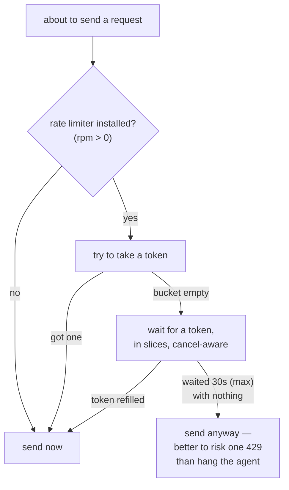

Your model provider meters you: so many requests per minute, and a pointed error (HTTP **429**, "too many requests") when you exceed it.

A client of yours that ignores the meter gets throttled, then slowed further, then cut off.

**Rate limiting** is the discipline of spending requests at a rate your provider will accept.

Do it proactively, before the 429, and reactively, once the server has spoken.

loopctl gives you both layers, and this page explains the machinery of each.

## The token bucket

The classic rate-limiting algorithm, and the one your loopctl uses (`src/stream/rate_limit.rs`), models a **bucket of tokens**:

- Your bucket holds up to **C** tokens, its capacity.

- Every one of your requests **takes one token**. No token, no request.

- Your tokens **refill continuously** at rate **r** per second, up to the brim, never beyond.

Two knobs, two behaviors for you:

```text
capacity C  →  BURST: how much you can do back-to-back right now
refill r    →  SUSTAINED: how much you can do forever
```

Worked example for you, using the default constructor's shape of 60 requests per minute: C = 60 tokens, r = 1 per second.

```text
t=0:00  bucket full (60) → fire 20 requests → 40 left
t=0:10  refilled +10 → 50 left → fire 30 → 20 left
t=0:30  refilled +20 → 40 left...
sustained rate: forever, 1 request per second;
               never more than 60 in any single burst from empty.
```

Your bucket is a savings account. It lets you save up capacity for a burst, then re-earns it at a fixed wage.

Compare the naive alternative, "at most 1 request per second", which forbids legitimate bursts and wastes capacity you have earned but not spent.

**The lazy-refill trick.** An obvious implementation runs a background task dripping tokens into your bucket. loopctl does it with no timer at all.

Each `take()` of yours looks at the wall clock, computes how much time elapsed since the last refill, adds `elapsed × r` tokens capped at C, and updates the bookmark.

The math is identical, and your moving parts are zero. One refinement: when your bucket is full, the bookmark only advances to the moment it became full.

Tokens you could not have stored were never yours.

## The bucket, computed

Your `take()` in pseudocode, the entire algorithm including the fill-point refinement:

```text
take():
    now      = clock()
    elapsed  = now − last_refill
    tokens   = min(tokens + elapsed × (capacity / 60), capacity)   # lazy refill
    if tokens == capacity:
        last_refill = the moment it reached capacity               # ← the refinement:
    else:                                                          #   tokens you couldn't
        last_refill = now                                          #   store were never yours
    if tokens ≥ 1:
        tokens −= 1
        return Ok
    else:
        return Wait(time until the next whole token)
```

Why the refinement matters: without it, a bucket that sat full for an hour would bank that hour of refills it never needed.

"Refill rate r" would silently become "refill rate r, plus whatever accumulated while idle."

Anchoring `last_refill` to the brim moment means your idle time earns nothing, exactly as the contract of capacity C burst and r sustained promises.

loopctl's concrete numbers: `RateLimiter::new(rpm)` gives each of your provider base URLs its own bucket with `capacity = rpm`, starting full.

`rpm = 0` disables your limiter entirely, so every `take` succeeds.

## The proactive layer: waiting before you fire

loopctl keeps one bucket per provider base URL, so your different providers get separate budgets, behind a `RateLimiter`. Your stream handler consults it before every attempt:



That last arrow is a philosophy, not an accident for you. Client-side limiting is throttling yourself politely, and it must never become deadlocking yourself.

Your wait is bounded by `rate_limit_max_wait`, default 30 s, and it is cancellation-aware. Past the bound your request goes out and takes its chances.

## The reactive layer: listening when the server speaks

Prevention is a guess. Your server's answer is a measurement. When a 429 still arrives, or a 503 or 529 overloaded, which get the same treatment, your [stream handler](/core-data/stream-events/) switches to the reactive ladder:

1. **Honor `Retry-After`.** Your response usually carries a header saying exactly how long to wait. That hint wins over any formula, because the server knows its own load.

2. Your wait is capped at 60 s so a hostile or broken hint cannot freeze your agent.

3. **Retry with the hint as the delay**, up to `fallback_after_retries`, default 3, times.

4. **Escalate.** Still limited after 3 tries, your failure becomes `RateLimitEscalation` and is reported to the [model circuit breaker](/safety/fallback/), which can reroute the whole turn to a backup model.

5. Deliberately, this does not silently retry the same model unstreamed. A rate limit is charged against your model's quota no matter how the request travels.

6. **Hard stop** after `max_retries`, default 5.

### The reactive ladder, counted precisely

The numbered flow above hides three exact rules worth having on record for you.

**Detection: what counts as "rate limited."** Three shapes, in order of trust. The structured `ApiError::RateLimit` variant, parsed from your response and carrying its `Retry-After`.

An `Api` error whose text contains "rate limit" or "429". An `Http` error with status 429, or 503/529 classified as Overloaded rather than plain rate limiting.

Your server is drowning rather than rationing, so it gets the same treatment with a different label for your dashboards.

**Delay: how the hint is honored.** `Retry-After` is parsed as delta-seconds, and as an HTTP-date when you build the `providers` feature on, then reduced to `min(hint, 60 s)`.

The cap is what keeps a hostile or broken hint from freezing your agent. With no hint at all your default is 5 s.

Every wait of yours is additionally clamped to the turn's remaining total deadline.

**Escalation: the exact rungs.** Your retries 1 to 3 honor the hint. The 4th rate-limit failure escalates, as `RateLimitEscalation { attempts, retry_after }`, recorded on your model breaker as `FailureKind::RateLimit`.

Past the 5th comes a hard stop, then the non-streaming fallback if you enable it, else failure.

Note what never happens: a same-model retry disguised as a fallback. A rate limit is charged against your model's quota however the bytes travel, so your only honest moves are wait, escalate, or switch models.

## Why two layers

The layers answer different questions and fail differently:

| | Proactive (token bucket) | Reactive (`Retry-After` ladder) |
|---|---|---|
| Acts | *before* the request | *after* the refusal |
| Knows | your configured rate | the server's actual state |
| Prevents | most 429s | damage from the ones that happen |
| Failure mode if wrong | you under-use your quota | you back off as told |

Keep both and each covers the other's blind spot. The same two-layer shape, prevent then adapt, recurs across your loopctl: timeouts with retries, health scores with circuit breakers, threshold compaction with the emergency line.

One accounting note: your rate-limit retries have a **separate budget** from transport retries, which cover network blips and 5xx.

A storm of 429s cannot consume the patience you need for genuine network failures. See [backoff and jitter](/principles/backoff-and-jitter/) for the other budget.

## Related pages

- [Stream events](/core-data/stream-events/): where both your layers are wired.

- [Backoff and jitter](/principles/backoff-and-jitter/): the retry math your reactive ladder uses.

- [Circuit breakers](/principles/circuit-breakers/): where your rate-limit escalation lands.
