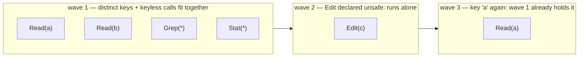
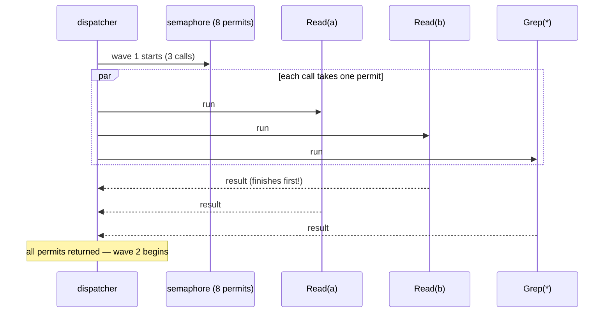

When your model replies with several tool calls in one turn, running them in parallel can turn five seconds of wall clock into one.

But two of those calls might write the same file, and running them together corrupts it. Whatever happens, your results must come back in the order the model asked for them, because providers require every tool call to be answered in place.

loopctl's parallel dispatcher has two phases. A pure **planning** phase groups your calls into **waves**, where every call in a wave is safe to run at the same time.

Your **execution** phase then runs each wave concurrently under a cap. The planning algorithm is deliberately simple: greedy first-fit.

This page covers the grouping, and why simple is the right choice for you. Source: `src/engine/bare/dispatch.rs`.

## The two safety flags

Your engine cannot guess which calls conflict. Only the tool author knows, and that author is you. So each of your tools declares two things per input, because both can vary from call to call:

```rust
// on your Tool implementation:
fn is_safe_for_concurrent_execution(&self, input: &Value) -> bool { /* default: false */ }
fn resource_key(&self, input: &Value) -> Option<String> { /* default: None */ }
```

- **`is_safe_for_concurrent_execution`**: "running me at the same time as anything else is fine." Your reads, searches and pure computations return `true`.

- Anything of yours with uncontrolled side effects returns `false`, which is the conservative default.

- **`resource_key`**: the shared thing this call of yours touches, such as a file path, a database name, or a service endpoint. Two of your calls with the same key must not overlap.

- Two calls with different keys, or with no key, can run together.

Your `Read` might return `Some("file:a.rs")`. Two reads of different files then run together, while two calls on `a.rs` serialize.

Your dispatcher consults the key only once the call is marked concurrency-safe.

## The planning algorithm

Your planning pass is pure. It reads the calls and your tool declarations and produces waves. No IO, no execution. Four rules:

```text
for each call, in the model's order:
  1. not concurrency-safe         → its own wave, closed to everyone
  2. safe, no resource key        → join the EARLIEST wave still open
  3. safe, key K                  → join the earliest open wave
                                      that doesn't already hold key K
  4. no such wave                 → start a new wave
```

In code terms, `ToolDependencyGraph::from_calls(calls, &registry)` builds one node per call: `{ idx, parallelizable, resource_key }`.

It asks each of your registered tools for its two declarations, passing the call's input. A tool you never registered is conservatively treated as non-parallelizable, because you cannot ask it.

Your `plan()` call then walks the nodes in model order and keeps two bookkeeping lists. `wave_keys` holds the resource keys each wave already took.

`wave_open` says whether a wave may still accept members.

A singleton wave is born closed:

```text
plan(nodes):
    for node in nodes (in model order):
        if !node.parallelizable:
            new wave [node.idx], born CLOSED
        else if node.resource_key is None:
            join the earliest wave with wave_open == true
        else if some open wave whose wave_keys excludes node.resource_key:
            join the earliest such wave; add the key to its set
        else:
            new wave [node.idx], born OPEN
```

Worked example. Six calls arrive from the model:

```text
calls, in order:   Read(a)   Read(b)   Edit(c)   Grep(*)   Read(a)   Stat(*)
                    safe,key  safe,key  UNSAFE    safe,—    safe,key  safe,—

the planner walks them once, left to right:

  Read(a)  → wave 1 is born (open, keys {a})
  Read(b)  → earliest open wave without "b" = wave 1          → joins
  Edit(c)  → unsafe: own singleton wave 2, born CLOSED
  Grep(*)  → keyless: earliest OPEN wave = wave 1             → joins
  Read(a)  → wave 1 holds "a", wave 2 is closed, nothing fits → wave 3 born
  Stat(*)  → keyless: earliest open wave = wave 1 (still open!) → joins
```

Your result is one four-call wave, one forced singleton, and one follow-up wave, run in that order:



Look at what the packing did to your `Read(a)`. Waves 1 and 3 both touch `a`, but they never overlap: the key rule forced your second read into a later wave.

There is one small surprise for you. `Edit(c)` was call 3, yet it runs before the wave-3 read, because waves run in creation order.

The closed singleton keeps its place in line. The same example as your planner sees it, with every decision and the rule that made it:

| # | Call | parallelizable? | key | Decision | Rule applied |
|---|---|---|---|---|---|
| 1 | `Read(a)` | yes | `a` | **new wave 1** (open, keys `{a}`) | nothing exists yet |
| 2 | `Read(b)` | yes | `b` | join wave 1 (keys `{a,b}`) | earliest open wave without `b` |
| 3 | `Edit(c)` | **no** | — | **new wave 2 — singleton, born closed** | rule 1: unsafe runs alone |
| 4 | `Grep(*)` | yes | — | join wave 1 | keyless: the *earliest open* wave — still wave 1 |
| 5 | `Read(a)` | yes | `a` | wave 1 rejected (holds `a`), wave 2 closed → **new wave 3** | no open wave without `a` |
| 6 | `Stat(*)` | yes | — | join wave 1 | keyless fits the earliest open wave, wherever it is |

Row 6 carries the detail worth remembering: open waves never close. A wave born open keeps accepting members for the whole planning pass, because only singletons are born closed.

A late keyless call of yours therefore still lands in wave 1, even after waves 2 and 3 exist. That is deterministic, slightly non-obvious, and exactly what first-fit means: always fill the earliest bin that fits.

**Why greedy, not optimal?** The minimal number of waves is a bin-packing problem. Solving it exactly is expensive, and your payoff is a few saved milliseconds of scheduling.

That saving is dwarfed by the tool calls themselves. Greedy first-fit runs in essentially linear time, is deterministic (same calls, same plan), and captures most of the parallelism available to you.

The general trade you should carry away: scheduling is cheap and execution is expensive, so never spend the first to save the second.

## Execution

Each of your waves runs to completion before the next starts. Within a wave, calls run concurrently, bounded by a semaphore holding your `max_concurrency` permits.

The default is 8, clamped down to your batch size, so you never get more slots than calls:



**Order preservation** is the subtle requirement for you. Your tools finish in arbitrary order, and `Read(b)` above finished first. Yet your model's conversation needs results in request order.

The fix is positional slots: your results array is pre-sized to the call count, and each call writes its result at its own original index, whichever task it runs in.

Completion order is irrelevant, slot order is everything. A slot still unfilled at the end becomes a soft error for you, never a hole.

**Failure semantics** are deliberately hard in one place:

- A soft error (`is_error: true`) is a normal result for you. It takes its slot and your wave moves on.

- A hard error, such as cancellation or a loop-detection stop, aborts your whole batch. Sibling results already resolved in that wave are discarded, and the error ends your run.

- There are no half-batches: your model would see a conversation missing results, and providers reject those.

- This is the same rule as the two-buffer scratchpad, all of a unit or none of it.

Your cancellation is checked at every wave boundary, and each call races the cancel signal on its own. See [cooperative cancellation](/principles/cooperative-cancellation/).

### The execution rules, precisely

- Your semaphore is clamped: `max_concurrency.clamp(1, tool_calls.len())`. Never more permits than calls, never zero.

- `max_concurrency: 1` turns your parallel mode into sequential on the same code path, which is a debugging switch, not a different mode.

- Permits are acquired inside each task, not up front. Your wave of 5 under a 3-permit semaphore starts 3 calls and admits the rest as permits free.

- A dropped or cancelled permit acquisition surfaces to you as `Err(Cancelled)`; it cannot silently shrink your wave.

- Your result slots are `Option`s pre-sized to the call count, and a task writes `results[original_index]`.

- The final mapping treats a slot that is still `None` as a soft `"dispatch produced no result"`. That case is defensively unreachable, so a hole can never reach your model.

- Within a wave, `join_all` ends the wave when all its calls end. A hard error propagates out of the join, and the already-resolved sibling slots of that wave are dropped with it.

- The test that pins this for you is named `parallel_hard_error_discards_sibling_results`.

- Fewer than 2 calls skips planning entirely. The sequential path serves them because there is nothing to overlap.

## When parallel does not apply

You have three fallbacks, and none of them is a lie. A batch of fewer than 2 calls runs through the sequential path, because there is nothing to overlap.

`max_concurrency: 1` makes your parallel mode behave like sequential on the same code path, which is a debugging tool you will want.

And the default mode is sequential all the way down. Parallel is opt-in per run, because only your declarations as the tool author make it safe.

Your observers see the same event stream in both modes. PREs arrive batched and POSTs arrive by completion, so pair them by `tool_call_id` rather than by arrival order.

Both modes use the same per-call pipeline, so every safety layer from [tool dispatch](/engine/tool-dispatch/) fires identically for you.

## The pattern

1. **Declarations, not guesses.** Your safety comes from your tools declaring it, per call.

2. **Plan purely, then execute.** The wave plan is a function of the calls, so you can test it without running anything.

3. **Greedy beats optimal at this scale.** Your scheduling must never cost more than it saves.

4. **Concurrency inside, ordering outside.** Your completion order is free, your result order is fixed.

5. **All-or-nothing failure.** A batch with a hole is worse for you than no batch.

## Related pages

- [Tool dispatch](/engine/tool-dispatch/): where waves sit in the per-call pipeline.
- [Tools](/core-data/tools/): declaring `is_safe_for_concurrent_execution` and
  `resource_key`.
- [Caching](/principles/caching-and-invalidation/): the epoch guard exists because waves
  let reads and writes overlap.
