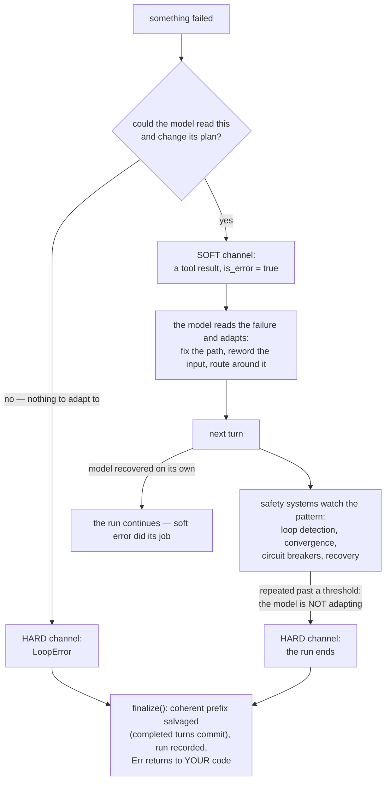

When something fails inside your agent, there are exactly two places the failure can go:

- **Soft**: it becomes a message your model reads, and your run continues.

- **Hard**: it becomes a `LoopError` returned to your code, and your run ends.

Which one to pick is the most consequential error-design decision in your agent framework.

loopctl answers it with a principle: your model is a collaborator that can read and adapt, so most failures are information for it.

They are not emergencies for you. This page explains the principle, where loopctl draws the line, and what your choice costs.

## The failure that teaches the pattern

A classic first agent looks like this: your model asks to read `src/mian.rs` (a typo). The tool call fails. Your program propagates the error. The run crashes.

Now watch your same moment with soft errors. The tool result comes back as a message: *"tool call failed: file `src/mian.rs` not found"*.

Your model reads it, says "oops," and asks for `src/main.rs`. The run succeeds, and nobody was paged.

Your model misspells paths, guesses at argument shapes, asks for tools that do not exist, and sends queries that time out.

It does this constantly, because it is guessing its way through your program's interface.

Each of those is a normal, expected, recoverable moment for you, and crashing on them means crashing on the normal case.

So: **if your model could plausibly read the failure and change its plan, the failure is soft.**

Hard errors are reserved for cases where continuing would be pointless or impossible: the network is gone, or your context cannot fit at all.

Or your model is stuck in a [detected loop](/safety/loop-detection/), or your user pressed Ctrl-C.

Nothing your model reads will fix those, so it never sees them. Your code does, as a typed `LoopError`.

The whole philosophy in one picture, including the escalation path that keeps your softness from becoming a trap:



## The two channels, side by side

| | Soft error | Hard error |
|---|---|---|
| Shape | a tool result with `is_error: true` | a `LoopError` value |
| Who sees it | **the model** (as message text) | **your code** (as `Err`) |
| The run | continues | ends now |
| The scratchpad | kept — the failure is part of the story | salvaged — completed turns commit, the in-flight tail drops (0.4.0; only the overflow family discards whole) |
| Example | "file not found" | network unreachable mid-turn |

Everything the dispatcher can produce lands on one side deliberately:

| Failure | Channel | Why |
|---|---|---|
| Tool returns `Err` | soft | the model can fix its input |
| Tool **panics** | soft | caught (`catch_unwind`), reported as text — the model retries or routes around it |
| Tool name unknown | soft | the brain pre-answers "tool 'x' is not available"; the model corrects the name next turn |
| A hook vetoes the call | soft | "blocked by policy: {reason}" — the model picks another route |
| Circuit breaker refuses a sick tool | soft | "temporarily unavailable" — the model routes around it |
| Recovery strategy gives up (skip/fail) | soft | the analysis *and* the failure go back to the model |
| Cancellation | hard | the user ended this; nothing to adapt to |
| Context can't fit after compaction | hard | no request can be built that would work |
| Loop / convergence stop | hard | the model already proved it won't adapt |
| Recovery retries past the ceiling (5) | hard | the model's retries aren't converging; stop wasting tokens |

Read the two columns of "why" and the rule falls out for you: **soft failures are ones your model's next turn can act on.**

Hard failures are ones no next turn can save.

**The no-panic promise is this principle taken to the limit.** Your crate compiles with `panic = "deny"` for itself. A tool that panics anyway is caught at the dispatch boundary.

It is converted to a soft error. A crashing tool of yours becomes one more piece of information in the conversation instead of a dead process.

## What softness costs, and what pays for it

Soft errors are permissive by design, and a permissive system can be trapped by its own permissiveness.

Picture a model of yours that responds to "file not found" by asking for the same missing file again and again.

It politely reads its own failure every turn. Every soft error is also an invitation to loop.

That is not a flaw in the principle. It is the boundary condition that shapes the rest of your safety stack.

loopctl keeps errors soft because separate systems watch for the pathological consequences:

- Your [loop detector](/safety/loop-detection/) catches identical calls returning identical failures, which is the "model ignoring its errors" case.

- It stops your run at the hard layer. [Convergence detection](/safety/convergence/) catches the answer-side version: near-identical final replies.

- Your [recovery](/safety/reflection/) layer adds memory between "error seen" and "retry blindly": analyze, correct, back off.

- Your circuit breakers ([fallback](/safety/fallback/), [tool health](/safety/tool-health/)) turn sustained soft failure into temporary refusal.

- It stays soft and model-visible for you.

The clean way to hold the whole design in your head: **soft errors handle the *expected* failure.**

Your safety systems handle the *repeated* failure.

## The exact words the model reads

Soft errors are text your model will reason about, so their wording is part of your design. The actual shapes:

| Producer | Result text (shape), `is_error: true` |
|---|---|
| Brain's pre-answer (name never advertised) | `tool 'x' is not available` |
| Registry miss at dispatch | `Tool not found: x. Available: a, b, c...` (+ `Did you mean 'a'?` if the [suggestion layer](/safety/middleware/) is installed) |
| Tool panicked | `Tool "x" panicked: <message>` — the payload is recovered by downcasting to `&str`/`String`, else `(unknown payload)` |
| Timeout middleware | `Tool 'x' timed out after Ns` |
| Circuit breaker refusal | `tool temporarily unavailable: circuit breaker open` |
| Loop-detector pre-dispatch refusal | `dispatch refused before execution: <the detection error>` |
| Hook veto | the hook's own reason text |
| Recovery gives up | the **original** failing result, verbatim — analysis never rewrites history |

Each string is written to be acted on: it names the thing that failed and, where possible, the alternatives you offer.

A stack trace is neither of those, and a phrase like "did you mean" is.

## The recovery ceiling, precisely

Your retry machinery around soft errors has one number that overrides everything: `MAX_RECOVERY_ATTEMPTS = 5`.

Here is how it actually counts for you:

```text
attempt 0  = the original call (failed)
attempt 1..5 = retries granted by the recovery strategy
attempt 6 would be the 6th total call → ToolRecoveryExhausted { attempts: 6 }
```

Your ceiling is enforced **twice, deliberately**. Your strategy receives `max_attempts = 5` as an input to its decisions.

And your driver independently stops any strategy that keeps saying "retry" past it.

A misbehaving custom strategy of yours cannot turn "soft errors plus retries" into an infinite loop.

Your hard channel catches what your soft channel's judgment misses. Hence the error payload's quirk: `attempts` counts total calls.

So 6 means "original plus 5 retries."

One more precision for you: when recovery answers `Skip`, `AskUser`, or `Fail`, your original failing result is returned soft.

It is not the reflector's analysis and not a summary. Your model sees exactly what went wrong, unedited.

Any correction is applied to your retry's input, never to the record of what happened.

## Where each hard error is born

Your hard channel is small enough to map completely. Here is every `LoopError` that ends your run through this philosophy, and the single spot it comes from:

| Error | Born at |
|---|---|
| `Cancelled` | any cancellation checkpoint ([the signal](/engine/cancellation/)) |
| `ContextExceeded` | compaction overflow, or the no-progress guard inside the compaction feed |
| `LoopDetected` | the loop detector's stop threshold, or convergence with action `Stop` |
| `UserInputRequired` | convergence with action `AskUser`, the one "hard" error that asks for a human, not a fix |
| `ToolRecoveryExhausted` | the ceiling above |
| `FallbackExhausted` | every model in the chain spent while the breaker's cooldown runs |

Note what is absent from your map: no tool-level error appears here. A tool cannot end your run, ever.

Your engine decides when your runs end, and your tools only contribute information.

## Writing your own tools with the principle

When your tool's function fails, you choose the channel too:

- Return `Err(...)` from `Tool::call`, or a `ToolOutput` marked error, and you stay **soft**: the text reaches your model.

- Do this for everything your model could fix: bad paths, invalid arguments, upstream 404s, empty results.

- There is no tool-level way to force a hard error, and that is deliberate: your engine decides when your runs end, not your tools.

- If a failure truly must stop your world, your host observes it, and [observers](/extensions/observers/) and [hooks](/extensions/hooks/) can fire the cancel signal.

And one craft rule for you: **write error text for your model, not for a log.**

"File `/etc/osts` not found. Did you mean `/etc/hosts`?" is something your model can act on. A stack trace is not.

## Related pages

- [Errors](/core-data/errors/): every `LoopError` variant and its meaning.

- [Tools](/core-data/tools/): the tool-side surface of your split.

- [Loop detection](/safety/loop-detection/): what catches your soft errors being ignored.

- [Circuit breakers](/principles/circuit-breakers/): refusing reliably failing things, softly.
