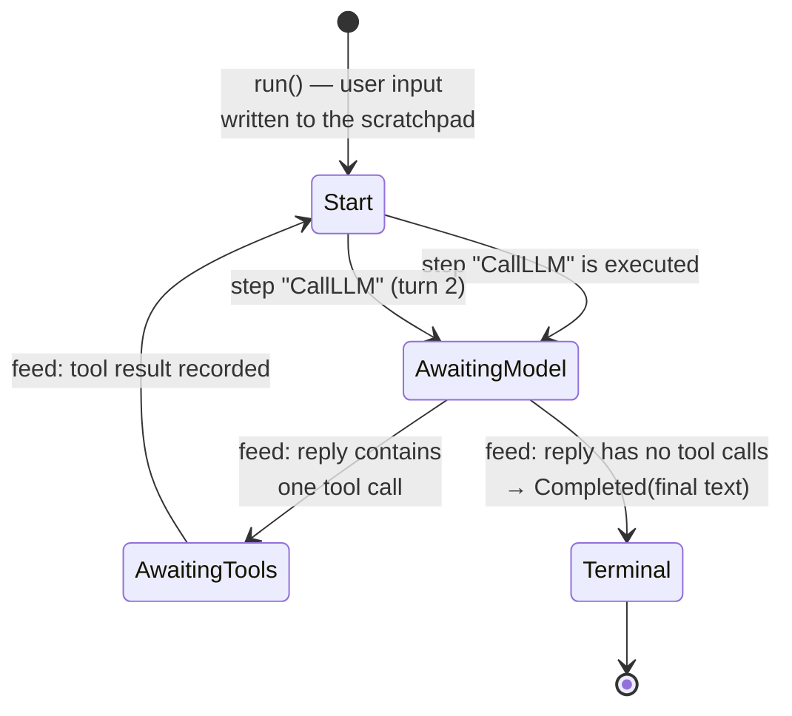

A **state machine** is a way of designing your system so that, at every moment, it is in exactly one named **state**.

Only certain moves (**transitions**) between your states are allowed. Everything else cannot happen: every state not on your list, every move not on your list.

That sounds abstract, so here is the whole idea in one familiar object: a **turnstile** (the waist-high gate at a stadium).

It has two states: *locked* and *unlocked*. It understands two events: *coin* and *push*.

| Current state | Event | New state | What happens |
|---|---|---|---|
| locked | coin | unlocked | it clicks open |
| locked | push | locked | it refuses (that's the point) |
| unlocked | push | locked | one person passes, it re-locks |
| unlocked | coin | unlocked | extra coin, no harm |

Notice what your table forbids: there is no row where pushing a locked gate lets anyone through. The machine cannot be confused, half-locked, or "probably open", because those are not states.

**That is the value: if you can name every situation, you can prove you handle every situation.**

loopctl's engine brain ([`LoopMachine`](/engine/state-machine/)) is a state machine of yours. This page explains why your agent loop is a natural fit for the pattern.

It also shows what the pattern buys you once it is there.

## Why an agent loop is a state machine

Watch what your run actually does. It sends your conversation to the model and **waits for the reply**. It runs your tools and **waits for the results**.

Sometimes it shrinks your conversation and **waits for that to finish**. Eventually it **ends**.

Those "waits" are not implementation details. They are the only situations your run can be in.

At any instant, your engine is doing exactly one of:

- nothing pending, ready to pick the next move,
- waiting for the model to answer,
- waiting for tools to finish,
- waiting for compaction to finish,
- finished (forever).

That is a state machine, whether you write it as one or not. The design choice is to **write it as one**.

Name your states, name your moves, and let the type system hold you to them.

The alternative is a loop of yours full of booleans (`is_calling_model`, `tools_pending`, `was_compacted`).

That loop can represent nonsense like "waiting for tools and finished". Every combination you forgot to check is then a bug waiting for a weird network timing to expose it.

## The loopctl machine

The brain's states, in code:

```rust
pub enum MachineState {
    Start,                     // ready to pick the next step
    AwaitingModel { turn },    // model call in flight
    AwaitingTools { turn },    // tool batch in flight
    AwaitingCompaction,        // shrink in flight
    Terminal(MachineOutcome),  // finished — forever
}
```

And now your full set of moves. Read down the left: what happened, a **feed**, which is your shell reporting a result.

Your brain reacts according to the state it was in:

| Was in | Feed: "here's the model's reply" | Feed: "here are the tool results" | Feed: "compaction finished" |
|---|---|---|---|
| `Start` | *(illegal — no call was in flight)* | *(illegal)* | *(illegal)* |
| `AwaitingModel` | no tool calls → **`Terminal(Completed)`**; else → `AwaitingTools` | *(illegal)* | *(illegal)* |
| `AwaitingTools` | *(illegal)* | → `Start` (next step: usually `CallLLM`) | *(illegal)* |
| `AwaitingCompaction` | *(illegal)* | *(illegal)* | → `Start`, or **`Terminal(Failed)`** if nothing was shaved |
| `Terminal` | ignored — terminal is forever | ignored | ignored |

Your "illegal" cells are where the pattern earns its keep. A tool result can only be fed to a brain that is `AwaitingTools`.

A driver bug of yours that tried to feed a model reply into a brain awaiting tools is not silently mis-filed.

It is a contract violation your design makes visible, because the feed does not match the state.

Two more pieces of vocabulary, because they carry weight for you:

- **Terminal is one-way.** `Terminal(Completed | Cancelled | MaxTurnsExceeded | Failed)` has no outgoing transitions.

- A saved-and-restored finished run of yours still knows it finished, and you cannot accidentally revive it. In the turnstile, "unlocked" is reachable again.

- In your agent run, "done" is not, and your machine enforces it. **Asking is not a transition.**

- `next_step()` is the question "what should happen next?", and it is pure. It reads your state and answers `CallLLM`, `CallTools`, `Compact`, or `Done`.

- It never changes your state. All change flows through your feeds. This is the sans-IO discipline from the [previous page](/principles/sans-io/) expressed as your machine rules.

## The guard checks, in order and in arithmetic

The `Start` / `AwaitingModel` branch of your `next_step` is a fixed chain of comparisons where the first hit wins.

Every one of them is plain integer arithmetic. There are no floats anywhere in your brain:

```text
1. cancelled flag set?                       → Done(Cancelled)
2. turns_taken >= max_turns?                 → Done(MaxTurnsExceeded)
3. context_tokens >= window × 95 / 100?      → Compact(Emergency)        — inclusive, always on
4. auto_compact AND
   context_tokens > window × threshold / 100?→ Compact(ThresholdExceeded) — strict
5. otherwise                                 → CallLLM(turn)
```

Three details inside those lines:

- **Order is policy.** Cancel beats everything. Your turn cap beats compaction, because there is no point shrinking a run that is already over.

- Your emergency line beats the threshold. Reordering those lines changes user-visible behavior for you, which is why they are written as an explicit chain rather than scattered checks.

- **Inclusive versus strict is deliberate.** Your emergency line uses `>=`, so at 95% you compact, because cutting it finer risks a rejected request.

- Your threshold uses `>`, so a payload exactly at 80% is served normally and only growth past it compacts.

- **`context_window = 0` disables checks 3 and 4 entirely.** "No window policy" is a legal configuration for you, and zero is its sentinel, not a bug.

On the exit side, each of your terminal outcomes maps to at most one error through `to_loop_error()`.

`Completed` maps to `None`, `Cancelled` to `LoopError::Cancelled`, `MaxTurnsExceeded` to its variant, and `Failed { error }` to the error it was born with.

The mapping is total, so your shell never has to interpret an outcome, only translate it.

## A two-turn run, walked through the machine

Your user asks "summarize this folder," and your model needs one tool call:



Every arrow is either a step, your brain instructing and your shell acting, or a feed, your shell reporting. Six transitions, the whole run.

When something goes wrong mid-run you can point at the exact arrow where it happened. That is what the pattern does for your debuggability.

## A longer run, as an event trace

The two-turn walk skipped the interesting states. Here is your run that compacts once and gets cancelled, with every row a real transition in order:

| # | State | What happens | New state |
|---|---|---|---|
| 1 | `Start` | feed `accept_input("fix the failing tests")` — scratchpad seeded | `Start` |
| 2 | `Start` | step `CallLLM(0)` runs; feed `model_response` (2 tool calls) — both names known, classified pending | `AwaitingTools(0)` |
| 3 | `AwaitingTools(0)` | step `CallTools` runs; feed `tool_results` — **the only feed that consumes `pending_tools`** | `Start` |
| 4 | `Start` | `next_step`: estimate now past 80% of the window → `Compact(ThresholdExceeded)` | `AwaitingCompaction` |
| 5 | `AwaitingCompaction` | pass ran, shrank the conversation; feed `compaction_result(new, before, after)` — history replaced wholesale, pending cleared, estimate = after | `Start` |
| 6 | `Start` | step `CallLLM(1)`; feed `model_response` (no tool calls — final answer) | `Terminal(Completed)` |
| 7 | `Terminal` | any further feed | ignored — forever |

Swap row 6 for "your user pressed Ctrl-C during the model call" and the trace ends. Your driver routes the cancel to `machine.cancel()` rather than `fail()`.

The next `next_step` returns `Done(Cancelled)`, and the exit door salvages the coherent prefix.

Completed turns commit and only the in-flight exchange drops, as of 0.4.0. Two more edge behaviors are worth knowing from this table:

- **Row 4's darker twin:** had your compaction pass shaved nothing, meaning `after >= before`, the feed itself ends your run as `Terminal(Failed(ContextExceeded))`.

- It does that rather than let rows 4 and 5 repeat forever. Your no-progress guard lives inside the feed.

- **Row 5's sibling:** a pass that did not rewrite anything feeds `compaction_noop` instead, and both your buffers are left untouched.

- Feeding your unchanged conversation through `compaction_result` would glue a half-finished scratchpad into permanent history mid-run.

- The two feeds exist precisely to make that mistake unexpressable for you.

## What the pattern buys, concretely

**1. Enumerate-and-test.** A finite list of your states and transitions is a test plan you can complete.

Your engine's test suite pins each arrow above, including the odd ones: compaction that saves nothing, a restored terminal machine, a cancel landing mid-state.

With booleans instead of states, "complete coverage" is not even a meaningful phrase for you.

**2. Serialization falls out.** A state machine whose state is plain data can be saved with `serde` and restored elsewhere.

Your data is one enum plus two message lists plus counters. The restored machine resumes exactly: same state, same rules.

Your agent mid-run is a value.

**3. Your rules live in one file.** Every policy question is answered by the transition rules in one place.

When do you stop, when do you compact, can your tools run yet: all answered there.

Nobody else in your codebase needs to make those calls, or gets to.

**4. Impossible situations cannot assemble quietly.** You cannot dispatch tools while awaiting a model reply.

You cannot glue a half-finished run into permanent history without passing through the one commit point. Bugs that would require an "impossible" configuration cannot occur, because your configuration cannot be expressed.

## Where else the pattern appears in loopctl

Once you see it, the shape is everywhere in your codebase, because it is the natural way to write sans-IO logic:

| State machine | States | Page |
|---|---|---|
| The engine brain | `Start / AwaitingModel / AwaitingTools / AwaitingCompaction / Terminal` | [the state machine](/engine/state-machine/) |
| Model fallback breaker | `Primary / Fallback / Recovering` | [fallback](/safety/fallback/) |
| Per-tool circuit breaker | `Closed / Open / HalfOpen` | [tool health](/safety/tool-health/) |
| Stream assembly | open slots per lane (text / tool / thinking) | [stream events](/core-data/stream-events/) |

All of them share the turnstile's virtues: your named situations, your listed moves, and everything else forbidden.

## Related pages

- [Sans-IO](/principles/sans-io/): the pattern this one lives inside.

- [The state machine](/engine/state-machine/): every rule of your brain, in detail.

- [The driver loop](/engine/driver-loop/): the shell that drives your transitions.

- [Circuit breakers](/principles/circuit-breakers/): the pattern as applied to your failing things.
