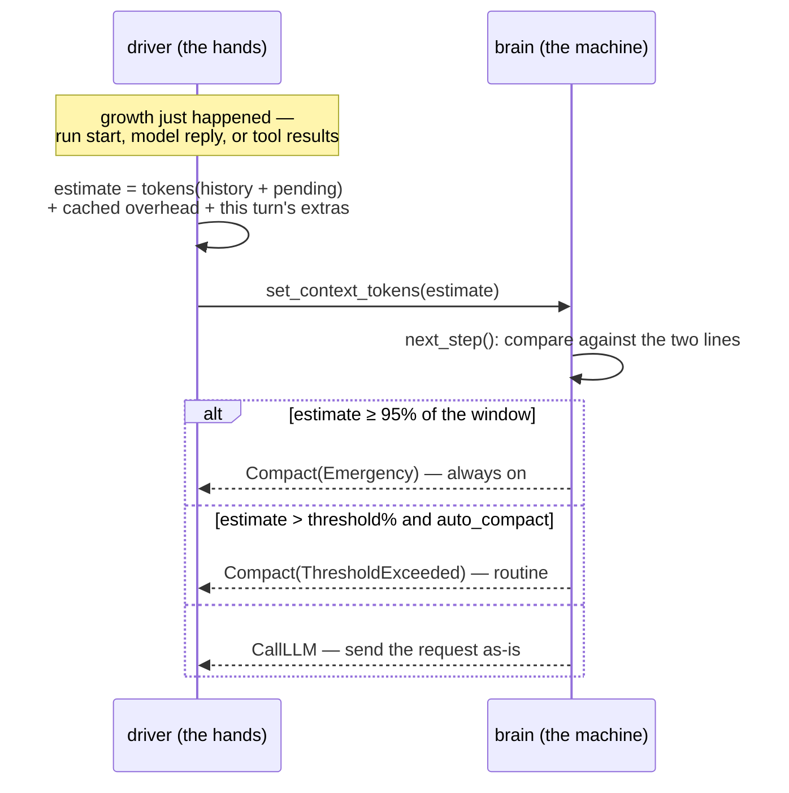

Almost every number in your agent engine is measured in **tokens**: costs, limits, and when to shrink your conversation.

This page explains what a token is, why your limits exist, and why loopctl estimates them instead of counting them exactly.

If you have wondered what your `context_window = 200_000` actually pays for, start here.

## What a token is

A model does not read characters or words. It reads **tokens**: short chunks of text drawn from a fixed vocabulary your model was trained on.

Common words are usually one token, like "the" or "hello". Rarer or longer pieces get split, so "tokenization" becomes "token" plus "ization".

Your numbers and code chop up unpredictably. Rules of thumb for English text:

- **1 token ≈ 4 characters**, roughly ¾ of a word.

- 100 tokens ≈ a short paragraph. A big novel is roughly 100k to 150k tokens.

Your providers speak in tokens rather than characters because your model's actual reading unit is the token.

Every character you send is first converted to tokens, and everything downstream is counted in that unit: memory use, compute time, price, and your limits.

**Tokenization** is the name of that text-to-tokens conversion. The exact splits depend on the tokenizer, and your tokenizer depends on the model.

The same sentence can tokenize slightly differently for two of your models. That detail is why exact counting is harder than it sounds, which is covered below.

## Why the context window is finite

Your **context window** is everything your model can see in one request: the whole conversation. That means the system prompt, your user messages, tool definitions and every tool result.

Add its own reply and you have all of it at once, as tokens.

Your providers cap it, from tens of thousands to a few million tokens depending on the model, for two physical reasons:

1. **Memory.** Your model's attention mechanism relates every token to every other token. Doubling the context more than doubles the bookkeeping.

2. The window is where the hardware says stop. **Cost.** Your providers bill input tokens per request.

3. A conversation of yours that grows by 2,000 tokens per turn is a meter running faster every turn, even before it hits any limit.

For a chat interface, a long conversation is an inconvenience. For your agent it is a structural problem: tool results are big, runs are long, and the conversation only grows.

Without intervention, every sufficiently long run of yours eventually builds a request your provider will reject. That intervention is [compaction](/engine/compaction/).

Compaction's trigger, budget and success measure are all token counts you depend on.

## Why loopctl estimates instead of counting

The honest way to know your conversation's token count is to run your provider's exact tokenizer over it. loopctl deliberately does not, and the reasons are practical:

- Your right tokenizer varies by model, and it changes with model versions.

- Pulling a tokenizer library into your agent framework adds weight and a per-message cost for a number you only need approximately.

- What your engine needs is not the bill. It needs a conservative yes/no: will your next request fit?

So your engine measures with a **token counter** trait, and the default is deliberately crude:

```text
HeuristicTokenCounter:
    tokens(message) ≈ (characters + 20) / 4      # +20 covers message framing
    image          = 256 tokens flat             # whatever its pixel size
```

Two properties matter to you more than its accuracy:

**It errs high, but 0.4.0 made it honest.** Your raw estimate still over-counts rather than under-counts, with images at a flat 256 and message framing charged per message.

Your estimate is no longer the whole story. Suppressed tool schemas under a `response_format` are no longer reserved.

Backends that report real `input_tokens` feed your rolling **calibration ratio**, and can **anchor** your figure wholesale. See [context accounting](/engine/context-accounting/).

Your window itself is **probed** where the provider discloses it, through llama.cpp `/props` or Ollama `/api/show`, instead of trusting the declared guess.

A false "fits" now costs you one overflow-salvage compact-and-retry before it costs your run.

**It errs consistently.** The same conversation always measures the same number for you. Consistency matters more than closeness, because mixing two of your counters is worse than either one.

See the one-unit rule below.

### Overhead tokens

Your conversation is not the only thing riding a request. Your system prompt and every tool schema, which are the JSON descriptions of your tools, travel along and count against your window on every turn.

Your driver measures this **overhead** once, caches it, and includes it in every context estimate you get.

An agent with 40 tools registered can carry thousands of overhead tokens before the conversation says a word, which is why your estimate counts them.

## Where the estimate is refreshed

Your estimate is only as good as its recency, so your driver re-measures at every moment your next request could grow:

| Moment | What the driver adds to the measurement |
|---|---|
| Run start | committed `history` + the new user input |
| After each model response | the reply just adopted (its text *and* any tool calls) |
| After each tool-result batch | the results — a single huge output is visible **before** the next request goes out |
| Before a model call carrying extras | this turn's contributor + memory messages (the *only* transient inputs that count) |

That last row has a subtlety for you. Your extras are gathered, then your estimate is refreshed with them included, then `next_step` runs.

A turn of yours whose extras would push the payload over a line therefore defers to compaction before anything is sent.

The retried turn reserves budget so your extras still fit after shrinking.

## A conversation, measured turn by turn

Your window is 8,000. Threshold 80%, so your line sits at 6,400. Overhead measured once at 700. Watch the arithmetic work for you:

| Turn | Event | Measured now | Estimate | % of window | Decision |
|---|---|---|---|---|---|
| — | run starts, history empty | input: 2,100 tokens | 700 + 2,100 = **2,800** | 35% | `CallLLM` |
| 0 | reply (1 tool call, 300 tokens) | — | **3,100** | 39% | `CallTools` |
| 0 | tool result: 1,200 tokens | — | 700 + 2,100 + 300 + 1,200 = **4,300** | 54% | `CallLLM` |
| 1 | reply (2 calls, 400 tokens) | — | **4,700** | 59% | `CallTools` |
| 1 | tool results: 1,900 tokens | — | **6,600** | 82% | past 6,400 → `Compact(ThresholdExceeded)` |
| — | pass shrank to 3,800 total | re-measured by the manager's counter | **3,800** | 48% | `CallLLM` — comfortably under |

Two things this trace shows that prose cannot:

- **Your trigger sees tool results, not replies.** The jump from 59% to 82% is a tool output.

- Your estimate refreshes after the batch and before the next request, so a giant result cannot sneak past your line.

- **After compaction, your estimate is the manager's own re-count**, not the compactor's self-report. The number that decides "when next" always comes from the same counter that decided "when now".

- Swap in a different counter at any layer and rows like the last two stop agreeing for you. Compact to 3,800 by one ruler, measure 5,100 by another, and compact again.

- That is the [flapping](/cookbook/gotchas/) loop gotcha #6 warns about, visible here as two rows that must share your ruler.

## The two lines: threshold and emergency

Your engine watches one number, your current estimate, against two lines on your window:

```text
0% ──────────── 80% ──────── 95% ──────── 100%
   normal life     threshold    emergency     provider's
                   (compact     (compact      hard wall
                   now, this    regardless
   is routine)     of settings)
```

- The **threshold**, default 80%, is ordinary planning: past here, shrink before your next model call. It is controlled by your `auto_compact` and remains tunable.

- The **emergency line**, 95%, is your safety net. It fires even when you switch compaction off, because the alternative is a request your provider will refuse.

Why two lines? A single line that is safe, 95%, leaves you compacting in a panic with little room for your next turn's growth.

A single line that is comfortable, 80%, would fire constantly if you could not turn it off. Two lines give you a routine lane and a last-resort lane, the same shape as a soft budget and a hard cap.

The same decision as an interaction: who measures, who decides, and when for you:



Your brain never measures anything itself. Your driver feeds it a number, and comparing that number against the lines is your brain's entire job.

That is the [sans-IO](/principles/sans-io/) discipline: the meter lives in your hands, the rule lives in your brain.

### The one-unit rule

One consistency rule sits above all your tuning: every token decision must be made with your same counter.

Your trigger asks "are we past 80%?" and your post-compaction check asks "did we get smaller?"

If those two questions use different units, a heuristic here and your provider's billed count there, your system can flap.

It compacts, measures small, grows back, measures big, and compacts again, forever. Install one counter on your `ContextManager` and your driver reuses it everywhere.

This is [gotcha #6](/cookbook/gotchas/) in your cookbook.

## A worked example

Your window is 8,000 tokens. Threshold 80%, so your line is 6,400. Emergency 95%, so your line is 7,600. Your system prompt plus tool schemas measured at 700 tokens overhead.

| Conversation | Overhead | Estimate | Decision before next model call |
|---|---|---|---|
| 4,000 tokens | 700 | 4,700 | normal — 59% of window |
| 5,700 | 700 | 6,400 | normal — *at* the line; threshold is strict (`>`), exactly-at serves |
| 5,701 | 700 | 6,401 | `Compact(ThresholdExceeded)` — routine shrink |
| 7,200 | 700 | 7,900 | `Compact(Emergency)` — even with `auto_compact: false` |

After your compaction pass, the [no-progress guard](/engine/compaction/) compares before and after with your same counter.

If nothing was shaved, your run ends with `ContextExceeded` rather than looping between "compact" and "call" forever.

## Related pages

- [Compaction](/engine/compaction/): what actually happens when your lines are crossed.

- [Session config](/core-data/session-config/): where your window and threshold live.

- [Sans-IO](/principles/sans-io/): why your brain stores a number someone fed it, never a measurement it took itself.
