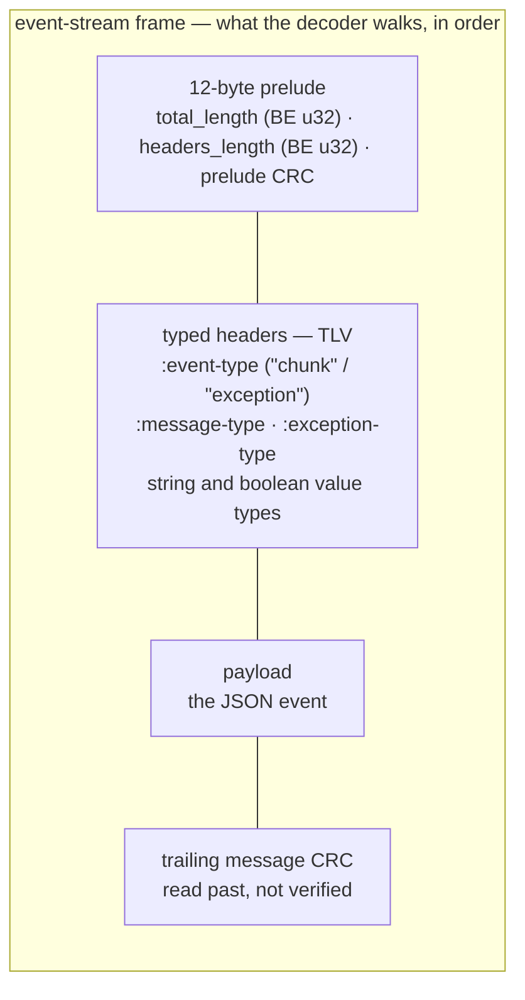

`BedrockClient` speaks AWS Bedrock, which takes two things other providers do not need. You need signed requests, meaning SigV4, which is the AWS authentication scheme. And for streaming you need binary event-stream framing rather than SSE.

The source is `src/provider/bedrock.rs`, under the `bedrock` feature, which pulls in `hmac` and `sha2` for signing.

## Construction

```rust
let client = BedrockClient::from_env()?;
// AWS_REGION, AWS_ACCESS_KEY_ID, AWS_SECRET_ACCESS_KEY (required)
// AWS_SESSION_TOKEN (optional), AWS_BEDROCK_MODEL
//   → default "anthropic.claude-sonnet-4-5-20250929-v1:0"

let client = BedrockClient::builder()
    .region("us-east-1")
    .access_key_id(...)
    .secret_access_key(...)
    .session_token(...)                    // optional (STS / role credentials)
    .model("anthropic.claude-sonnet-4-5-20250929-v1:0")
    .max_tokens(8192)                      // default 8192; 0 rejected
    .build()?;
```

Your region format is validated to lowercase letters, digits, and hyphens, because a dotted region would silently redirect the host.

Models with their own lower output caps reject budgets above that cap, so check before you set it. Some Claude 3 tiers cap at 4096, so set `max_tokens` per client accordingly.

### Credential rotation

`set_credentials(key, secret, token)` swaps your triple atomically on a live client, which is what STS/IRSA refresh flows need.

Every request signs with one consistent snapshot, so a torn pair of new key and old secret can never be sent.

## Two wire paths, picked per model

```text
model id starts with "anthropic."  →  ANTHROPIC path: the native Messages body
                                       (reuses the direct client's builders and emitter)
everything else                    →  CONVERSE path: Bedrock's cross-model API
                                       (its own body shape and stream events)
```

The path is auto-selected per request, so when you `set_model` across vendors the wire format switches too. You can also pin it with `.path(BedrockPath::Anthropic)` or `.path(BedrockPath::Converse)`.

ARN-style ids and inference-profile ids carry no `anthropic.` prefix, so they route to Converse, which is the only API that serves them.

## SigV4 in one paragraph

Every request is signed. A canonical request holds your method, URI, headers, and hashed payload.

That request is HMAC-chained from `AWS4<secret>` through date, region, `bedrock`, and `aws4_request` into an `Authorization` header, alongside `X-Amz-Date` and the payload hash.

Your model id is percent-encoded into the URL path, and that exact encoded path is what gets signed, which matches the AWS SDKs. The signing implementation is pinned against AWS's own documented test vectors.

## Streaming: binary event-stream, not SSE

Bedrock streams responses as AWS event-stream frames, meaning binary headers plus payload chunks rather than text lines.

The client contains a hand-written incremental decoder that walks frame length, typed headers such as `:event-type`, payload, and CRCs, so it handles partial frames arriving in arbitrary TCP chunk splits.

Four rules cover the frames:

- On the **Anthropic path**, each frame's payload is the same JSON event as the direct API, and it feeds the shared Anthropic emitter.
- On the **Converse path**, shipped 0.4.0, frames carry `messageStart`, then `contentBlockDelta`, then `messageStop`.

  The `contentBlockDelta` lane covers text, tool-input, and reasoning.

  A final `metadata` frame carries stop reason and usage together, and the terminal pair is emitted exactly once from it.
- Exception frames carry their `:exception-type` into your error.
- A stream cut before the terminal frame emits no terminal event, which is truncation, as everywhere else.

### Cache accounting on both paths

Converse's `cacheReadInputTokens` fills `Usage::cached_input_tokens`. The Anthropic-shape responses get the same input normalization as the direct client, meaning raw plus cache reads plus cache-creation spend.

### The frame format

This is what the decoder walks when you are reading packet captures:



A frame's declared length must land in `16 bytes … 16 MiB`. Anything else marks the buffer as unsynchronized and it resets, so the decoder never allocates based on a hostile length. Header values that overrun their declared frame are skipped individually rather than fatally.

## Converse mapping notes

- Messages use `user` and `assistant` roles only. Tool calls are `toolUse` blocks and results are `toolResult` blocks with a `status` field of `success` or `error`, so `is_error` does travel on this wire.
- Tools go in `toolConfig.tools[].toolSpec`, your system prompt goes in `system` as a list of text objects, and your output budget goes in `inferenceConfig.maxTokens`.
- Empty-content messages are dropped for you, because Bedrock rejects them.

## Limits of this client

Three gaps are worth knowing before you pick this path:

- There is no `RequestOptions` support. Per-request model overrides, response formats, and tool constraints are not implemented here, so the base trait's reject-loudly defaults apply.
- HTTP errors are not auto-classified into rate-limit and auth forms the way the other clients do. They surface as plain `ApiError` carrying status and body.
- Images are dropped, as with the other shipped converters.

## Related pages

- [Anthropic](/providers/anthropic/) covers the body builders and emitter that the Anthropic path shares.
- [Overview](/providers/overview/) is the provider map.
