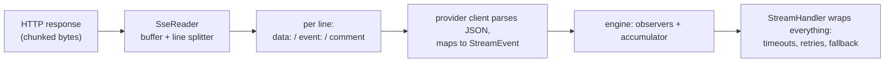

SSE, short for Server-Sent Events, is the text protocol most providers use to stream replies. The server keeps the HTTP connection open and pushes lines at you.

This page explains the shared reader under the provider clients, which is useful when you debug a stream or write your own client. The source is `src/provider/sse.rs`.

## The wire format

An SSE response is a stream of lines:

```text
event: content_block_delta        ← optional event name
data: {"type":"content_block_delta", ...}   ← the JSON payload
                                    ← blank line = event boundary
: keep-alive                      ← colon lines are comments; ignore
data: [DONE]                      ← OpenAI's end sentinel
```

The reader, `SseReader`, handles the parsing rules that matter:

- **The `data:` and `event:` prefixes** accept exactly one optional space after the colon, so `data:{...}` and `data: {...}` both work. Field names are case-sensitive.

- **Line endings** are handled as both `\n` and `\r\n`, because the reader trims.

- **Bytes, not strings.** Buffering is byte-oriented on purpose, since TCP chunks do not respect character boundaries. Decoding happens per complete line, and a genuinely invalid-UTF-8 line is an error rather than a crash.

- **Comment lines** starting with `:` are skipped, which is how providers send you keep-alives.

- **Multi-line data**, as Anthropic sends it, means consecutive `data:` lines of one event concatenate with newlines.

- **A 1 MiB line cap** turns one endless line from a broken server into a protocol error rather than unbounded memory.

### The reader's line state machine

Those rules compose into a small loop over a byte buffer:

```text
fill buffer from the socket (arbitrary chunk boundaries)
loop:
    find the next b'\n' in the buffer
    none yet?  → wait for more bytes (a partial line survives across chunks)
    take the bytes up to it, trim a trailing b'\r'        ← CRLF handled here
    blank line? → dispatch the accumulated event (data lines joined with \n), reset
    starts with b':'? → comment: skip (keep-alives die here)
    "data:" prefix (one optional space)? → append the rest to the current event's data
    "event:" prefix (one optional space)? → record the event name
    anything else → skip (unknown fields are legal SSE; ignore them)
    line longer than 1 MiB? → protocol error
```

Watching it eat a chunk boundary makes the byte-orientation obvious:

```text
socket chunk 1:  b'data: {"type":"content_block_del'
socket chunk 2:  b'ta","index":0}\n\ndata: [DONE]\n\n'
                                     ── after chunk 2, two complete lines
                                        surface: the payload, then the sentinel
```

A string-oriented reader that decoded eagerly could split a multi-byte UTF-8 character at exactly that boundary. That is why decoding happens per complete line only.

## The [DONE] sentinel

OpenAI-family servers end their stream with `data: [DONE]`, and the reader records having seen it.

Your OpenAI client uses that flag to tell "the server said we are done" apart from "the connection died". That is the difference between a completed turn and a truncated one.

Anthropic and Gemini have no sentinel. They use their own terminal signals, the `message_stop` event and the `finishReason` chunk.

## Where retry lives: not here

The SSE layer is a parser and not a reconnector. If your stream dies mid-reply, the reader ends and your provider client reports the events it got, with no fake terminal.

The decision to retry belongs to the [StreamHandler](/core-data/stream-events/), one layer up. That layer owns backoff, rate-limit honoring, and non-streaming rescue.

Keeping the two apart is what lets a retry transparently replay a whole turn.

## Reading flow, end to end



## Debugging tips

Three symptoms point at the real cause:

- A stream that ends silently almost always means the terminal event never arrived. Look for `truncated` outcomes in your handler logs rather than for exceptions.

- Gibberish or empty events usually mean your base URL is wrong for the protocol, such as pointing an OpenAI client at a non-OpenAI path.

- If you implement a custom client over SSE, honor the two invariants the engine depends on. Events must arrive in the standard order, and you must never synthesize a `MessageStop` on failure.

## Related pages

- [Stream events](/core-data/stream-events/) covers the vocabulary and the handler.
- [API client](/core-data/api-client/) covers implementing your own client.
