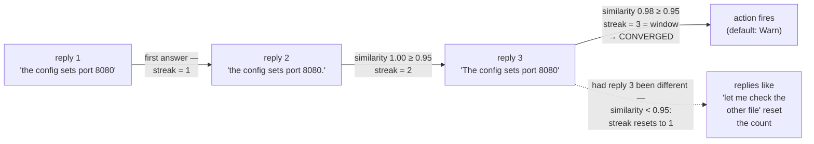

Convergence detection notices when the model keeps handing you the same answer. The detector on the previous page watches repeated tool calls.

This one watches your model's final answers becoming near-identical turn after turn, which means the agent has converged on one response and is quietly stuck saying it. Source: `src/detection/convergence.rs`.

## How it works

1. Only **terminal replies**, meaning replies with no tool calls, are considered. An acting turn that says "Let me check..." before running tools is not a converged answer, and the engine never feeds those to this detector.
2. The detector compares each new terminal reply with the reply immediately before it. The score is word overlap, so how many words the two texts share as case-folded, punctuation-stripped word sets, from 0.0 to 1.0.
3. A score at or above the threshold grows the streak. The default threshold is 0.95. Below it the streak resets to 1.
4. When the streak reaches the window size you are converged. The default window is 3 consecutive similar answers.

The timeline shows the whole mechanism at once. Each reply is compared only to its predecessor, and one dissimilar answer resets the count.



Because the streak compares each reply only to the one before it, an A-B-A-B alternation never counts, and one odd answer in the middle clears everything. An empty reply also resets the streak, because silence is a break rather than a continuation.

## What the metric gets wrong

Word-overlap similarity is simple and cheap, and it shows. A paraphrase that swaps in different vocabulary scores low, so you miss a real repetition.

The failure runs the other way too. A boilerplate-heavy reply like "Sure! Here's what I found:" scores high even when the content differs, so you see a repetition that is not there. That is exactly why the default action is a warning rather than a stop.

## The actions on convergence

You choose what happens with `ConvergenceConfig::on_converge`. The default is `Warn`.

| Action | Engine behavior |
|---|---|
| `Warn`, the default | The run continues and observers get `on_convergence_detected`, so you can log or alert. |
| `Stop` | The run ends with `LoopError::LoopDetected` carrying "convergence detected". Opt-in only. |
| `AskUser` | The run ends with `LoopError::UserInputRequired`, so you can ask a human and run again. |
| `Compact` | The run continues and the host is expected to compact. The engine does not compact for you. |
| `SwitchPhase` | The run continues and you decide what the next phase means. |

The split is deliberate. Text similarity is a heuristic, so anything drastic is strictly opt-in. The two host-executed actions surface through `ConvergenceStatus::action` for your code to act on.

A tighter window and a looser threshold catch near-echoes sooner:

```rust
let detection = DetectionManager::new_with_config(DetectionConfig {
    convergence_threshold: 0.90,          // default 0.95
    convergence_count: 2,                 // default 3 (window size)
    on_converge: ConvergenceAction::Warn, // default
    ..DetectionConfig::default()
})?;
```

## Reading the state

```rust
ConvergenceStatus {
    detected: bool,             // streak >= window
    consecutive_count: usize,   // current streak
    similarity_score: f32,      // peak similarity vs any window member, last add
    similar_responses: Vec<String>, // the streak's members, deduplicated
    action: ConvergenceAction,  // forwarded from config
}
```

`similarity_score` is the peak against any member of the window, taken on the last add. `similar_responses` holds the streak's members deduplicated, so you can show the repetition without repeating it.

Config validation is real. A window size below 2 or a threshold outside 0 to 1 is rejected with a `ConvergenceConfigError` rather than silently misbehaving.

## The two detectors, side by side

| | Loop detection | Convergence detection |
|---|---|---|
| Watches | Tool operations by name, parameter, and result hash | Terminal reply texts |
| Metric | Exact identity of operations | Word-set similarity at or above threshold |
| Warn at | 3 repetitions by default | A converged streak of 3 similar answers |
| Stop at | 10 repetitions, on by default | Never by default, opt-in only |
| False-positive armor | Result-hash awareness, recoverable-error clearing, signature normalization | Warnings-only default, acting turns excluded, predecessor-only streak |

Both detectors live behind one `DetectionManager` with independent enable flags, `enable_loop_detection` and `enable_convergence_detection`, and one `reset()`.

Which fires first? The engine checks loop detection first, because a tool-calling loop is a stronger signal.

The two also disagree about runs. Loop-detection state is cleared between runs, so a stop that never fired cannot kill your next run. Convergence state deliberately persists, because three consecutive identical final answers across three runs is a real signal for the opt-in `Stop` and `AskUser` actions.

## Related pages

- [Windows, averages, and similarity](/principles/measuring-repetition/) covers the Jaccard word-set similarity this detector uses, with worked examples.
- [Loop detection](/safety/loop-detection/) is the sibling detector.
- [Termination](/engine/termination/) covers where `UserInputRequired` fits.
