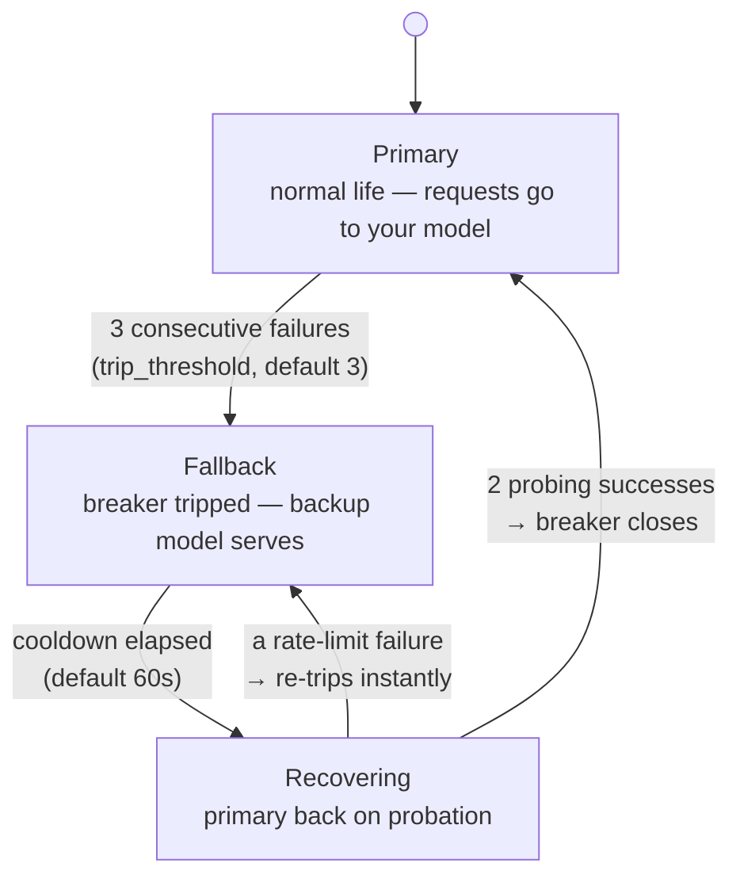
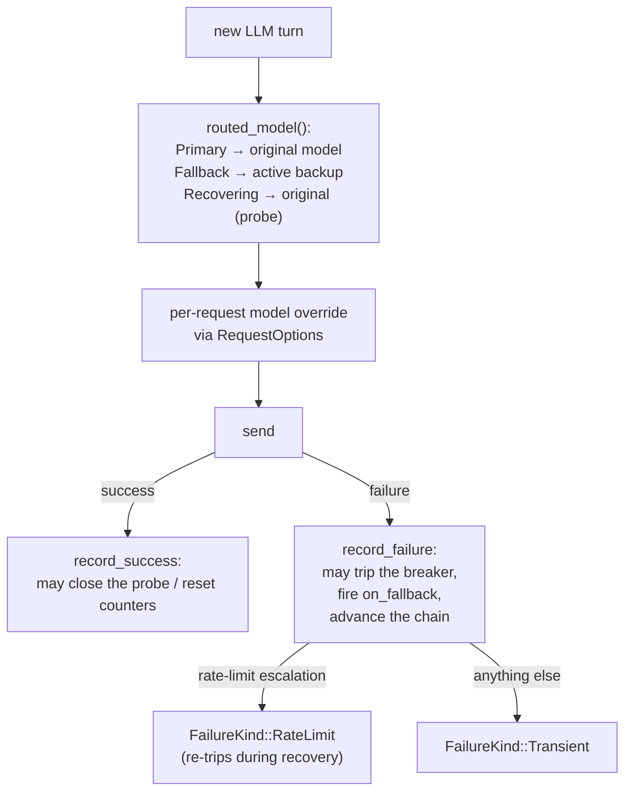

Providers fail. You hit rate limits, outages, and timeouts. The fallback manager is a circuit breaker over your model. Once enough consecutive calls fail, it sends your requests to a backup model instead, then probes the primary to decide when to come back. Source: `src/fallback.rs`.

## The three states



**Primary** is normal life, where requests go to your model. Failures stack up in `consecutive_failures`, and one success resets the count.

**Fallback** means the breaker has tripped and requests route to a backup model. Entering this state fires `on_fallback` to your observers and resets the failure counter.

**Recovering** means the cooldown has passed, so requests go back to the primary on probation. Two successes close the breaker, and a rate-limit failure re-trips it instantly.

A transient failure during recovery resets the success streak and stacks toward a re-trip at `trip_threshold`. Only rate-limit failures could end probation before, which let a dying primary keep the probe alive forever.

### One threshold nuance

Setting `trip_threshold = 0` trips the breaker on the **first** failure. It does not mean the breaker never trips.

## A chain of backups

Your backups form an ordered chain, and the first healthy entry serves:

```rust
let mut managers = LoopManagers::new();
managers.fallback_mut().set_fallback_models(vec![
    "gpt-4o-mini".into(),
    "llama3-local".into(),
]);
```

When the current fallback model fails too, the engine marks it failed through `mark_fallback_failed`, and the chain advances to the next entry.

An entry recovers when the breaker closes. You can also flip its `available` flag yourself with `set_fallback_available(name, false)`, which is an out-of-band kill switch.

### When the chain runs out

`FallbackExhausted` is the honest end of this path. You get it when the breaker is tripped, every chain entry has failed, and the cooldown has not elapsed. The engine fails rather than silently retreating to the known-bad primary.

That corner is hardened: `active_model()` with an empty chain refuses to serve the known-bad primary and fails closed instead. Once the cooldown passes, your next turn probes the primary rather than failing again.

A manager with no chain never produces this error. It still trips, but it keeps serving the primary.

### Names are validated

Two setter validations shipped with 0.4.0. `set_original_model` and `set_fallback_models` reject empty and whitespace-only names, and so does each per-entry name. You get a loud `Config` or `InvalidInput` error. A blank model name used to flow into the per-request `model` override and come back as confusing provider 404s.

## How the engine uses it



Routing is per-request. The engine overrides the `model` field on each request, so the shared client stays untouched and two loops over one client never cross-wire their models.

One corollary bites people: configure the manager's primary under a different name than the client's model, and every request is silently rerouted. The manager wins.

Every routing change notifies you. `on_model_switched(from → to)` fires on a trip, on a chain advance, and on recovery, so your observability sees model churn without wiring anything else.

Rate-limit escalations are special. They count as rate limits. When the [stream handler](/core-data/stream-events/) exhausts its retry budget on 429, 503, or 529, the error reaches the breaker as `RateLimitEscalation`. During recovery that re-trips immediately, because the primary is still refusing load.

Cancellations do not count. A cancelled turn touches neither your counters nor your events.

## Configuration quick reference

```rust
FallbackConfig {
    trip_threshold: 3,              // consecutive failures to trip
    recovery_timeout: 60s,          // cooldown before probing
    recovery_successes_needed: 2,   // probe successes to close
    max_fail_count: 2,              // per-backup failures before skipping it
}
```

You read the manager off the component bundle as `managers.fallback()`, or as `Loop::fallback` through the `FallbackCapable` trait.

When a lock poisons, the breaker does not guess with half-updated state. It fails closed and gives you `LoopError::LockPoisoned { what: "fallback" }`.

### Resetting it

`fallback.reset()` returns the manager to a fresh `Primary` with clean counters. It is also part of `LoopManagers::reset_all()` and of `RunConfig { reset_managers: true }`. Use it after a known outage or when you switch tasks.

## The state, in fields

For reading logs or debugging a stuck breaker, the entire manager is one locked state struct:

| Field | Type | Meaning |
|---|---|---|
| `state` | `FallbackState` | `Primary`, `Fallback`, or `Recovering`. |
| `consecutive_failures` | counter | Resets on a trip and on any success in `Primary`. |
| `primary_success_count` | counter | The recovery probe's streak, and it needs 2 to close. |
| `fallback_activated` | bool | Sticky flag for whether it ever tripped, which you use for telemetry. |
| `original_model` | `Option<String>` | Your primary, which also becomes the probe target. |
| `fallback_models` | `Vec<FallbackEntry>` | The chain, in order. |
| `active_fallback` | `Option<String>` | Cached first non-failed entry, so routing reads stay O(1). |
| `fallback_switched_at` | `Option<Instant>` | When your cooldown clock started. |

Each chain entry is `{ name, available, attempt_count, max_fail_count }`. An entry counts as failed when it is unavailable or when `attempt_count` has reached `max_fail_count`, and that budget defaults to 2. Values below 1 are clamped up.

One lock guards the whole struct, so a poisoned lock stops the breaker. It fails closed instead of guessing with half-updated state.

## Model switch versus fallback

| | [`switch_model`](/engine/model-switch/) | Fallback manager |
|---|---|---|
| Who decides | You, explicitly. | The engine, on failures. |
| When | Between runs. | Mid-session, per turn. |
| Resets the breaker | Yes, because old-model failures are moot. | It is the breaker. |
| Fires `on_model_switched` | Yes. | Yes. |
| Typical use | Use the cheap model for this phase. | Survive an outage automatically. |

## Related pages

- [Circuit breakers](/principles/circuit-breakers/) covers the pattern this manager implements, from scratch.
- [Stream handler](/core-data/stream-events/) covers the retry ladder that feeds this breaker.
- [Termination](/engine/termination/) covers `FallbackExhausted` in context.
