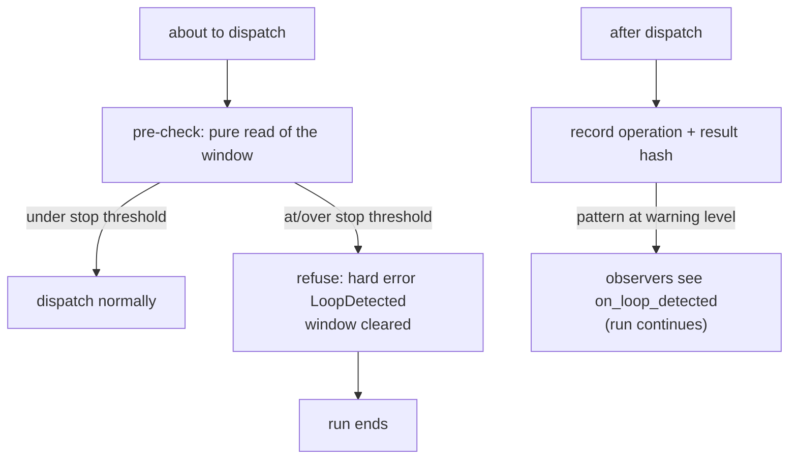

Sometimes a model gets stuck. It calls the same tool with the same arguments, gets the same answer, and does it again, burning tokens forever. The loop detector watches for exactly that pattern and stops your run before it wastes your budget. Source: `src/detection/loop_detector.rs`, with engine wiring in `src/engine/bare/dispatch.rs`.

## What counts as the same thing

Every tool dispatch you make is recorded as one operation:

```text
operation = ( tool name,
              primary parameter,        // the "what" — file path, command, query...
              result hash )             // fingerprint of what came back
```

Two operations are identical only when all three parts match, and the result hash is the clever part:

- The same call with different results is a different operation, so that is progress rather than a loop. A search that returns changing results never trips your detector.
- The same call with the same result stacks up repetitions.

Four details are worth knowing:

- The hash is a fast, non-cryptographic fingerprint. It is deterministic within a process and not stable across Rust versions, so never persist it.
- Empty output hashes to nothing, so silent successes of the same operation count as identical.
- A multipart result is hashed by its rendered text, which makes images invisible to the detector.
- The primary parameter comes from a `ToolSignature` you supply. If it extracts nothing, the engine falls back to your whole input JSON, so only byte-identical inputs repeat-match.

That fallback is deliberate. It is better to under-detect than to flag `Read(a.rs)` and `Read(b.rs)` as the same call.

## The thresholds

| Setting | Default | Meaning |
|---|---|---|
| `repetition_threshold` | 3 | At this count the pattern is flagged, so the warning fires and the run continues. |
| `stop_threshold` | 10 | At this count the next dispatch is refused and the run ends with `LoopDetected`. A value of `0` disables hard stops. |
| `window_size` and `max_history` | 50 and 100 | How many recent operations count, with older ones sliding out. |

The engine checks before it dispatches, which is how it refuses the call that would be repetition number 11. It records after each call.

A stop fires on the dispatch after your threshold is crossed, and it consumes the pattern, so your next run starts with a clean window.

The engine also clears a never-fired stop at every run end. A run that crossed the line and then ended on its own does not poison the next one.

A warning below the stop threshold is one-shot per pattern, so once reported, the same pattern does not re-warn on every poll. Make progress with a differing result and the pattern is forgotten entirely.

## Tuning per tool with ToolSignature

The detector is only as good as its knowledge of which argument matters for each tool:

```rust
struct MySignature;
impl ToolSignature for MySignature {
    fn extract_primary_param(&self, tool: &str, input: &Value) -> String {
        match tool {
            "Read" | "Edit" => input["path"].as_str().unwrap_or("").to_string(),
            "Bash" => input["command"].as_str().unwrap_or("").to_string(),
            _ => String::new(),
        }
    }
    fn is_recoverable_error(&self, tool: &str, error: &str) -> bool {
        tool == "Edit" && error.contains("old text not found")
    }
    fn tool_thresholds(&self) -> HashMap<String, usize> {
        [("Edit".to_string(), 2)].into_iter().collect()  // trip faster on Edit
    }
    // also available: get_suggestion, normalize_param_for_comparison,
    // is_file_read_tool / is_file_edit_tool, file_path_for_reset
}
```

The hooks that matter, and what each one buys you:

- `extract_primary_param` states the identity of a call for one tool. Without it, everything degrades to whole-input matching, which is safe but blunt.
- `is_recoverable_error` is the false-positive killer. A legitimate workflow looks like repetition, because an edit fails with "old text not found", your agent re-reads the file, and then the edit is retried.
- Mark that error recoverable and the detector clears same-file edit warnings when it appears. The docs call overriding this critical, because most retry storms are made of recoverable errors.
- `tool_thresholds` sets per-tool trip lines, so you can flag `Edit` repetition at 2 instead of 3.
- `normalize_param_for_comparison` makes `file.rs#42` and `file.rs#100` match the same file.

Attach your signature with `DetectionManager::new_with_signature(Arc::new(MySignature))`, hand it to `LoopManagers::with_detection(...)`, and build with `new_with_managers`.

## What the engine does with a detection



Seven behaviors are pinned by the false-positive suite:

- Changing outputs are progress and are never flagged, even at high frequency.
- Different inputs with identical outputs are different operations, so three files with the same content do not merge into one repeat.
- Recovery retries count as attempts, so a flaky tool failing repeatedly can trip detection on its own, and recoverable-error marking is the fix.
- Gate refusals reach the detector (0.4.0). A refusal from your [tool health](/safety/tool-health/) breaker records into the loop detector too, so a model hammering an unavailable tool is caught by either subsystem rather than neither.
- Acting-turn preambles never trigger convergence, which is the next page. Repeating "Let me check that..." over real tool work is fine.
- `stop_threshold: 0` disables hard stops entirely and leaves you with warnings only.
- A genuinely stuck tool does stop, because identical input and output over the line is the whole point.

## Reading the state

- `check_loop()` returns a full snapshot as `LoopStatus { is_looping, repeated_operations, repetition_count, warning, should_stop }`.
- `max_operation_count()` gives you the live maximum even below the threshold, so your telemetry can watch a potential loop build.
- `DetectionStats { turns_analyzed, loops_detected, convergences_detected, current_streak }` holds the counters.
- Observers see `on_loop_detected(pattern: "Read(/etc/hosts)", repetitions)`.

If a warning fires and a human or your code has dealt with it, `acknowledge_loop_warning(&ops)` silences that pattern. Acknowledging is orthogonal to detection, so you cannot acknowledge your way out of a stop.

## Related pages

- [Windows, averages, and similarity](/principles/measuring-repetition/) covers the sliding window and fingerprint hashing this detector is built on.
- [Convergence detection](/safety/convergence/) is the sibling detector for repeated answers.
- [Tool dispatch](/engine/tool-dispatch/) covers where the checks plug in.
- [File reference: detection](/file-reference/detection/)
