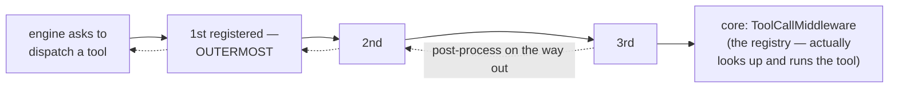

Middleware is how you change what happens around a tool call without touching your tools or the engine. Kill slow calls, deny dangerous ones, cap giant outputs, cache repeats, verify writes. You register layers in a pipeline, and every dispatched call flows through them. Sources: `src/middleware.rs` and `src/middleware/*.rs`.

## The pipeline model



Registration order is execution order. The first registered layer is outermost, so its before logic runs first and its after logic runs last. That is why an outer output cap bounds whatever your inner layers append.

Each layer receives a mutable context and the rest of the chain. It can inspect or rewrite the call, pass it on, and post-process the result. It can also return a result itself and short-circuit everything inside.

The innermost core is `ToolCallMiddleware`. It does the registry lookup, runs the tool with panic isolation, and turns outcomes into results.

```rust
pub trait ToolMiddleware: Send + Sync {
    fn name(&self) -> &str;
    fn dispatch<'a>(&'a self, ctx: &'a mut ToolDispatchContext,
                    next: &'a ToolPipeline)
        -> Pin<Box<dyn Future<Output = ToolDispatchResult> + Send + 'a>>;
}
```

### What a layer can touch

| Field | What it is | Layers may |
|---|---|---|
| `tool_name` | The tool your model asked for | Rewrite it for routing or aliases, because the core looks up the rewritten name. |
| `input` | The JSON arguments | Inspect or rewrite. |
| `call_id` | The id the model issued | Read it. The engine re-stamps the final result authoritatively. |
| `turn_number` | Which turn this is | Read it for per-turn limits or a cache TTL. |
| `cancel` | `Arc<CancelSignal>` | Poll it in long waits. |
| `permission` | The current `PermissionCheck` | read/set (the permission layer reads it) |
| `tool_context` | What the tool receives | Enrich it. This is the sanctioned point for host state injection. |

### The result

`ToolDispatchResult` is a struct rather than an enum: `{ tool_call_id, output: ToolContent, is_error: bool, duration, resolved_tool_name, display_hint }`.

An error here means the `is_error` flag, which is a soft error your model sees. Hard failures such as `LoopError` exist only outside the pipeline.

Layers rewrite `output` to truncate, redact, or append diagnostics, and they generally leave `is_error` alone.

### Installing

```rust
let builder = ToolPipeline::builder()
    .with_middleware(PermissionMiddleware::deny_all())
    .with_middleware(TimeoutMiddleware::from_secs(30))
    .with_middleware(UnknownToolMiddleware::new(registry_arc));
agent.set_pipeline(builder)?;   // the loop injects its own registry as the core —
                                // do NOT call .with_core() yourself
```

Call `set_pipeline` before your first `run()`. To use a pipeline without an engine, call `ToolPipeline::new(registry)`, which starts with zero layers, or use the builder's `.with_core(registry)` and then `.build()`.

## The shipped layers

### TimeoutMiddleware, a per-call clock

`TimeoutConfig { timeout, retry_on_timeout, max_retries }` defaults to 2 minutes with no retry.

On a timeout you get a soft error reading "Tool 'x' timed out after Ns". The in-flight future is dropped, so there is no partial output. If you enable retries, the deadline doubles on each attempt.

`TimeoutMiddleware::none()` opts out, and `from_secs(n)` is the shortcut.

### PermissionMiddleware, your policy function

```rust
PermissionMiddleware::deny_all()      // block everything ("blocked by policy")
PermissionMiddleware::allow_all()     // pass-through
PermissionMiddleware::from_context()  // honor ctx.permission (set by the engine/host)
    .with_check(|ctx| {               // or decide yourself:
        if ctx.tool_name == "rm" { PermissionCheck::deny("destructive in this session") }
        else { PermissionCheck::allow() }
    })
    .with_ask_resolver(|prompt, tool| async move { ask_the_human(prompt).await })
```

`PermissionCheck` is the decision type: `Allow`, `Deny { reason }`, `Ask { prompt }`, and `Modify { modified_input }`.

A `Deny` short-circuits with a soft error and zero duration, so nothing inside runs.

`Ask` resolves through your async resolver, and without one it is denied, which keeps a headless run safe. `Modify` rewrites the input and proceeds, and that input is not re-validated against your schema, so keeping it valid is your job.

[The permission page](/safety/permission/) goes into all of it.

### OutputLimitMiddleware, a hard cap on output

`OutputLimitMiddleware::new(max_chars)` counts characters and never cuts inside a UTF-8 character. It keeps the head of the text and appends `\n[truncated]` inside the budget.

A multipart output shares one budget across its text parts, and images pass through untouched. `new(0)` disables the cap.

This matters for agents that read big files, because one uncapped `Read` can blow your context window.

### UnknownToolMiddleware, a suggestion layer

When a dispatched call misses your registry, this layer appends `Did you mean 'closest_name'?` to the error text. The suggestion comes from longest-common-subsequence similarity at a threshold of 0.4, which you can tune.

The lookup uses the post-dispatch name, so it stays correct behind your renaming layers. A name your model was never shown is pre-answered by the engine instead and never reaches this layer.

### MemoizingMiddleware, a per-turn-window cache

This layer caches results for the tools you name, typically `Read`, `Glob`, and `Grep`. Your write tools invalidate it, typically `Write` and `Edit`, by the file paths they declare.

The builtin `WritePathExtractor` in `middleware::verify::builtin` maps a write-class call to its paths, and both this cache's invalidation and the verifier's targets read from it.

```rust
MemoizingMiddleware::new(
    vec!["Read".into(), "Glob".into()],     // cached tools (exact names)
    vec!["Write".into(), "Edit".into()],    // invalidating tools
    Arc::new(path_extractor),               // maps (tool, input) → file paths
    5,                                      // TTL in turns; 0 disables caching
)
```

Five rules decide what a hit means:

- The key is the tool name plus a hash of the input, with key order canonicalized.
- Errors are never cached, and neither are write results.
- A failed write does not invalidate anything, because the filesystem did not change.
- A hit appends `[cached]` and carries the requesting call's id, which matters little since the engine stamps ids authoritatively anyway.
- A hit replays the original duration, so your health stats still track real latency.

There is no capacity limit, so pair long sessions with a short TTL.

### VerifyMiddleware, proof that writes worked

This layer runs your `Verifier` after a write-class tool succeeds, then appends the verdict:

```rust
impl Verifier for CargoCheck {
    async fn verify(&self, ctx: &ToolContext, _tool: &str) -> VerifyResult {
        // run `cargo check` in ctx.cwd, return pass/fail + diagnostics
    }
}
VerifyMiddleware::new(Arc::new(CargoCheck), vec!["Write".into(), "Edit".into()])
```

The appended text is `"\n\n[verify] passed: ..."` or `"\n\n[verify] failed: ..."`. The layer never sets `is_error`, so a failed check on a successful write stays a success, and your model reads the diagnostics and decides. It is skipped when the tool itself errored.

The [Constrained preset](/integration/presets/) wires the real builtin verifier by default (0.4.0). That verifier is `CommandVerifier`, and it judges write-class calls statically rather than running anything.

Its two checks are a deny-glob check on shell commands and a target-path check on write inputs. The shell check catches `rm -rf /` in any spacing, and it matches at token boundaries.

A wrapped `sh -c "…"` call must name an allowed shell, and the inner command is what gets checked. The path check asks whether the parent directory exists and is writable.

You get one-line diagnostics written for a small-model reader.

Verification that actually runs something, such as your test suite, stays your territory: bring your own `Verifier`. `NoopVerifier` remains the explicit opt-out.

### RedactingMiddleware, secret scrubbing

This layer needs `features = ["redaction"]`. `RedactingMiddleware::new(SecretPatternSet::default_common())` replaces secrets in tool output with `[REDACTED:<kind>]`.

The curated patterns are `bearer` for Authorization headers, `api_key_kv`, `aws_access_key` for an AKIA prefix, `pem_private_key`, `github_pat` for a ghp_ prefix, and `gitlab_pat` for a glpat- prefix.

An entropy heuristic backs them up. Any token of 32 characters or more with at least 4.5 bits/byte of randomness is redacted, so base64 secrets match and hex hashes do not. Add your own pattern with `SecretPatternSet::default_common().with_pattern(...)`.

This layer never sets errors, leaves images untouched, and runs only after execution.

### SafetyShieldMiddleware, risk-based blocking

This layer needs `features = ["tool_shield"]`. It consults a `ToolSafetyShield`, which is a `UnixShield` by default, before your watched tools run.

A `Block` decision becomes a soft error, and a `Warn` decision logs and proceeds. Every admitted call is recorded, so a multi-call rule such as a download followed by a pipe to a shell can fire across turns.

[The shield page](/safety/tool-shield/) tells that story in full.

## Getting the order right

First registered is outermost, and `ConstrainedProfile` uses this canonical order:

```text
output_limit → verify → memoize → [core]
```

Memoize sits innermost so the cache holds the raw result. The cache never holds verify diagnostics, and every write is verified anew. The cap sits outermost so it truncates the combined output, which means verify diagnostics cannot escape the cap.

Five slots are worth pinning down:

| Layer | Recommended slot | Why |
|---|---|---|
| `PermissionMiddleware` | Outermost, or near it | Deny before any work, and a pinned test says a deny returns in about 0ms. |
| `RedactingMiddleware` | Outer, before your verifiers | It also scrubs what inner layers append, so a verifier that echoes tool output cannot re-leak. |
| `SafetyShieldMiddleware` | Inside renaming layers, outside memoize | It then scores the name the registry will execute, and cache-served repeats still get scored. |
| `TimeoutMiddleware` | Around everything slow | It bounds the layers inside it too. |
| Your own layer that must see original calls | Mind the preset rule | Anything you chain onto `ConstrainedProfile::pipeline_builder()` lands inside its memoize layer. |

Three guarantees hold regardless of order. The engine stamps `tool_call_id` after the pipeline, so an id from your middleware cannot corrupt pairing. `DisplayHint` and `duration` survive every shipped layer. And middleware is invisible to parallel-dispatch planning, because waves come from tool declarations rather than layers.

Middleware is not the place for two related features. The [budget gate](/safety/budget-gate/) sits engine-side and is consulted before each model request rather than around tool calls.

The [ask channel](/safety/approvals/) parks at the engine's pre-execution boundary. Both stay outside the pipeline on purpose, because they need to see your whole run rather than one dispatch.

## Related pages

- [Caching and invalidation](/principles/caching-and-invalidation/) covers the memoizer's algorithm: keys, TTL, and epochs.
- [Text matching](/principles/text-matching/) covers the LCS math behind a suggestion.
- [Tool dispatch](/engine/tool-dispatch/) covers where the pipeline sits.
- [Permission](/safety/permission/) covers the decision type in depth.
- [File reference: middleware.rs](/file-reference/middleware/)
