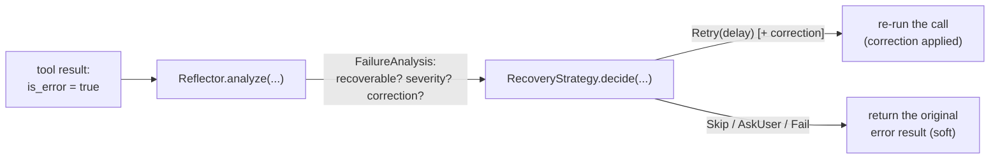

A tool call fails. Now what? Retry blindly, give up, or fix the arguments and try again? loopctl splits that decision into two pluggable pieces. A reflector analyzes what went wrong, and a recovery strategy decides what to do about it. Sources: `src/reflection.rs`, `src/reflection/llm.rs`, and `src/reflection/backoff.rs`.

## The two pieces



### The analysis

```rust
FailureAnalysis {
    is_recoverable: bool,          // worth trying again at all?
    root_cause: String,
    severity: FailureSeverity,     // Low < Medium < High < Critical
    correction: Option<Correction>,// how to fix it, if known
    context: String,               // free-form extra info
}
```

A `Correction` carries a machine-usable fix, and what the engine does with it depends on the type:

| `correction_type` | Fields that matter | What the engine does on retry |
|---|---|---|
| `InputFix` | `modified_input`, a JSON object | Replaces the call's input. |
| `ToolChange` | `alternative_tool`, a registry name | Swaps the tool. |
| `PrerequisiteFix`, `ApproachChange`, `Escalate` | `guidance` text | Nothing mechanical, so the retry runs unchanged and your guidance stays advisory. |

A correction that fails to apply is logged and dropped. An `InputFix` without a JSON object is the usual case, and the retry still happens, uncorrected.

### The decision

`RecoveryAction` has four shapes:

- `Retry { delay }` waits, then runs the call again with the correction applied first. Your cancel signal races that wait.
- `Skip(reason)` gives up on this call and returns the error result softly, so the run continues.
- `AskUser(prompt)` returns softly to the model in this driver, and the prompt text tells it a human decision is needed.
- `Fail(reason)` stops retrying, and the error result flows back softly.

Everything except a cancel and the hard ceiling stays soft. Your model sees the failure and can change its plan.

### The hard ceiling

`MAX_RECOVERY_ATTEMPTS = 5` overrides any strategy you write. The sixth total call fails the run with `ToolRecoveryExhausted { tool, attempts }`, and `attempts` counts total calls, so subtract 1 to get retries.

One number covers both sides. The strategy is told `max_attempts`, and the driver enforces the same ceiling, which means a misbehaving custom strategy cannot retry forever.

## The defaults, and the surprise in them

The default reflector is `NoopReflector`. It marks everything `is_recoverable: false` at severity `Medium`, with no correction.

The default strategy is `ExponentialBackoffRecovery::new(3)`. It allows up to 3 retries at 100ms, 200ms, then 400ms, each doubling and capped at 30s. Its rules run in order: a non-recoverable failure fails, running out of retries fails, and High severity with a correction available asks your user. Anything else retries.

Put together, the stock defaults mean zero retries. `NoopReflector` says the failure is not recoverable, the strategy fails immediately, and each tool call gets exactly one attempt. Retrying is opt-in, so pick your reflector accordingly.

## LlmReflector

The in-tree upgrade is one structured request per failed call, which asks the model to produce a `FailureAnalysis` as JSON.

```rust
let reflector = LlmReflector::new(Arc::new(client));       // uses the built-in analyst prompt
// or: .with_system_prompt("You analyze failures for a coding agent...")
agent.set_reflector(Arc::new(reflector));
```

The default prompt specifies the exact JSON shape and gives two instructions. Propose `modified_input` only when you can conform to the tool's schema, and prefer `is_recoverable: false` over inventing a correction.

With the `schema_validation` feature, a proposed `InputFix` is checked against the tool's real schema before the retry, so a nonsense correction is rejected up front. The reflection errors, and the engine maps that to a conservative `Fail`.

The tool's schema travels in the request when it is available. For an unregistered name it is `None`, and a reflector should skip validation then.

The cost is one model round trip per analyzed failure, which is exactly why this is not the default.

### The exact wire format

The user message sent to the analyst model is a fixed template, which is worth knowing when you wonder why an analysis came back wrong:

```text
Tool: {tool_name}
Input: {tool_input}
Schema: {schema}          ← this line is OMITTED entirely when the tool isn't
                             registered (there is no schema to show)
Error: {error}
Task: {context.task}      ← the engine currently passes an empty task string
Attempt: {attempt + 1} of {max_attempts}
```

Note the `+1`. Attempts are 0-indexed in `ReflectionContext` but rendered 1-indexed for the model, so the original call reads "Attempt: 1 of 6".

The system prompt pins the JSON shape with a strict `failure_analysis` schema, where every field is required and severity and correction type are enums.

It ends with the two guardrails that matter most. Set `modified_input` only when you can conform to the tool's schema, and prefer `is_recoverable: false` over inventing a correction. A wrong fix costs you a retry and pollutes the analysis.

### Errors map conservatively

Every failure path of the structured request collapses to `ReflectionError::Internal`. That covers an API failure, a schema mismatch, and a deserialize error.

The engine answers any reflector error the same way: treat the call as unrecoverable and fail. It never guesses on top of a broken reflector, because a working reflector that says nothing beats a silent fallback to heuristic behavior.

### Writing your own reflector

A rule-based reflector reads the error text and answers for itself:

```rust
struct SimpleReflector;
impl Reflector for SimpleReflector {
    fn analyze(&self, error: &str, tool: &str, input: &Value,
               _schema: Option<&ToolSchema>, ctx: &ReflectionContext)
        -> Pin<Box<dyn Future<Output = Result<FailureAnalysis, ReflectionError>> + Send + '_>>
    {
        let recoverable = error.contains("timed out") || error.contains("temporarily");
        Box::pin(async move {
            Ok(FailureAnalysis {
                is_recoverable: recoverable,
                root_cause: error.to_string(),
                severity: if recoverable { FailureSeverity::Low }
                          else { FailureSeverity::High },
                correction: None,
                context: format!("attempt {} of {}", ctx.attempt + 1, ctx.max_attempts),
            })
        })
    }
}
```

`ReflectionContext` gives you `attempt` and `max_attempts`, and the attempt is 0-indexed, so add 1 when you render it for a human.

## The full loop, end to end

Five steps, from soft error to either a re-run or an end:

```text
tool call fails (soft error)
  1. reflector.analyze(error, tool, input, schema, {attempt, max})
  2. strategy.decide(analysis, attempt, max)
  3. Retry{delay}?  sleep (cancel-aware) → apply correction → re-run
       — the FULL pipeline re-fires: observers, hooks, detection, health, per attempt
  4. Skip/AskUser/Fail?  original error result returned softly
  5. attempt > 5 at any point?  run ends: ToolRecoveryExhausted
```

Two interactions follow every retry. Each one records into the [loop detector](/safety/loop-detection/), and identical error texts stack up, so mark recoverable errors in your `ToolSignature`. Each one also counts toward the tool's [health stats](/safety/tool-health/).

## Related pages

- [Tool dispatch](/engine/tool-dispatch/) covers where this loop lives.
- [Errors](/core-data/errors/) has `ToolRecoveryExhausted` decoded.
