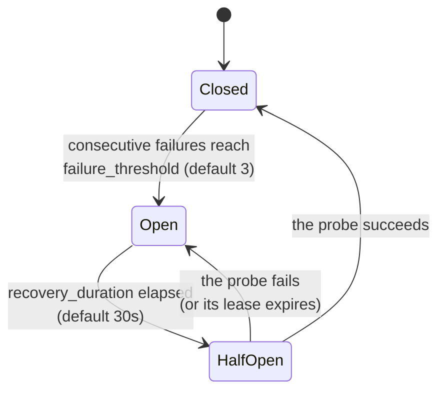

A tool that keeps failing should not get dispatched again and again. Maybe a dead database sits behind it, or its endpoint hangs.

The tool health subsystem watches success, failure, and latency for each of your tools and opens a circuit breaker that refuses calls to a sick one. The refusal is soft, so your model can adapt. Source: `src/tool/health.rs`.

You enable it with `features = ["tool_health"]` and install it with `agent.set_health_registry(Arc::new(ToolHealthRegistry::new()))`.

## What gets measured

Your registry keeps lock-free counters for each tool:

- Success rate is plain successes over total calls.
- An exponentially weighted moving average tracks recent success, so recent calls matter more than ancient ones. Each new sample counts as 30% of the score.
- `health_score` is 0.3 × success_rate + 0.7 × ewma, so recent failures outweigh old successes by design.
- Durations are kept as an average and a maximum, and the maximum includes failed calls because a timeout is tail latency too.

Classification is fixed. Score ≥ 0.8 → `Healthy`, a score from 0.5 to 0.8 → `Degraded`, and below that → `Unhealthy`.

The score never blocks anything by itself, and only the breaker blocks. A closed breaker dispatches even on a terrible score.

## The stats, in atomics

Each tool gets one lock-free struct where every field is an `AtomicU64`, so your hot path never takes a lock to record a result:

| Field | What it accumulates |
|---|---|
| `total_calls`, `success_count`, `failure_count` | The all-time ratios. |
| `total_duration_ns` | A saturating sum, which gives the average duration. |
| `max_duration_ns` | The high-water mark, and failed calls count because a timeout is tail latency too. |
| `ewma_success` | The decaying success score, stored scaled by 1,000,000, so `0.7` is literally `700_000`. Integer atomics, no floats, no locks. |

New tools start at `ewma_success = 1.0`. That is optimistic, so a tool is not punished before it has a record.

Latency is there for your dashboards and never feeds the score. A slow but reliable tool stays healthy, and only success and failure move the number.

The registry takes a lock only the first time it sees a tool name. Everything after that is the atomics above.

## The circuit breaker, three states



Closed is normal operation, where calls are allowed and failures are counted.

Open means your tool is sick and calls are refused. After the cooldown, one caller is granted a probe.

HalfOpen has exactly one probe call in flight and refuses concurrent calls, which is your thundering-herd guard. A probe that succeeds closes the breaker, and a probe that fails returns to Open with a fresh cooldown.

### The probe lease

The lease is `probe_timeout`, default 30s, and it prevents a classic wedge. A probe that never returns, from a cancelled dispatch or a dead task, used to strand the breaker in HalfOpen forever.

Now an expired lease re-arms the cooldown. Your availability queries treat it as expired, and a result that arrives late after expiry re-arms instead of closing.

### Stale results get the same care

Success arriving while the breaker is Open is ignored, because it describes a pre-trip world. After lease expiry a late success re-arms instead of closing. And a failure arriving while Open restarts the cooldown clock, because that is fresh bad news.

### What a refusal looks like

Your engine's gate consults the breaker before dispatching. A refusal is a soft error reading `tool temporarily unavailable: circuit breaker open`, and it carries zero duration, so your model sees it and the run continues.

That is not an exception and not a crash. Your model routes around the sick tool, or it waits for recovery.

## Configuration

```rust
ToolHealthRegistry::with_config(CircuitBreakerConfig {
    failure_threshold: 3,          // 0 disables tripping (counting continues)
    recovery_duration: 30s,        // cooldown before probing
    probe_timeout: 30s,            // probe lease; 0 disables the lease
})
```

`with_config` applies to breakers created after the call, so set it before you send traffic.

Your dashboards read through `get_health_status(tool)` and through `health_summary()`, which reports status and score for every tool. `is_tool_available(tool)` is a pure availability oracle: it does not consume the single probe slot, unlike the mutating `allow_request`.

## Health-aware routing

A refusal is not your only policy. `HealthRouter` routes to a healthy substitute instead:

```rust
let router = HealthRouterBuilder::new()
    .add_fallback("primary_search", vec!["backup_search".into()])
    .build();
// resolve_tool(name, &registry): primary if available, else first healthy fallback
```

`resolve_tool` gives you the primary when it is available, or the first healthy fallback when it is not.

You can also write this into a middleware that rewrites `tool_name`. Read the gotchas below before you do.

## Gotchas

1. The gate keys on the requested name, and recording keys on the resolved name. A renaming middleware can split those two key spaces. No in-tree middleware renames today, but yours might, so keep them identical or route deliberately.
2. Everything retry-shaped re-fires per attempt. A tool that fails 3 recovery retries records 3 failures, which is enough to open its own breaker. That is usually correct, because the tool really is failing, but it is the interaction to know.
3. Repeated shield blocks count as failures toward your breaker. Once it opens, the engine's gate refuses first, and your model sees "temporarily unavailable" instead of the shield's reason.

   Gate refusals also record into the [loop detector](/safety/loop-detection/) (0.4.0). A model hammering an unavailable tool gets caught rather than spinning.
4. `failure_threshold: 0` disables tripping. It does not mean never trip, and the breaker still counts.
5. `is_tool_available` and the mutating gate agree at every instant, including the expiry-aware HalfOpen states, and tests pin both. Either one is safe to build on.

## Related pages

- [Circuit breakers](/principles/circuit-breakers/) covers the pattern, from scratch.
- [Windows, averages, and similarity](/principles/measuring-repetition/) shows how the EWMA score is computed, with worked numbers.
- [Tool dispatch](/engine/tool-dispatch/) covers where the gate sits in the pipeline.
- [The shield](/safety/tool-shield/) covers the refusals that feed these breakers.
