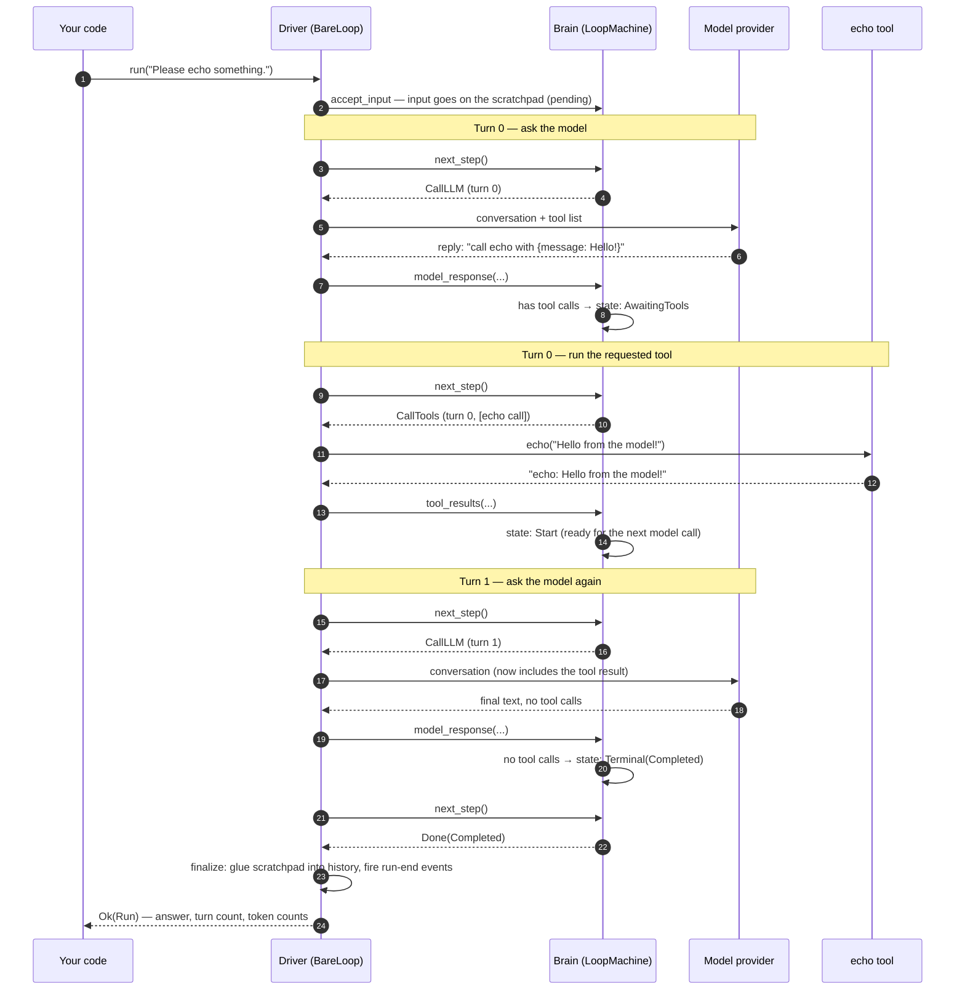

This page walks through one complete run of a loopctl agent. You ask something, the
model requests one tool, the tool runs, the model answers. Every layer, in order.

The example matches `examples/echo-tool-cli.rs` in the loopctl repository. The model is a
scripted fake, `MockApiClient`, so the behavior is 100% predictable.

## The setup

```rust
// A fake model connection with a script of two replies:
//   reply 1: "please call the echo tool with 'Hello from the model!'"
//   reply 2: "I echoed your message. Done!"
let client = MockApiClient::new("echo-model").with_responses(vec![
    MockResponse {
        text: String::new(),
        tool_call: Some(MockToolCall {
            id: "call_1".into(),
            name: "echo".into(),
            input: json!({"message": "Hello from the model!"}),
        }),
        stop_reason: "tool_use".into(),
    },
    MockResponse {
        text: "I echoed your message. Done!".into(),
        tool_call: None,
        stop_reason: "end_turn".into(),
    },
]);

let mut tools = ToolRegistry::new();
tools.register(
    FnTool::new("echo", "Echo a message back", echo_schema, echo_fn).read_only()
);

let mut agent = BareLoop::new(Arc::new(client), tools, SessionConfig::default());

let result = agent.run("Please echo something.", &RunConfig::default()).await?;
// result.turn_count() == 2, result.tool_call_count() == 1
// result.output == "I echoed your message. Done!"
```

## The run, step by step

Two turns. The first asks for a tool, the second gives the answer.



The same walk in words, with the details that matter.

1. **You call `run(input, run_config)`.** The driver creates a fresh `Run` record, which
   is the audit-log entry for this run, and calls `brain.accept_input(input)`. The input
   becomes a user message on the scratchpad (`pending`). The scratchpad is cleared first:
   a new run starts fresh, and only `history` carries over.

2. **The driver asks the brain what to do.** It calls `brain.next_step(policy)`, where
   `policy` carries your limits such as max turns and the context window. The brain checks
   in this order:

    - Turn limit reached? Then `Done(MaxTurnsExceeded)`.
    - Context at 95% of the window? Then `Compact(Emergency)`.
    - Context past your threshold, default 80%? Then `Compact(ThresholdExceeded)`.
    - Otherwise `CallLLM`.

3. **The driver asks the model.** It gathers the conversation (`history` plus `pending`),
   your system prompt if you set one, and the list of tool schemas. Extra ingredients you
   configured, such as memory entries and contributor messages, are added for this turn only.

They are never saved into the conversation. The request goes out through the model
   client.

4. **The reply comes back.** The driver folds it into the brain with `model_response(...)`.
   The brain looks at the reply. If it contains tool calls, the brain files them and enters
   `AwaitingTools`. If it is pure text, the run is done: `Terminal(Completed)` with that
   text as the final answer.

5. **Tool calls run.** `next_step` now returns `CallTools`. For each requested call the
   driver walks the whole safety pipeline:

    - Notify observers.
    - Ask pre-hooks, if you installed any.
    - Loop-detection check.
    - Health gate, if you installed one.
    - Run the tool. Panics are caught and turned into error text.
    - Record the outcome for detection, health, and memory.

   Results, including error text, become tool-result messages fed back with
   `tool_results(...)`. The brain returns to `Start`.

   If a tool fails, the model reading the error is often the best recovery. It can fix its
   arguments, pick another tool, or give up gracefully. Only hard problems end the run:
   cancellation, a detected infinite loop, retries exhausted.

6. **The loop continues until `Done`.** On turn 1 the model sees the whole conversation so
   far, including the tool result, and produces the final text. No tool calls, so
   `Terminal(Completed)`.

7. **`finalize()` is the single exit door.** Every run exit passes through it: success,
   error, max turns, cancellation.

    - On success: the scratchpad is glued into `history` by `commit_pending`, and memory is
      consolidated if you installed it.
    - On cancel or ordinary failure: `salvage_pending` keeps the coherent prefix. Completed
      turns commit, only the in-flight exchange drops. Since 0.4.0.
    - On the `ContextExceeded` family: `discard_pending` throws the scratchpad away whole.
      An unshrinkable over-window history would wedge every later run.
    - Either way: the run's end time and stop reason are recorded, observers get
      `on_run_end`, and the cancel signal is re-armed for the next run.

8. **You get a `Run`.** It carries the answer in `output`, every turn's input, output and
   tool calls, the token counts (`input_tokens`, `output_tokens`) and timing. It stays in
   `agent.session().runs` forever. That audit trail is something compaction never touches.

## What the model sees

The model never sees your Rust objects. Each request is a plain list of messages. Turn 1 of
our example looks conceptually like this:

```text
[
  { role: "user",      text: "Please echo something." },
  { role: "assistant", tool_call: echo(message="Hello from the model!") },
  { role: "user",      tool_result: "echo: Hello from the model!" }
]
```

The user-role tool result is not a mistake. Every major provider
expects tool results to come back as user-side messages. loopctl handles the convention for
you.

## How a run ends

A run goes on until one of five things ends it.

| Ending | Who decided | Error you see |
|---|---|---|
| Final answer | The model: a reply with no tool calls | None. `Ok(Run)` |
| Turn limit | You: `RunConfig::max_turns`, default 200 | `LoopError::MaxTurnsExceeded` |
| Cancellation | You: the cancel signal | `LoopError::Cancelled`. A clean stop, not a failure. |
| Context overflow | The brain: compaction could not shrink enough | `LoopError::ContextExceeded` |
| Hard failure | The engine: network dead, loop detected, recovery exhausted | The matching `LoopError` variant |

[Termination](/engine/termination/) has the complete table with code paths.

## Next

- [The driver loop](/engine/driver-loop/): everything steps 3 to 6 do, in full detail.
- [Tool dispatch](/engine/tool-dispatch/): the whole safety pipeline around one tool call.
- [Building a tool](/core-data/tools/): write your own.
