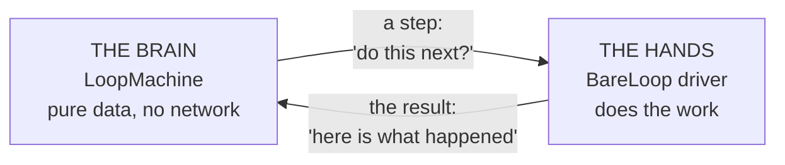
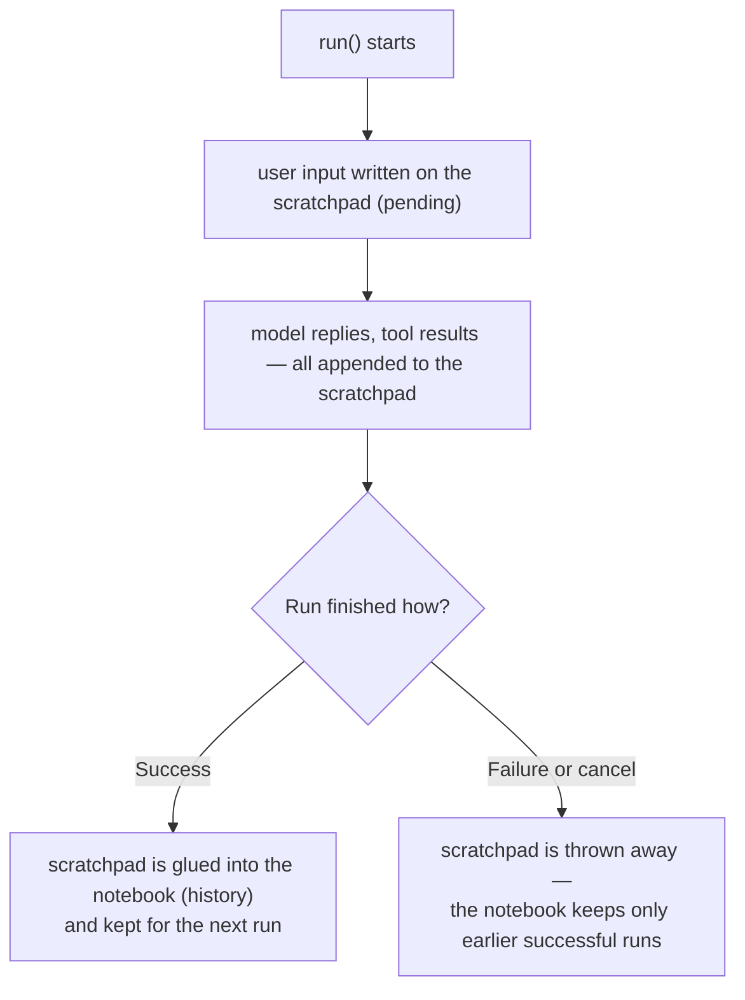

You will find this question in every agent engine, asked over and over: what should happen next? loopctl splits that question between two pieces, with a strict border between them.

The brain is your `LoopMachine`. It decides what happens next, and it never touches the network, never runs a tool, and never reads a clock, because it is pure data.

The hands are your `BareLoop` driver. It runs whatever the brain asked, which means calling the model, running your tools, and shrinking the conversation. Then it reads the result back and reports it.

You will see a name for this split in the code, which is **sans-IO**, meaning without input or output. Your brain does no input or output at all.



## Why split them

Three payoffs.

### You can test the brain with no mocks

The brain is plain data in, plain data out. So when you want to test whether it detects a loop after 3 identical tool results, you build a machine, feed it results, and check what it says.

You get no fake network, no waiting, and no flaky tests.

### You can save a run mid-flight and continue it elsewhere

The brain is pure data, so `serde` can serialize it to bytes and read it back later. You can pause an agent on one machine and resume it on another:

```rust
// Save: the machine is just data — turn it into JSON, store it anywhere.
let machine = agent.into_machine();          // takes the brain out of the agent
let saved = serde_json::to_string(&machine)?; // ...store `saved`...

// Later, elsewhere: put the brain into a fresh body.
let machine: LoopMachine = serde_json::from_str(&saved)?;
let mut agent = BareLoop::from_machine(machine, config, client, tools);
```

### The engine works with any model provider

The brain does not know who your model is. Your hands talk to the provider through one small trait, `ApiClient`, so you can swap OpenAI for a local Ollama model and the brain never notices.

## The four steps

Your brain speaks a tiny language of exactly four steps. Each one has a matching method your hands use to report back.

| Step (brain says) | Meaning | Hands do | Feedback (hands report back) |
|---|---|---|---|
| `CallLLM { turn }` | "Ask the model now." | Send the conversation to the model | `machine.model_response(...)` |
| `CallTools { turn, calls }` | "Run these tool calls." | Execute each tool | `machine.tool_results(...)` |
| `Compact { reason }` | "Shrink the conversation first." | Rewrite history into something smaller | `machine.compaction_result(...)` or `machine.compaction_noop(...)` |
| `Done(outcome)` | "We're finished." | Wrap up and return | Nothing. The run is over. |

`LLM` means large language model, the AI model. `Compact` means shrink the conversation, and [Compaction](/engine/compaction/) explains how.

Your driver's loop is literally this simple:

```rust
loop {
    match machine.next_step(policy) {
        MachineStep::CallLLM { turn } => self.handle_call_llm(turn).await?,   // ask model
        MachineStep::CallTools { turn, calls } => self.handle_call_tools(turn, &calls).await?,
        MachineStep::Compact { reason } => self.handle_compact(reason).await?,
        MachineStep::Done(outcome) => break,                                   // finished
    }
}
```

This is the real code shape, slightly simplified, and the driver lives in `src/engine/bare.rs`.

Your brain never stores settings such as "max 200 turns" or "context window is 32,000 tokens". Your driver hands it a fresh `MachinePolicy` on every `next_step` call. That
small struct of numbers is what keeps the brain pure data that serializes cleanly.

## Machine state

At any moment your brain sits in exactly one state, and that state tracks what your brain is waiting for.

```rust
pub enum MachineState {
    Start,                    // ready to ask for the next step
    AwaitingModel { turn },   // asked the driver to call the model; waiting for the reply
    AwaitingTools { turn },   // asked the driver to run tools; waiting for results
    AwaitingCompaction,       // asked the driver to shrink history; waiting
    Terminal(MachineOutcome), // finished — accepts no further input, ever
}
```

Once your machine reaches `Terminal` it stays terminal forever. A machine you saved, restored, and had already finished still knows it finished.

## Outcomes

`MachineOutcome` says how your run ended, and you get four variants.

| Outcome | Meaning |
|---|---|
| `Completed { final_text }` | The model gave a final answer with no tool calls. Success. |
| `MaxTurnsExceeded` | Hit the turn limit. See `RunConfig::max_turns`, default 200. |
| `Cancelled` | Someone fired the cancel signal. A clean stop, not a failure. |
| `Failed { error }` | Something broke: network dead, context overflow, loop detected. |

## History and pending

Your brain holds the conversation in two separate lists, and this split explains most of loopctl's behavior.

| List | What lives there | When it changes |
|---|---|---|
| `history` (the notebook) | Messages from previous, successful runs | Only when a run finishes successfully, or when compaction rewrites everything |
| `pending` (the scratchpad) | The current run's messages: the user's input, each model reply, each tool result | Starts empty each run and grows during it. On cancel or failure the coherent prefix is salvaged into history and only the in-flight tail is dropped. Since 0.4.0. |



This matters when your run fails halfway. Say the network dies on turn 7, and your conversation is not poisoned.

Since 0.4.0 the turns that did complete are salvaged into history, so your next `run()` continues from them minus the interrupted exchange. The model never sees a half-finished turn with a missing tool result, because providers reject such conversations.

Gotcha: compaction is the one operation that touches both lists at once. It merges `history + pending` into a new, shorter `history`, and it empties `pending`.

You can read the full story in [Compaction](/engine/compaction/), including why a run that compacts and then fails still keeps the compacted history, since compaction is a commit point.

## Who decides what

Hold onto this rule while you read the rest of the knowledge base.

| Question | Answered by |
|---|---|
| What happens next? Model, tools, shrink, or stop. | The brain: `LoopMachine` |
| How exactly to do it? HTTP, retries, running the tool. | The hands: `BareLoop` |
| When has the context grown too big? | The brain: threshold plus emergency line |
| How to shrink it? | A pluggable `ContextCompactor`. Default: cut the middle, keep head and tail. |
| Should this tool call be allowed? | Hooks and middleware, if you install them |
| Is the model stuck in a loop? | The `DetectionManager`, if enabled |

Your hands never decide turn order, compaction timing, or termination. That one discipline is what makes the rest of the engine predictable to you.

## Next

- [Anatomy of a run](/start-here/anatomy-of-a-run/): one full run travelling through the brain and the hands.
- [The state machine](/engine/state-machine/): every rule the brain follows, in detail.
- [The driver loop](/engine/driver-loop/): every job the hands do.
- [The principles section](/principles/sans-io/): [sans-IO](/principles/sans-io/) and [state machines](/principles/state-machines/) explained from scratch.
